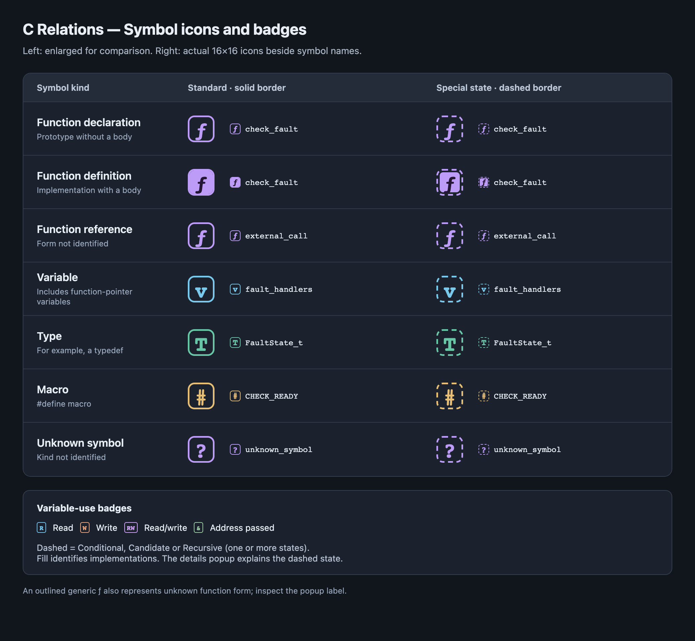

# C Relations — User Guide

This guide is included with the extension and works offline. You do not need Git or a GitHub account to use C Relations.

## Start here

1. Open a folder containing your C source files in VS Code. A build, SDK or compilation database is not required.
2. Run **C Relations: Open Relation and Context** from the Command Palette.
3. Click a function or variable name in the main editor. Relation shows its relationships; Context shows the selected code.
4. Check the file count and index status at the bottom. Relationships may be incomplete while **Indexing C sources…** is shown.

Use **Settings** in the C Relations toolbar to configure Include and Exclude for the current workspace. With no folder open, it opens user settings instead. In a multi-folder workspace, use the folder settings tab for a folder-specific override. **Help** opens this guide again. Both actions are also available in the Command Palette as **C Relations: Configure Analysis Scope** and **C Relations: Open User Guide**.

## Choose which files to analyze

Only C/H files are analyzed. Patterns are relative to each workspace folder; use `/` even on Windows. For a folder and everything inside it, write `App/**`, not just `App`.

| Include | Exclude | Result |
| --- | --- | --- |
| Empty | Empty | All C/H files, apart from built-in exclusions |
| Set | Empty | C/H files matching any Include pattern |
| Empty | Set | All C/H files except Exclude matches |
| Set | Set | Include matches minus Exclude matches |

**Exclude always wins.** An empty Include list means all C/H files; a nonempty list with no matches means zero files. Overlapping patterns do not duplicate files. Changes automatically rebuild the index and also apply to file changes and unsaved edits.

In Settings, add each pattern as a separate item. To edit JSON instead, run **Preferences: Open Workspace Settings (JSON)** and merge the following entries into the existing object. Keep your other settings.

Analyze only App and Drivers, but omit generated code and tests:

```json
{
  "cRelation.include": ["App/**", "Drivers/**"],
  "cRelation.exclude": ["**/generated/**", "**/test/**"]
}
```

Analyze the full project except Polyspace and build output:

```json
{
  "cRelation.include": [],
  "cRelation.exclude": ["**/Tools/Polyspace/**", "**/build/**"]
}
```

Other examples: `App/**/*.{c,h}` matches C/H files under App; `**/vendor/**` matches vendor folders at any depth. Paths are case-sensitive in WSL. Windows-hosted analysis ignores path casing.

- `node_modules`, `.git` and `.vscode-test` are always excluded.
- `files.exclude`, `search.exclude` and `C_Cpp.files.exclude` do not configure this extension's analysis scope.
- Definitions and references outside the scope are absent from Relation. Include shared headers and libraries if you need their relationships.
- To restore full scope, empty Include and remove unwanted Exclude entries.

## Navigate Relation and Context

- **References** shows direct calls, address references and declarations. **Callers** shows direct callers. The tree grows toward the code that calls or references the selected symbol.
- **1 level – 8 levels** controls the initial tree depth. Click a Relation symbol to preview it in Context and expand from that node by the selected depth. The root stays in place; already deeper branches remain open. Repeated clicks do not grow the same node indefinitely.
- **Double-click / Enter** opens the symbol or reference in the main editor.
- **Context code click** moves the main editor to that location. When following selection, Relation also follows the clicked symbol. Drag to select and copy text without navigating.
- **Following selection** means Relation follows symbols selected in the editor or Context. Click it to switch to **Pinned · Follow paused** and keep the current root. Click again to resume. Pinning does not stop indexing or manual branch expansion.
- Hover over a node without moving for 500 ms, or press **Space** on a focused node, to see details and individual call/reference locations. Click a location to preview the exact use in Context. **Escape** closes details.
- **→** expands a focused node, **←** collapses it, and **Shift+→** lets you choose an expansion depth. The details popup also offers **Levels…**.
- If multiple definitions match, use **Select definition** to choose the correct file.
- Drag the divider to resize Context and Relation.

Functions, variables, types and macros have distinct icons. Context and detail popups use syntax colors; these are not full compiler-based semantic highlighting.

## Symbol icons and badges



All icons remain **16×16**. Function icons retain the original rounded `ƒ` shape; fill distinguishes declarations from implementations.

| Icon | Meaning |
| --- | --- |
| Outlined `ƒ` | Function declaration: a prototype without a body |
| Filled `ƒ` | Function definition: an implementation with a body |
| Generic `ƒ` | Function reference whose declaration/definition form is not identified; uses the outlined style too, so inspect the popup label |
| Blue `v` | Variable, including a function-pointer variable |
| Green `T` | Type, such as a typedef |
| Amber `#` | Macro |
| `?` | Unknown symbol kind |

The popup names a known function form as **Function declaration** or **Function definition**. A **dashed border** independently marks one or more of **Conditional**, **Candidate** or **Recursive**. These states share the same dashed style; inspect the popup for the exact reason. A solid border means none of these special states is marked; it does not prove the code executes at runtime. Filled function icons leave a small gap inside a dashed border so the dashes remain visible.

Variable-use badges are **R** (read), **W** (write), **RW** (read/write) and **&** (address passed). Several badges can appear on one node. Function colors adapt to light and dark themes. The image above shows the dark theme and includes enlarged icons for comparison alongside their actual size.

## Variable reads and writes

Selecting a variable switches the relation filter to **Variable · All uses**, **R · Read**, **W · Write**, **RW · Read/write**, or **& · Address passed**. Read and write filters both include RW operations. Clicking a use node previews the first matching use; its details list other locations.

Address passing does not prove that a callee writes the variable. Pointer aliases and writes to array elements or structure members are not fully tracked.

## Skip inactive branches

**Skip inactive branches** excludes branches known to be inactive from literal `#if` / `#elif` conditions of `0` or `1`, including their `#else` branches and nesting. Context still displays the original source.

It does not determine build-specific `#ifdef`, `#ifndef`, `defined(...)` or macro-expression conditions. Both possible branches remain visible as conditional candidates. Local `#define` / `#undef` changes and compiler build flags are not evaluated. Turn the option off to include `#if 0` code too.

## If results are missing or slow

1. Check **Following selection** versus **Pinned · Follow paused**.
2. Check the status and file count. If **Index ready** shows zero files, use **Settings** to check Include paths, casing and Exclude matches. An empty folder or a folder without C/H files also produces zero files.
3. **Partial index: 10,000 file limit reached** means the initial scan omitted files. Narrow Include or add Exclude patterns. Scope filtering happens before this limit.
4. Expand **Analysis notices**. Files above 2,000,000 UTF-16 code units are skipped. Unsupported C syntax can also produce notices. **Index ready** means indexing finished, not that every file was analyzed without errors.
5. **Rebuild index** repeats analysis with the current settings. It does not change the scope or limits.

The graph displays at most 300 nodes. Recursion stops expansion along that path. Macro expansion, runtime function-pointer targets and some compiler-specific syntax are not resolved. Missing relationships can therefore also be an analysis limitation.

## WSL and updates

In a WSL-connected VS Code window, install the VSIX into the WSL environment. Check that C Relation Explorer appears under the WSL extension list. Configure workspace scope from that same window and match Linux path casing.

Use **C Relations: Check for Updates** to check for a newer release. Updates require internet access and your approval; analysis and this guide work offline. After installing an update, run **Developer: Reload Window** and verify the version shown next to **Context**.

Automatic checks are enabled by default and run when the production extension activates, then when due. Successful checks are limited to once per 24 hours; an hourly timer checks whether one is due. New releases do not trigger an immediate notification. From v0.1.22, failed network/metadata checks retry on the next hourly tick while the extension remains active. Manual checks bypass the daily interval and report failures. Automatic checks stay quiet on network errors and are disabled in development/test mode. Use the user setting **C Relation: Automatic Updates** to enable or disable them.
