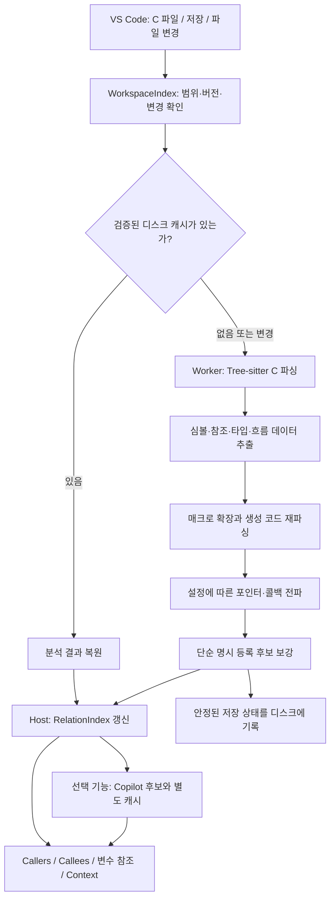

# Dynsight 분석 알고리즘: 소스에서 Relation 화면까지

작성일: 2026-10-21 · 확인한 코드: **v0.1.56, `f16d9df`**

이 문서는 현재 구현을 설명한다. Python 도입은 별도의 [최적화 설계 검토](../superpowers/specs/2026-10-21-python-analysis-optimization-design.md)에 정리한 제안이며, 아직 구현되지 않았다. 이번 확인은 소스 조사이며 사용자의 WSL 프로젝트에서 새 성능 측정을 수행한 것은 아니다.

## 1. 먼저 알아둘 구조

**Tree-sitter는 C 코드의 문법 구조를 만든다. 함수·변수의 연결, 매크로 확장, 콜백 대상 추적은 Dynsight가 별도로 구현한다.** Copilot은 선택적으로 불확실한 콜백의 후보를 제안한다.

예를 들어 `ccc->cb_preprocess()`를 읽으면 Tree-sitter는 “멤버를 통한 호출”이라는 구조를 알려준다. `ccc`가 어느 객체를 가리키고, 그 객체의 `cb_preprocess`에 어떤 함수가 등록되었는지는 추가 분석이 필요하다.

현재 실행 코드는 TypeScript를 JavaScript로 묶은 Node.js 확장이다. Python은 사용하지 않는다. 파서는 `web-tree-sitter` 0.27.1과 `tree-sitter-c` 0.24.1의 WASM 파일을 사용한다. 빌드 과정은 [scripts/build.mjs](../../scripts/build.mjs), 버전과 확장 실행 위치는 [package.json](../../package.json)에 있다.



캐시가 손상되었거나 버전·설정과 호환되지 않는 경우에는 조용히 유효한 결과처럼 사용하지 않고 명시적 Rebuild가 필요한 상태를 표시한다. 위 그림의 캐시 분기는 정상 캐시와 일반적인 변경 처리를 요약한 것이다.

### Extension Host와 Worker

- **Extension Host**: VS Code 이벤트, 설정, 파일 검색, 화면용 인덱스, Copilot API를 담당한다.
- **분석 Worker**: Tree-sitter, 매크로, 정적 콜백 분석, 분석 캐시를 담당한다.
- **Webview**: 준비된 그래프와 Context를 표시한다.

Worker는 확장 하나를 뜻하지 않는다. Dynsight 내부에서 만드는 작업 스레드다. 현재 `node:worker_threads`를 사용하므로 Extension Host와 **같은 OS 프로세스 안의 별도 JavaScript 실행 환경**이다. 일반 객체를 메시지로 보내면 복제된다. 현재 코드는 전체 분석 자료를 공유 메모리로 공동 사용하지 않는다. [Node Worker 문서](https://nodejs.org/api/worker_threads.html#portpostmessagevalue-transferlist)

Dynsight는 `extensionKind: ["workspace"]`다. WSL 프로젝트에서는 확장의 분석도 작업 공간이 있는 원격 Extension Host에서 실행되는 구조다. [VS Code Extension Host 문서](https://code.visualstudio.com/api/advanced-topics/extension-host)

## 2. Tree-sitter를 실제로 사용하는 방법

[src/analyzer.ts](../../src/analyzer.ts)의 `createAnalyzer()`가 다음 순서로 동작한다.

```ts
// 현재 구현의 핵심 순서만 요약한 코드
await Parser.init({ locateFile: () => runtime });
const parser = new Parser();
parser.setLanguage(await Language.load(grammar));

const tree = parser.parse(text);
// tree.rootNode에서 선언, 참조, 타입, 흐름 데이터를 추출한다.
flowFacts(tree.rootNode, /* 추출 결과와 조건 정보 */);
tree.delete();
```

Tree-sitter의 결과는 구체적인 문법 트리(CST)다. 코드에서는 `node.type`, `namedChildren`, `childForFieldName()`으로 직접 순회한다. **현재 분석기는 Tree-sitter Query/QueryCursor 패턴으로 심볼을 추출하지 않는다.** 함수 전체를 정규식으로 찾는 방식도 아니다. 다만 파일 간 의존성의 보수적인 후보 수집 등 일부 보조 단계에는 정규식을 사용한다.

실제 선언은 다음처럼 구조로 나누어 읽는다.

```c
static int run(const struct callbacks *p) {
    p->cb_preprocess();
}
```

```text
function_definition
  declarator: function_declarator
    declarator: identifier "run"
    parameters: parameter_list
  body: compound_statement
    expression_statement
      call_expression
        function: field_expression
          argument: identifier "p"
          field: field_identifier "cb_preprocess"
```

위 트리는 설명용으로 일부 노드를 생략했다. 함수 이름, 매개변수, 본문, 호출 대상을 각각 구분할 수 있다는 점이 핵심이다. 문법 노드와 필드 접근 방식은 [Tree-sitter 파싱 문서](https://tree-sitter.github.io/tree-sitter/using-parsers/2-basic-parsing.html)에서 확인할 수 있다.

### 어떤 노드로 무엇을 찾는가

| 찾을 대상 | 주로 확인하는 C 문법 노드 | Dynsight가 추가로 기록하는 정보 |
|---|---|---|
| 함수 정의 | `function_definition`, `function_declarator` | 이름, 반환 타입, 매개변수, 본문 범위, `static` 여부 |
| 함수 선언·변수·매개변수 | `declaration`, `parameter_declaration`, 선언자 내부 구조 | 포인터·배열·함수 선언 구분, 타입, 범위, 초기값 |
| typedef | `type_definition` | 별칭과 원래 타입의 연결 |
| 구조체·union·enum | `struct_specifier`, `union_specifier`, `enum_specifier` | 타입 ID, 필드, 익명 구조체 정보 |
| 구조체 멤버 | `field_declaration`, `field_identifier` | 소속 타입, 수신 객체와 멤버 접근 경로 |
| 함수 호출 | `call_expression` | 호출 위치, 호출한 함수, 직접 이름인지 간접 표현식인지 |
| 일반 변수 사용 | `identifier` | 읽기·쓰기·주소 취득, 소속 함수·스코프 |
| 매크로·include | `preproc_def`, `preproc_function_def`, `preproc_include` 등 | 매크로 본문·인자, 정의/해제 시점, include 목록 |
| 불완전한 문법 | `ERROR`, 누락 노드 | Analysis notices에 보낼 진단 |

추출은 크게 두 단계다. 먼저 선언과 타입·스코프를 모은 뒤, 식별자 사용과 호출을 모은다. 선언의 이름을 변수 사용으로 다시 세지 않으며, `sizeof`·정렬 관련 비평가 문맥의 식을 실행 호출처럼 취급하지 않도록 구분한다.

`#if 0` 같은 확실한 비활성 조건은 설정에 따라 제외한다. 판단하지 못한 매크로 조건을 무조건 거짓으로 간주하지 않는다. Tree-sitter 파싱 자체가 실제 빌드의 모든 전처리 조건을 확정해 주는 것은 아니다.

## 3. 문자열 이름을 실제 선언과 연결하는 과정

파싱 결과는 [src/model.ts](../../src/model.ts)의 일반 JavaScript 데이터로 바뀐다.

| 데이터 | 용도 |
|---|---|
| `SymbolRecord` | 함수·변수·타입·매크로의 선언/정의, 위치와 스코프 |
| `ReferenceRecord` | 사용·호출 위치와 대상 연결, 읽기/쓰기, 추론 근거 |
| `FileAnalysis` | 파일 텍스트, 심볼, 참조, include, 진단, 분석용 데이터 |
| `FlowProgram` / `FlowExpression` / `FlowStatement` | 함수 내부의 대입·주소·멤버·호출·분기·반환을 표현한 중간 자료 |

심볼 ID는 기본적으로 파일 URI와 선언 위치를 포함한다. 따라서 다른 파일에 같은 이름의 `static` 함수가 있어도 이름 하나로 합치지 않을 수 있다. 파일 앞부분을 수정하면 위치 기반 ID도 바뀔 수 있으므로 캐시와 추론 결과는 소스 버전 검증이 필요하다.

[src/relations.ts](../../src/relations.ts)의 `RelationIndex`는 이름뿐 아니라 위치·스코프·지역 변수에 의한 가림·파일 내부 연결·include·타입 정보를 이용해 대상을 고른다. 구조체 멤버는 [type-info.ts](../../src/type-info.ts)와 [member-resolver.ts](../../src/member-resolver.ts)가 읽은 수신 객체의 타입과 접근 경로를 이용한다.

따라서 서로 다른 구조체에 `cb_preprocess`라는 필드가 있다고 해서 모두 같은 멤버가 되는 것은 아니다. 타입 정의나 포인터 전달 근거가 빠져 있으면 연결하지 못하거나 불완전한 후보로 남는다.

### Callers와 Callees

```text
caller 함수 → 호출 위치 → target 함수
```

이 관계의 출발점에서 모으면 Callees, 도착점에서 모으면 Callers다. 양쪽 보기를 켜도 기반 관계가 추가로 증명되는 것은 아니다. 콜백 목표가 해결되지 않았으면 `p → cb_preprocess` 같은 미해결 호출 표현식이 남을 수 있다.

변수 참조 화면도 같은 원본 선언·참조 자료를 사용하지만, 변수의 사용 위치를 찾았다는 사실이 곧 콜백 호출 목표를 알아냈다는 뜻은 아니다.

## 4. 매크로는 별도 단계에서 확장한다

매크로를 함수라고 잘못 인식하거나, 매크로 안에서 생긴 호출을 놓치지 않기 위해 [project-analysis.ts](../../src/project-analysis.ts), [macro-expansion.ts](../../src/macro-expansion.ts), [c-tokens.ts](../../src/c-tokens.ts)가 추가 작업을 수행한다.

1. 파일의 include와 `#define`/`#undef` 순서를 모은다.
2. 해당 위치에서 가능한 매크로 정의와 조건을 찾는다.
3. C 토큰 단위로 인자를 대입하고 치환·문자열화·토큰 결합 등을 처리한다.
4. 확장한 C 조각을 Tree-sitter로 다시 파싱한다.
5. 생성된 호출·흐름 정보를 원래 소스 위치와 연결한다.

폴더별 매크로 설정은 이 추가 확장을 수행할 범위를 조절한다. 전처리와 빌드 환경 전체를 재현하는 컴파일러는 아니므로 대안 개수·중첩·토큰 작업량에 제한이 있다. `Macro expansion alternative limit: 32 candidates`는 그중 후보 수 제한이다.

## 5. 콜백은 세 가지 경로가 공존한다

현재 구현에 **`.cb_` 접두어만 특별히 인식하는 규칙은 없다.** 이름이 `cb_preprocess`든 `on_done`이든 문법, 대입, 객체, 타입과 포인터 흐름이 근거다.

| 경로 | 분석 방법 | 결과의 의미 |
|---|---|---|
| 전체 정적 콜백 추적 | 포인터 값·별칭·인자·반환·저장 위치를 전파 | 정적 분석에서 찾은 가능한 호출 대상. 실제 실행 여부의 보증은 아님 |
| 단순 명시 등록 후보 | 객체의 필드에 함수를 등록한 코드와 단순 지역 별칭을 연결 | `registered`, 항상 불완전한 후보로 표시 |
| 선택적 Copilot | 제한된 소스 근거와 허용된 함수 목록으로 후보 요청 | `ai-candidate`, 검증을 보조하는 후보 |

### 5.1 전체 정적 콜백 추적

[flow-parser.ts](../../src/flow-parser.ts)가 문법 트리를 분석용 중간 자료로 바꾸고, [pointer-targets.ts](../../src/pointer-targets.ts)의 `inferPointerCalls()`가 이를 해석한다. 여기에는 AI가 관여하지 않는다.

이 엔진은 실제 C 프로그램을 실행하지 않는다. 각 값에 “어떤 함수·객체·매개변수일 수 있는가”라는 후보를 붙여 흐름을 따라간다.

1. `&object`, 포인터 대입, 구조체·배열 필드의 초기값을 읽는다.
2. 호출식의 실제 인자와 호출 대상 정의의 매개변수를 **위치에 맞춰** 연결한다.
3. 함수별 반환 값과 외부 저장 위치에 대한 쓰기 효과를 요약한다.
4. 요약이나 읽던 값이 달라진 함수의 분석을 갱신하고, 변화가 안정되거나 제한에 도달할 때까지 전파한다.
5. 간접 호출 위치에서 얻은 함수 후보와 대입·전달 근거를 호출 참조에 붙인다.

분기에서는 가능한 결과를 합치며, 알 수 없는 외부 호출이나 복잡한 주소 계산은 불확실성을 남긴다. 배열의 가변 인덱스는 요소를 대표하는 경로로 합칠 수 있다. 후보를 과도하게 펼치지 않도록 쓰기 효과와 도달 가능한 저장 영역을 제한한다.

사용자가 제시한 구조는 다음 경로를 모두 연결해야 한다.

```c
static const struct callbacks table = {
    .cb_preprocess = actual_preprocess,
};

const struct callbacks *get_callbacks(void) { return &table; }

static const struct callbacks *saved;
void init(int context, const struct callbacks *callbacks) {
    saved = callbacks;
}
void setup(void) { init(0, get_callbacks()); }
void run(void) { saved->cb_preprocess(); }
```

```text
actual_preprocess
  ← table.cb_preprocess의 초기값
  ← get_callbacks()가 반환한 &table
  ← init의 callbacks 매개변수
  ← saved에 저장한 포인터
  ← run에서 saved->cb_preprocess() 호출
```

이 예에서는 두 번째 인자다. 실제 사진의 세 번째 인자처럼 **특정 번호를 하드코딩한 규칙이 아니다.** 함수 선언 순서와 호출 인자를 대응시킨다. 위 코드는 경로 설명용이며, 사용자 프로젝트 전체에서 이 경로가 현재 해결된다는 검증 결과는 아니다.

구조체 선언은 멤버 타입과 콜백 타입을 판단하는 데 도움이 된다. 하지만 구조체 선언 하나만 있다고 getter·등록 함수·저장 포인터를 거치는 연결까지 자동 완성되는 것은 아니다. 필요한 파일이 분석 범위에 없거나 한도에 걸려도 끊긴다.

표준 정수 이름이 Tree-sitter의 `primitive_type` 선언자로 나와도 typedef 심볼을 수집한다.
보이는 typedef를 먼저 해석하고, 정의가 없는 표준 정수·크기 이름만 스칼라로 보완한다.
배열 원소·역참조 결과는 정규화한 기본 타입과 선언의 스칼라 의존성 키를 유지한다.
일반 데이터 쓰기는 함수의 콜백 변경 요약에서 제외하되, 콜백 선택에 필요한 정수·배열과
포인터/콜백 저장소는 추적한다. `void`는 내용이 알려진 스칼라 저장소로 간주하지 않는다.

본문이 없는 외부 `memcpy`·`memmove`·`memset`은 목적지 바이트 변경으로 모델링한다.
원본과 목적지 내부 포인터의 pointee는 변경하지 않는다. 이 구분은 helper의 함수 요약에도
보존한다. 실제로 알려진 길이 0은 변경하지 않고 반환값은 목적지를 가리킨다. ABI 크기나
바이트 오프셋을 확정하지 못하면 목적지 배열 범위를 넓혀 무효화하며 복사된 콜백의
함수 값은 확정하지 않는다. 사용자 함수 본문이 있으면 이 모델 대신 본문을 분석한다.
`sizeof`·정렬 식은 피연산자를 실행하지 않으며 결과는 0이 아닌 미확정 값으로 남긴다.

원소를 가리키는 주소는 배열 값의 decay와 구분해 보관한다. 실제 저장소 키에는 주소
표식을 넣지 않으며, 반환값·실제 인자 해석·함수 effects/regions 결합은 공통 주소 결합을
사용한다. `&table[1]`과 `[1]`은 `table[2]`로 합치고, 행 주소나 배열 전체 주소는 해당
차원을 유지한다. 겹치는 wildcard 주소는 보수적으로 합치며 읽을 때 가능한 원소를
반영한다. 주소 선택에 쓰인 인덱스 의존성은 가리키는 데이터의 의존성과 구분하므로
일반 숫자 버퍼의 내용이 콜백 선택자로 잘못 전파되지 않는다.

GNU 속성의 위치가 문법에서 지원되지 않아 파싱이 실패하면, 파서가 오류 없이 인식한
`attribute_specifier`만 같은 길이의 공백으로 바꾸어 한 번 재파싱한다. 줄바꿈·원본 소스와
심볼 오프셋을 보존하며, 전처리 정의 본문은 바꾸지 않는다. 정상 속성 자체가 아닌 오류와
미완성 속성은 계속 진단한다. 매크로가 생성한 본문에도 같은 복구 파서를 사용한다.

함수 재평가 캐시는 읽은 heap 값·호출 함수 버전·매개변수와 함께, 조회한 객체/배열의
shape 버전과 해당 저장소에 매칭되는 무효화 영역을 기록한다. 전체 heap 크기나 무관한
전역 region 변경으로 모든 함수를 다시 실행하지 않는다. 관련 배열 원소 추가·wildcard
쓰기·영역 무효화는 여전히 관련 함수의 캐시를 무효화한다. 256/10초 안전 한도는 유지한다.

### 5.2 단순 명시 등록 후보

[explicit-callbacks.ts](../../src/explicit-callbacks.ts)는 무거운 전체 전파와 별개로, 다음처럼 직접 확인할 수 있는 연결을 보강한다.

```c
static const struct callbacks table = { .cb_preprocess = actual_preprocess };
void run(void) {
    const struct callbacks *p = &table;
    p->cb_preprocess();
}
```

객체 심볼 ID와 필드 경로를 키로 저장한다. 직선 코드의 지역 포인터 별칭은 따라가지만, getter 반환·매개변수 전달·전역 포인터 저장을 거치는 전체 흐름을 이 보강기가 해결하지는 않는다. 분기·루프·알 수 없는 식에서는 보유한 근거를 보수적으로 비운다. 후보에는 등록 위치와 별칭 근거를 붙이고, **호출이 증명된 결과로 표시하지 않는다.**

`dynsight.analyzeCallbacks = false`이면 전체 포인터 전파를 생략한다. 단순 등록 후보와 함수 인자 전달 표시용 처리는 남는다. 따라서 현재의 `programs`·`initializers`는 이 설정을 껐다고 전부 삭제할 수 있는 데이터가 아니다. 메모리 압박으로 보강 단계까지 생략될 수도 있다.

### 5.3 Copilot 후보와 캐시

현재 AI 기능은 VS Code의 기존 Copilot 모델을 `vscode.lm`으로 사용한다. TypeScript 측 [copilot-service.ts](../../src/copilot-service.ts)가 모델 선택·요청·취소를 맡는다. Python이나 별도 API 키를 사용하지 않는다.

- [copilot-context.ts](../../src/copilot-context.ts): 미해결 호출과 관련 파일에서 제한된 문맥·함수 후보·근거 위치를 만든다.
- [copilot-callbacks.ts](../../src/copilot-callbacks.ts): 모델 응답의 형식을 확인하고, 제공한 대상 ID와 근거 ID 범위 안인지 검사한다.
- [copilot-relations.ts](../../src/copilot-relations.ts): AI 후보임을 표시하여 그래프에 반영한다.

로컬 분석이 미해결 호출에 `registered` 또는 불완전한 `inferred` 후보를 남겼다면,
`copilot-context.ts`가 **호출 위치별 대상 ID와 등록 근거를 먼저 추린다.**
기존 엔진의 객체·필드 경로, 함수 정의와 파라미터 슬롯, getter 반환 추적을 재사용하며,
동일한 필드명만으로 다른 객체의 함수를 합치지 않는다. 중간 getter·호출자 소스는
작업량을 제한해 보충하며, 이 보충 검색으로 함수 후보를 새로 추가하지 않는다.

이 검토 문맥은 최대 함수 후보 8개·소스 조각 10개·소스 8,000자다. 사용 가능한 로컬
후보가 없으면 기존의 넓은 이름 기반 문맥 검색을 사용한다. 로컬 목록은 가능한 대상을
모두 포함한다는 보장이 없으므로 항상 `Context limited`로 표시한다. LLM이 빈 답변을
돌려줘도 로컬 등록 후보를 삭제하거나 미해결 호출을 확정 결과로 바꾸지 않는다.

2026-10-22 합성 회귀 사례에서는 40개 필드의 테이블에서 `cb_39` 호출을 분석했다.
기존 문맥은 앞의 함수 32개로 잘려 로컬에서 찾은 `target_39`를 놓쳤다. 로컬 후보 우선
문맥은 `target_39` 한 개와 근거 소스 두 조각을 포함하며, 전송 JSON 문맥 크기는
9,084바이트에서 1,081바이트로 감소했다. 이 수치는 모델 지시문을 제외한 문맥 비교이며,
실제 사용자 코드의 LLM 응답 지연 또는 전체 인덱싱 성능을 측정한 결과는 아니다.

ID 검사는 만들어낸 위치·대상을 거르는 장치다. 모델이 설명한 의미적 연결이 옳다는 증명은 아니다. 관련 소스는 Copilot 요청에 포함되며, 로컬 디스크 캐시만 사용한다는 뜻은 아니다.

캐시 키는 모델·버전, 프롬프트 형식 버전, 설정, 소스와 문맥 의존성을 반영한다. 시작·일반 탐색·모델 선택은 새 모델 추론 요청 없이 캐시를 복원한다. 일반 Rebuild 자체도 AI 강제 재분석 명령과 구분한다. 활성화된 상태에서 저장된 소스가 바뀌면 안정된 인덱스에 대해 제한된 요청을 수행할 수 있다. 명시적 Analyze 명령은 남은 항목을 5개씩 자동으로 이어 처리하며 진행 수를 유지한다. Stop은 현재 요청을 취소하고 완료된 결과를 보존한다. 사용자가 중지한 작업은 Analyze로 다시 시작하며, 요청 오류가 나면 연속 처리를 멈춘다. 명시적 전체 작업이 없을 때 저장 이벤트로 시작하는 백그라운드 분석은 최대 5개로 제한한다. 남은 항목이 곧 전체 분석 완료를 뜻하지 않는다.

파일이 바뀌거나 모델을 바꾸면 이전 진행 결과를 취소·무효화한다. 관련 파일의 변경도 후보에 영향을 줄 수 있으므로 “수정 파일 한 개만 다시 요청한다”는 절대 규칙은 아니다.

## 6. 지금의 증분 분석과 디스크 캐시

### 구문 트리 증분 재사용은 현재 하지 않는다

`analyzer.ts`는 `parser.parse(text)` 후 `tree.delete()`한다. 이전 트리를 전달하거나 `tree.edit()`를 호출하는 경로는 없다. **바뀐 파일은 전체를 다시 파싱한다.**

Tree-sitter 자체는 트리에 수정 범위를 반영하고 이전 트리를 넘겨 구조를 재사용할 수 있다. 이는 Python만의 기능이 아니다. 도입하려면 트리 보관 비용과 변경 위치·파생 자료 무효화를 함께 설계해야 한다. [Tree-sitter 증분 파싱 문서](https://tree-sitter.github.io/tree-sitter/using-parsers/3-advanced-parsing.html)

### 이미 구현한 증분 처리는 파일과 파일 묶음 단위다

1. [workspace.ts](../../src/workspace.ts)가 변경 이벤트를 100ms 단위로 모으고 이전 텍스트·옵션과 비교한다.
2. 달라진 파일만 Worker에서 다시 파싱한다.
3. [incremental-analysis.ts](../../src/incremental-analysis.ts)가 이름·멤버·include 의존성으로 파일을 보수적으로 묶는다.
4. 바뀌지 않은 묶음은 결과를 재사용하고, 영향을 받은 묶음은 함께 관계 분석을 다시 한다.
5. 요청의 버전과 결과 세대를 확인하여 오래된 결과가 최신 인덱스를 덮지 않게 한다.

의존성 수집은 주석·문자열의 식별자도 포함할 수 있다. 특히 소스 어디든 `##`가 있으면 현재는 전체 작업 공간을 하나의 묶음으로 취급한다. 따라서 **파일 하나 수정 → 파싱 한 파일 → 관계 계산은 많은 파일**이 될 수 있다. 실제 프로젝트에서 묶음 크기와 소요 시간을 측정해야 한다.

### 재시작 때 디스크 캐시가 줄이는 일

[analysis-cache.ts](../../src/analysis-cache.ts)는 소스 해시·설정·분석 호환 버전·파일 목록을 확인하고 원본 분석 자료와 파생 결과를 복원한다. 정상 캐시 적중 시 파싱과 관계 분석을 생략한다. 그래도 소스 읽기·해시 계산, JSON 읽기, 메모리 객체 복원, Host 인덱스 생성은 남는다.

분석 호환 버전은 `ANALYSIS_CACHE_VERSION` 한 곳에서 관리하며 현재 값은 **3**이다.
확장 릴리스 번호는 캐시 키에서 제외한다. 파서·매크로 확장·콜백 추론·저장 분석의 의미가
바뀌어 이전 결과를 재사용할 수 없으면 이 값을 올린다. UI·문서·포장 변경에는 유지한다.
manifest 형식은 `schema: 2`이며 `analysisVersion`을 따로 기록한다. 직렬화 형식이
호환되지 않게 바뀌면 manifest schema도 올리고 읽기 분기를 함께 수정한다.
분석 버전(상향·하향 모두), 작업공간 설정, 이전 manifest 형식 불일치는 `incompatible`과
각 이유로 구분하고 수동 Rebuild를 안내한다. JSON·구조·레코드 체크섬 손상은 `invalid`로
구분한다. 이전 schema 1 캐시는 도입 시 한 번 Rebuild가 필요하다. Diagnostics와 문제
보고서에는 원인 및 현재·저장된 호환 버전을 기록한다. AI 캐시의 설정 키에도 같은 분석
호환 버전을 포함하므로, 일반 확장 업데이트로는 무효화하지 않되 분석 변경 시 재검증한다.

Relation의 Callees/양방향 트리는 실제 AI 대상이 있는 호출 위치(URI·시작·끝)에서만
미해결·간접 호출 항목을 숨긴다. 로컬 함수 연결과 다른 호출 위치는 유지한다. 소스 참조를
삭제하지 않으므로 커서 추적·원본 호출 위치·AI 문맥 구성은 유지하며 AI 해제 시 원래 항목이 복원된다.

저장은 안정된 저장 소스 상태에서 세대별 파일과 manifest 교체로 수행한다. 수정 중인 문서에 대한 오래된 결과를 유효 캐시로 확정하지 않는다. 캐시는 재계산을 줄이는 장치이며 **사용 중인 전체 분석 자료를 디스크에만 두는 구조는 아니다.**

## 7. 메모리를 어디에 사용하는가

| 위치 | 유지하는 자료 | 현재 의미 |
|---|---|---|
| Worker의 파서 | 파싱 중인 Tree-sitter 트리와 WASM 메모리 | 구문 트리는 추출 후 삭제. WASM 메모리·할당기 예약분과 OS 반환은 별개 |
| Worker의 원본 분석 | 소스 텍스트, 심볼, 참조, 타입, 흐름 중간 자료 | 저장·변경 후 관계 재분석에 사용 |
| Worker의 파생 자료 | 매크로 결과, 콜백 후보·근거, 증분 재사용 결과 | 여러 Map이 같은 객체를 참조하기도 하므로 Map마다 전체 복사본인 것은 아님 |
| Host의 RelationIndex | 전달받은 소스 텍스트·심볼·참조와 조회용 Map | Worker 자료와 별도 객체. 전체 흐름 프로그램은 전달하지 않음 |
| Copilot 처리 | 문맥 검색 인덱스, 요청 중 문맥, 후보·캐시 검증 정보 | 로컬 전처리 비용과 모델 응답 대기는 별도로 측정해야 함 |
| 디스크 캐시 | 분석 세대·파일 레코드, 별도 AI 후보 캐시 | 실행 시 복원하면 다시 메모리를 사용 |

`analysis-worker.ts`의 `forIndex()`는 `programs`, `initializers`, `argumentPrograms`, `statementConditions`를 빼고 보낸다. 그러나 소스와 참조 전체는 해당 파일의 스냅샷으로 보낸다. 트리 객체를 통째로 보내는 것은 아니다.

추가 검토 지점은 캐시의 **필드 단위 차이 저장**이다. 파생 `references` 배열이 새 배열이면 배열 전체를 저장한다. 원본 배열과 개별 참조 객체를 공유했더라도 JSON 복원 후에는 그 객체 공유가 사라질 수 있다. 중복의 실제 크기는 아직 측정하지 않았다.

### 주요 보호 한도

| 제한 | 현재 값·적용 대상 |
|---|---|
| 분석 파일 | 최대 10,000개 |
| 파일 크기 | 텍스트 길이 2,000,000 초과 시 제외·진단 |
| Worker 분석 메모리 가드 | 측정한 V8 JS 힙 한도의 60% |
| 전체 정적 콜백 전파 시간 | 준비 작업 이후부터 협력적으로 확인하는 10초 예산. 함수 전체 실행시간의 절대 상한은 아님 |
| 콜백 식 평가 작업 | 전파 회차당 2,000,000회 제한 |
| 콜백 전파 반복 | 전체 최대 12회, 루프 분석 최대 4회 |
| 함수별 쓰기 효과 | 256 슬롯 제한 |
| 콜백 영역 추적 | 순서 있는 무효화 영역·함수 영역 요약·도달 객체 순회 각각 256개 제한 |
| 콜백 값·함수 후보 | 주요 후보 집합에 64개 제한 |
| 매크로 확장 | 대안 32개, 중첩 32단계 등의 제한 |

`Partial index`는 메모리뿐 아니라 시간·후보·쓰기 효과 등 분석 한도에 걸렸을 때도 나타날 수 있다. 일반적인 문법 경고만 있으면 `Index ready`로 표시될 수도 있으므로 상태 문구와 Analysis notices를 함께 읽어야 한다. 예를 들어 `mutation limit: 256 slots`의 슬롯은 함수에 적힌 대입문 개수와 같지 않다. 호출을 통해 전파된 쓰기 효과도 포함된다.

Diagnostics의 단계별 힙 수치는 GC와 캐시의 영향을 받는 **샘플**이다. 단계 전후 차이를 그 단계의 정확한 할당량으로 해석하거나, Worker JS 힙을 시스템 전체 RAM으로 해석하면 안 된다. Extension Host 힙에는 다른 확장도 포함된다.

## 8. 필요한 코드부터 읽는 길잡이

| 질문 | 진입점 |
|---|---|
| 파일을 언제 읽고 다시 분석하는가? | [workspace.ts](../../src/workspace.ts): `WorkspaceIndex`, `schedule`, `analyze`, `derive`, `reindex` |
| Worker와 자료 전달은 어떻게 하는가? | [analysis-worker.ts](../../src/analysis-worker.ts): 요청 큐, `forIndex`, `memoryPressure` |
| Tree-sitter에서 무엇을 추출하는가? | [analyzer.ts](../../src/analyzer.ts): `createAnalyzer`, `analyze`, `derive` |
| 구조체·typedef·멤버는 어떻게 구분하는가? | [type-info.ts](../../src/type-info.ts), [member-resolver.ts](../../src/member-resolver.ts) |
| 선언과 사용, Callers/Callees는 어떻게 연결하는가? | [relations.ts](../../src/relations.ts): `RelationIndex` |
| 함수 내부 흐름을 어떻게 표현하는가? | [flow-parser.ts](../../src/flow-parser.ts): `flowFacts` |
| 복잡한 콜백을 어떻게 따라가는가? | [pointer-targets.ts](../../src/pointer-targets.ts): `inferPointerCalls` |
| 직접 등록한 콜백 후보만 찾는 경로는? | [explicit-callbacks.ts](../../src/explicit-callbacks.ts): `suggestExplicitCallbacks` |
| 무엇을 재사용하는가? | [incremental-analysis.ts](../../src/incremental-analysis.ts), [analysis-cache.ts](../../src/analysis-cache.ts) |
| Copilot에 무엇을 보내고 검증하는가? | [copilot-context.ts](../../src/copilot-context.ts), [copilot-callbacks.ts](../../src/copilot-callbacks.ts), [copilot-service.ts](../../src/copilot-service.ts) |

다음 설계의 출발점은 “파서를 다른 언어로 바꾼다”보다 **어느 단계가 비싸고, 어떤 자료를 두 군데 보관하며, 변경 하나가 얼마나 넓게 재계산되는가**를 확인하는 것이다. 구체적인 비교안과 실험 범위는 [Python 최적화 설계 검토](../superpowers/specs/2026-10-21-python-analysis-optimization-design.md)를 따른다.
