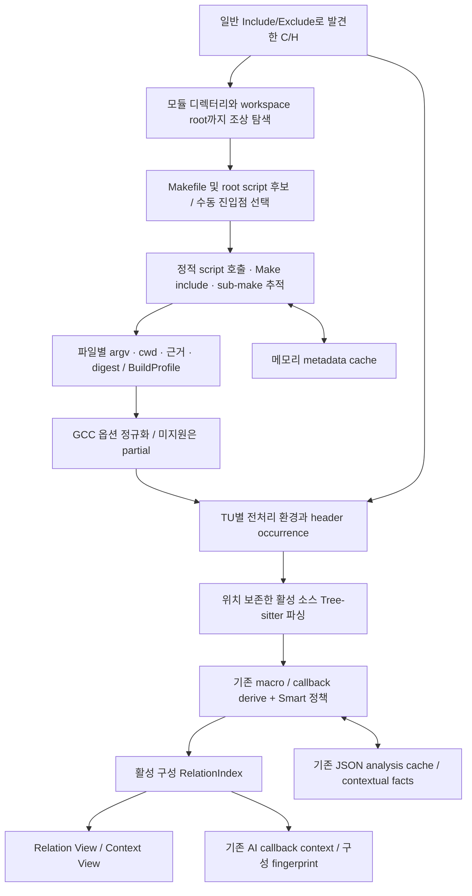

# Make Build Context 구현·검증 보고서

- 기준: 2026-10-25, `/Users/james_black/work/project/vscode_extension`의 현재 작업 트리.
- 브랜치: `codex/build-context`, 시작점: `main`의 `c736aebf576c3ab385a789b53fb5f5935ddc946f`.
- 이 보고서는 구현된 코드와 아래 실행한 테스트를 구분한다. 제품 버전은 0.1.75로 유지했다. 새 패키지 설치, 프로젝트 빌드 설정 수정, compiler 실행, 확장 설치·게시를 수행하지 않았다.
- 선행 계획: [scope-first-build-context.md](/Users/james_black/work/project/vscode_extension/docs/superpowers/plans/2026-10-25-scope-first-build-context.md). 계획의 모든 체크 항목이나 Make 전체 문법을 완료했다는 의미는 아니다.

## 1. 결과와 범위

**구현 확인:** 기존 Include/Exclude로 발견한 C/H를 시작점으로 빌드 진입점을 찾고, 선택된 script/Make의 실제 연결을 따라 확인한 파일별 옵션을 매크로·콜백 분석에 적용한다. `compile_commands.json`은 필요하지 않다.

**부분 구현:** 정적 sh/cmd/Make와 GCC 옵션의 제한된 부분집합이다. compiler builtin/default include 환경, Diab 전용 옵션, 전체 빌드 소속·최종 링크 일치성은 검증하지 않는다. 현재 생성되는 `BuildProfile.coverage`는 `partial`이다. 미확정을 완전한 빌드 결과로 표시하지 않는다.

| 항목 | 상태 | 구현 근거 |
|---|---|---|
| 소스 범위에서 모듈·조상 Make 후보 탐색 | 구현 확인 | `discoverBuildEntries()`; [build-discovery.ts:55](/Users/james_black/work/project/vscode_extension/src/build-discovery.ts:55) |
| 여러 모듈, 여러 `.mk`, include/sub-make 연결 | 구현 확인 | `extractStaticBuildOptions()` 내부 `make()` / `parse()` / `target()`; [build-options.ts:15](/Users/james_black/work/project/vscode_extension/src/build-options.ts:15) |
| root sh/bat/cmd 및 명시적 하위 script | 부분 구현 | 같은 함수의 `script()`; [build-options.ts:188](/Users/james_black/work/project/vscode_extension/src/build-options.ts:188). 동적 실행·전체 제어 흐름은 미지원 |
| GCC D/U·헤더 경로·forced input·response | 부분 구현 | `normalizeCompileContext()`; [build-context.ts:75](/Users/james_black/work/project/vscode_extension/src/build-context.ts:75). 미지원 옵션은 partial |
| 파일별 조건·헤더 출현별 독립 분석 | 구현 확인 | `preparePreprocessorContext()`, `BuildAnalysis.prepare()`; [preprocessor-context.ts:67](/Users/james_black/work/project/vscode_extension/src/preprocessor-context.ts:67), [build-analysis.ts:37](/Users/james_black/work/project/vscode_extension/src/build-analysis.ts:37) |
| 일반 범위와 Smart 범위 유지 | 구현 확인 | `WorkspaceIndex.buildScope()`, Worker의 `eligibleHeader` 및 기존 파일별 `analysisPolicy`; [workspace.ts:34](/Users/james_black/work/project/vscode_extension/src/workspace.ts:34), [analysis-worker.ts:164](/Users/james_black/work/project/vscode_extension/src/analysis-worker.ts:164) |
| Relation/Context 및 기존 AI 후보 조회와 연결 | 구현 확인 | `WorkspaceIndex.index/indexFor()`, `View.track()`, `CallbackContextBuilder`; [workspace.ts:25](/Users/james_black/work/project/vscode_extension/src/workspace.ts:25), [view.ts:124](/Users/james_black/work/project/vscode_extension/src/view.ts:124), [copilot-context.ts:20](/Users/james_black/work/project/vscode_extension/src/copilot-context.ts:20) |
| 메타데이터 캐시·Worker 세대·JSON 복원 | 구현 확인 | `BuildMetadataCache`, `sameBuildEpoch()`, `BuildAnalysis.setCache()/save()` |
| Diab 의미·실제 펌웨어 정확도 | 확인 불가 | `dcc` 식별 후 미검증 옵션 처리. 팀의 실제 소스·빌드 환경으로 검증하지 않음 |
| MCP/T32 API·빌드 실행기·compile DB import | 미구현 | 이번 변경에 새 서버·프로토콜·실행기 없음 |

## 2. 데이터 흐름

1. `registerBuildConfigurations()`는 `workspace.sourceFiles`를 재사용한다. 프로젝트 전체를 별도 재귀 검색하지 않는다. 각 모듈의 조상 목록을 중복 제거하고 workspace 경계까지 조사한다.
2. 후보 `.mk`의 위치만으로 소속을 확정하지 않는다. 선택 진입점에서 실제 include·호출한 파일을 읽는다. 범위 밖에 있는 참조 `.mk`도 설정 자료로 읽을 수 있지만 그 폴더의 C/H를 자동 추가하지 않는다.
3. `CompileUnitContext`에는 source/output/cwd/argv와 근거 위치, 순서 있는 define/undef, 종류별 include 경로, forced input, 의존성 digest, 미확정 사유를 보관한다. 타입 정의: [build-context.ts:17](/Users/james_black/work/project/vscode_extension/src/build-context.ts:17).
4. 정적 옵션이 확정된 단위만 그 옵션을 적용한다. 해석 불가능한 build 호출에서 나온 소속은 `unknown`으로 두며 활성 graph에 확정적으로 합류시키지 않는다. 기본 소스 탐색은 유지한다.
5. `preparePreprocessorContext()`가 include/define/undef 순서를 따라 환경을 만들고 확정 비활성 영역을 공백으로 가린다. 원본 text·URI·UTF-16 offset·개행은 유지한다. `analyze()`가 준비된 소스를 파싱하고 `contextualizeFacts()`가 semantic ID를 분리한다.
6. 동일 헤더가 서로 다른 C 파일에서 다른 define으로 사용되면 TU/occurrence별 facts가 생성된다. `fileKey()/locationKey()`는 context ID를 사용하고 화면 이동은 원본 URI를 사용한다. 같은 header URI가 다른 변형을 덮어쓰지 않는다.

## 3. 지원하는 정적 분석과 불확실성

- Make: `=`, `:=`, `?=`, `+=`, 제한된 변수 참조·상수 조건, include, 명시 target/prerequisite, 단순 pattern rule과 자동 변수, sub-make의 `-f`/`-C` 및 command-line 변수 재정의. 선택/default target에서 도달한 recipe를 따라간다. 모든 Make 구문을 해석하지 않는다.
- Script: 제한된 변수 대입·export·디렉터리 이동·source/call 및 인자 전달. shell의 비export 변수와 Make의 비export 파일 변수는 자식 Make 환경에 자동 전파하지 않는다.
- GCC: 순서 있는 `-D`/`-U`, `-iquote`/`-I`/`-isystem`/`-idirafter`, `-imacros`/`-include`, bounded response 파일을 다룬다. `-imacros`는 macro 입력이며 C 정의를 추가하지 않는다. compiler 기본 검색 경로가 불명확하면 그 뒤의 `-idirafter` 결과를 확정하지 않는다.
- 조건식: 작은 정수 literal/alias, `defined`, 괄호, `!`, 비교, `&&`/`||` 부분집합을 사용한다. 알 수 없는 builtin·ABI·수식은 unknown이다. 미지정 macro를 compiler 환경 확인 없이 일괄 0으로 처리하지 않는다. 단순 header guard와 `#pragma once`를 다룬다.
- 필수 header가 일반 범위 밖이거나 누락되면 읽어 들여 범위를 넓히지 않는다. 더 뒤의 동명 header로 확정 대체하지 않고 해당 의존성과 관계에 불확실성을 남긴다.
- 복합 shell 명령, 동적 Make 함수/제어 흐름, 미지원 옵션 등은 issue/provenance로 남긴다. 상속되거나 설정된 비어 있지 않은 `MAKEFLAGS`/`MFLAGS`/`MAKEOVERRIDES`/`MAKEFILES`도 아직 해석하지 않으므로 소속을 unknown으로 남긴다. 실행해서 값을 얻지 않는다. 전체 manifest나 최종 link를 확인하지 않으므로 TU 사이 연결에도 `link membership` 미검증 사유를 붙인다. `RelationIndex.linkageUncertain()` 근거: [relations.ts:137](/Users/james_black/work/project/vscode_extension/src/relations.ts:137).

## 4. 기존 macro propagation 문제에 적용되는 부분

**구현 확인:** 이전에는 `#if FEATURE`의 실제 값을 몰라 양쪽 macro 정의를 대안으로 유지하던 입력에, Make에서 확인한 `-DFEATURE=1` 등을 적용한다. 해당 TU에서 불가능한 정의·호출을 제거한 뒤 기존 전파 분석으로 넘기므로 조합 수와 재파싱을 줄일 수 있다. 서로 다른 TU의 header 환경도 섞이지 않는다. 조건 간 상관관계와 `elif`의 배타성도 준비된 branch 정보로 유지한다.

**해결하지 않는 부분:** 활성 코드 자체의 큰 callback table, alias 후보, mutation/region 복사, opaque write와 interprocedural 전파 비용은 계속 존재한다. Make 옵션 확보만으로 모든 작업량 한도 문제가 해결되는 것은 아니다. 기존 함수/프로젝트 작업량·variant·mutation·메모리 보호 한도를 늘리거나 callback 분석을 끄지 않았다. 전처리 작업도 `AnalysisWorkBudget.consumeProject()`에 포함한다.

**확인 불가:** 팀의 실제 firmware에서 관찰했던 macro/callback limit 원인이 얼마나 줄어드는지는 실제 입력으로 다시 확인해야 한다. 아래 수치를 그 문제의 해결 판정으로 사용하지 않는다.

## 5. 저장·갱신과 비용

| 대상 | 저장/갱신 방식 | 제약 |
|---|---|---|
| 선택 진입점·사용 인자 | VS Code workspaceState의 `buildConfiguration-v1` | 한 번에 한 활성 profile |
| script/Make/response 내용·디렉터리 목록 | `BuildMetadataCache` 메모리 | text 최대 128개/8 MiB, discovery/profile 각 8개; 범위·의존성 변경 시 무효화 |
| build 옵션/provenance | 메모리 `BuildProfile` + 의존성 digest | 재시작 시 metadata를 다시 확인; 별도 SQLite DB 없음 |
| TU/header prepared facts | `BuildAnalysis` 메모리 | 일반 소스 수정은 의존성이 바뀐 단위를 재준비. profile fingerprint 변경은 선택 구성 전체를 보수적으로 무효화 |
| raw/derived 인덱스 | 기존 JSON `AnalysisCache` | workspace storage `analysis-cache/profiles/<profileId>/build-facts`; semantic version 13, schema 2 |
| 구성/소스 변경 중 Worker 결과 | profile fingerprint + context/source revision | 오래된 결과·진행률을 새 구성에 적용하지 않음 |
| AI 후보·수동 연결 | context ID·source digest·configuration fingerprint | 다른 TU의 같은 헤더 위치와 혼합하지 않으며 구성 변경 후 재검토 |

- `BuildMetadataCache.invalidate()`는 참조 파일 변경뿐 아니라 조사한 디렉터리에 새 Make/script가 생기는 경우도 처리한다. 기존 파일 내용만 고치는 일반 C 편집은 metadata 추가 read/list/parse를 유발하지 않는다. C 파일 생성·삭제는 seed 집합이 바뀌므로 탐색 캐시 키도 바뀐다.
- 설정 파일 변경은 선택 구성을 다시 평가한다. `.mk` AST를 부분 수정하는 정밀 incremental Make evaluator는 구현하지 않았다. 기존 이름/의존성 기반 C 분석도 보수적인 dirty component를 사용한다.
- 본문을 공유해도 TU마다 facts·flow 프로그램·조건 정보가 생기므로 header 변형이 많은 프로젝트에서는 메모리가 늘 수 있다. depth/work/memory/cancel 보호를 유지한다. 파일 read adapter의 1 MiB 제한은 읽은 후 검사하며 단일 read의 사전 할당을 보장하지 않는다.
- Git commit별 인덱스 관리와 실제 최종 image/link 검증은 구현하지 않았다. profile은 진입점·인자·옵션/의존성 fingerprint를 기준으로 구분한다.

## 6. View와 AI 재사용

**구현 확인:** Relation/Context는 활성 profile의 같은 인덱스를 조회한다. 선택 구성에 facts가 없는 파일은 기본 소스 인덱스를 탐색하되 활성 graph에 혼합하지 않는다. 공유 헤더의 TU가 여러 개면 원본 파일을 포함하는 소스 선택 UI를 사용하고 선택 context를 유지한다. `skipInactive=false`는 기존 모든 분기 분석이며 활성 조건으로 분기를 제거하지 않는다.

**구현 확인:** 기존 `CallbackContextBuilder`가 활성 인덱스의 source/site identity와 build fingerprint를 포함한다. 다른 TU의 헤더 snippet·AI hint·수동 override가 같은 물리적 위치라는 이유로 섞이지 않는다. AI에 넣는 inherited macro 요약은 최대 16개, 이름 64자·본문 128자로 제한하고 생략 여부를 표시한다. 이것은 전체 전처리 환경 export가 아니다.

**미구현:** 외부 AI Agent의 일반 목적 symbol/query API, MCP server, T32 Assistant 연결은 추가하지 않았다. 기존 AI callback 기능이 재사용하는 기반 인덱스는 준비됐지만 외부 서비스가 직접 질의할 프로토콜·수명주기·응답 schema는 별도 작업이다. 변경 영향도는 현재 관계를 입력으로 사용할 수 있으나, 미확정 link/callback과 분석 누락을 포함하는 완전한 영향도 증명은 제공하지 않는다.

## 7. 실행한 검증

| 검증 | 결과 | 재현 방법/근거 |
|---|---|---|
| 타입 검사 / bundle | 통과 | `npm run typecheck`, `npm run build` |
| 전체 단위 회귀 | 685/685 통과 | `npm test` |
| Worker·Workspace·범위·context | 92/92 통과 | `npm run test:worker`와 동일한 5개 node test 파일; 이번에는 완료된 build를 재사용해 직접 실행 |
| 기존 메모리 회귀 | 6/6 통과 | `npm run test:memory` |
| 실제 macOS VS Code Extension Host | 통과 | `node scripts/test-extension.mjs`; 마지막 결과 `Dynsight extension integration checks passed` |
| 공백/patch 검사 | 통과 | `git diff --check` |

새 회귀는 모듈별 nested mk·연결되지 않은 mk 생략, script 환경·실제 recipe line, sub-make 변수 우선순위, 과대 변수/response 제한, 동일 header의 static/callback 분리, 조건 배타성과 상관관계, forced input, scope로 막힌 header, Windows encoded drive 경로, stale Worker 결과, AI/override context 분리, 디스크 복원 후 변경 거절을 포함한다.

구체적인 검증 근거:

- [build-context-analysis.test.ts:28](/Users/james_black/work/project/vscode_extension/test/build-context-analysis.test.ts:28): 동일 header의 서로 다른 TU별 static storage와 callback 후보.
- [build-context-analysis.test.ts:62](/Users/james_black/work/project/vscode_extension/test/build-context-analysis.test.ts:62): 확정 조건에서 variant 감소, macro 호출·등록 유지.
- [build-context-analysis.test.ts:138](/Users/james_black/work/project/vscode_extension/test/build-context-analysis.test.ts:138): 실제 JSON cache를 다시 열어 AST parse 0회 복원, 소스 편집 시 거절·재분석.
- [extension.test.ts:879](/Users/james_black/work/project/vscode_extension/test/extension.test.ts:879): native picker로 Makefile 선택, MODE 1→2에서 callback `native_first`→`native_second`, Context 원본 URI 유지, Make만 수정 시 generic source parse 재사용.
- [build-context-performance.ts:10](/Users/james_black/work/project/vscode_extension/test/build-context-performance.ts:10): 아래 합성 비용 비교와 warm metadata read/list 0 검증.

### 합성 성능 측정

다른 테스트 프로세스가 종료된 뒤 `npm run test:build-context-performance`를 별도 실행했다. 12개 모듈 각각 `module.mk → options.mk`, 6개 독립 조건과 callback 1개를 가진 fixture이다. 각 arm을 5회 측정한 중앙값이며 총 시간에는 기본 파싱·전처리 준비·derive가 포함된다. metadata 최초 추출은 별도 8.86 ms, 26 read/14 list였다. 같은 입력 재사용 시 추가 read/list는 각각 0이다.

| 비교 | 기본 소스 수 | 총 시간 중앙값 (최소–최대) | macro 재파싱 / run variant | macro 작업량 | callback 작업량 |
|---|---:|---:|---:|---:|---:|
| A: 넓은 소스 범위, build 조건 없음 | 24 | 105.04 ms (96.82–156.63) | 384 / 384 | 5,940 | 6,600 |
| B: 동일 선택 소스, build 조건 없음 | 12 | 73.84 ms (72.36–85.79) | 384 / 384 | 5,940 | 5,388 |
| C: B에 확인된 build 조건 적용 | 12 | 30.61 ms (28.91–34.11) | 12 / 12 | 3,996 | 180 |

C에서 12개 callback 대상이 유지되고 alternative limit이 없음을 assertion으로 검사했다. A/B는 미확정 조합 때문에 기존 alternative limit에 도달하므로 세 arm을 동일 완전성 결과의 속도 비교로 해석하면 안 된다. 목적은 범위 축소 효과와 **조건 확정에 따른 분기 감소**를 구분하는 것이다. sampled heap은 단계별 관측치이며 실제 peak memory 측정이 아니다. 팀 GCC/Diab firmware의 indexing 시간 단축률이나 메모리 상한을 보장하지 않는다. 원시 결과는 실행 시 `test-results/build-context-performance.json`에 생성된다.

## 8. 남은 우선순위

1. **P1 / 확인 불가:** 실제 프로젝트의 선택 script·인자·연결된 mk와 추출 옵션을 대조하고, 기존 macro/callback limit 위치를 재현한다. 미지원 구문을 찾으면 그 사례를 최소 fixture로 추가한 뒤 필요한 정적 문법만 확장한다.
2. **P1 / 부분 구현:** Diab option adapter와 compiler builtin/default include 환경을 실제 빌드 자료에 근거해 검증한다. 현재는 Diab를 GCC 옵션으로 간주하지 않는다.
3. **P2 / 미구현:** 최종 link/source manifest를 확인할 자료가 있을 때 구성별 graph의 완전성·cross-TU 후보 확정 방법을 추가한다. 현재 `coverage=partial`과 link uncertainty를 유지한다.
4. **P2 / 부분 구현:** 실제 측정에서 필요성이 확인되면 profile 변경 시 전체 재준비 비용과 header occurrence 메모리를 개선한다. 현재 일반 C 편집의 metadata 재탐색 비용은 제거했다.
5. **P2 / 미구현:** 외부 AI/MCP의 읽기 전용 질의 계약을 기존 context ID·fingerprint·불확실성 사유 위에 설계한다. 외부 답변에서 partial 인덱스를 완전한 영향도로 제시하지 않도록 응답에 포함해야 한다.

이번 구현은 빌드 조건이 없는 상태의 불필요한 대안 전파를 줄이고 기존 AI 인덱스에 구성 identity를 연결했다. 실제 firmware의 잔여 전파 비용과 compiler별 일치성은 위 후속 검증으로 구분한다.
