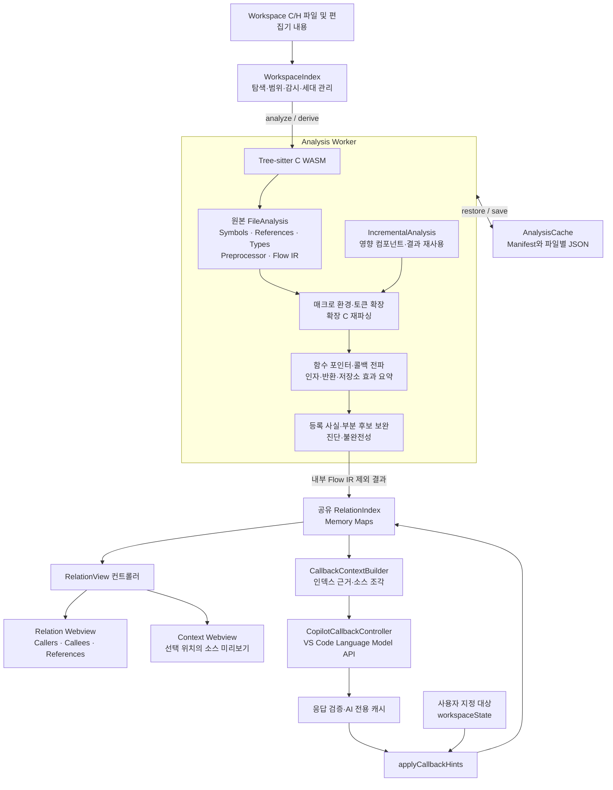

# Dynsight Relation View와 Context View 소스 아키텍처 분석

## 문서 기준과 AI의 사용 범위

- 조사일: 2026-10-25, Asia/Seoul.
- 저장소: `/Users/james_black/work/project/vscode_extension`.
- 기준 HEAD: `ddef1367a7e2bd967c674757912dd0f9b457260a`.
- 분석 대상: 위 HEAD에 **현재 미커밋 변경을 포함한 작업 트리**. HEAD만 checkout하면 이 문서의 일부 구현과 다를 수 있다.
- manifest 버전: `package.json:5`의 `0.1.75`. 설치 버전이나 최신 배포 버전을 뜻하지 않는다.
- 조사 방법: 소스와 테스트 정의의 정적 검토. 실제 펌웨어, VS Code 실행, GCC/Diab 빌드 비교, 성능 측정, 테스트 실행은 수행하지 않았다.
- 이번 요청의 산출물은 이 Markdown 문서다. 제품 코드, 설정, 패키지, 빌드 구성은 변경하지 않는다.

### 판정 규칙

| 판정 | 의미 |
|---|---|
| 구현 확인 | 호출 경로와 구현 코드를 확인했다. 모든 입력에서 정확하다는 뜻은 아니다. |
| 부분 구현 | 해당 기능의 일부 범위만 구현되어 있거나 명시적인 분석 제약이 있다. |
| 미구현 | 조사한 `src`와 `package.json`의 실행·등록 경로에 해당 기능이 없다. |
| 확인 불가 | 외부 프로젝트나 실제 빌드·실행 검증이 필요하다. |

### AI가 이 문서를 사용할 때 지켜야 할 해석

1. 파일 경로는 저장소 루트 기준이다. `파일:줄`은 조사 시점의 위치다. 변경 후에는 함께 적힌 함수명으로 다시 찾는다.
2. 구현 사실, 코드에서 도출한 구조적 제약, 향후 개선 제안을 구분한다.
3. `registered`, `inferred`, `ai-candidate`, `user-confirmed`를 동일한 확정 호출로 합치지 않는다.
4. `inference.incomplete`, `reasons`, `analysis.status`, `issues`, `callbackDiagnostics`, graph의 `truncated`를 함께 읽는다.
5. `Index ready`나 snapshot 세대 일치만으로 컴파일러 빌드 결과와의 일치를 주장하지 않는다.
6. 테스트 파일의 존재와 이번 세션의 테스트 통과를 혼동하지 않는다.
7. 아래 MCP 도구 이름과 연동 설계는 **제안**이며 현재 제공되는 API 목록이 아니다.

## 핵심 평가

**기존 Index는 AI Code Intelligence의 소스 탐색·관계 조회·근거 수집에 재사용할 수 있다. 현재 Copilot 콜백 분석이 실제로 같은 분석 자산을 재사용한다.**

단, 현재 인덱스는 GCC/Diab 빌드 설정을 반영한 컴파일러 의미 인덱스가 아니다. 외부 Agent용 안정된 조회 API와 MCP 서버도 없다. AI 재사용의 다음 작업은 파서 재작성보다 읽기 전용 snapshot 조회 계층을 만드는 것이다. 실제 빌드 기준 정확도가 필요한 기능에는 별도로 compiler/build configuration 모델이 필요하다.

근거: `src/copilot-service.ts:58`의 `snapshot()`, `src/copilot-context.ts:19`의 `CallbackContextBuilder`, `src/relations.ts:42`의 `RelationIndex`, `src/extension.ts:56`의 activation 반환값.

## 1. 전체 Architecture Diagram

**판정: 구현 확인.**



근거:

- `src/extension.ts:20`, `activate()`: WorkspaceIndex·RelationView 생성 및 두 Webview 등록.
- `src/workspace.ts:18`, `WorkspaceIndex.index`: 공유 RelationIndex.
- `src/analysis-worker.ts:148`: basic 분석 후 증분 상세 분석.
- `src/analyzer.ts:399`, `derive()`: 매크로 → 콜백 → 보완 처리.

## 2. 주요 모듈과 Source File 위치

| 판정 | 파일·위치 | 함수·클래스 | 책임 |
|---|---|---|---|
| 구현 확인 | `src/extension.ts:11` | `activate()` | 확장 초기화, View·명령·선택 이벤트 등록 |
| 구현 확인 | `src/workspace.ts:17` | `WorkspaceIndex` | 파일 탐색·필터·감시, Worker 통신, 상태·캐시 수명주기 |
| 구현 확인 | `src/analysis-worker.ts:84` | `parentPort.on('message', …)` | 원본·파생 snapshot, 분석 순서, 캐시·취소·전달 |
| 구현 확인 | `src/analyzer.ts:42` | `createAnalyzer()` | C parser 초기화 및 원본·확장 소스 분석 |
| 구현 확인 | `src/flow-parser.ts:10` | `flowFacts()` | 구문 트리에서 분석용 Flow IR 추출 |
| 구현 확인 | `src/type-info.ts` | `declarator()`, `declaredType()`, `typedExpression()` | 선언자·타입·멤버 표현식 구조화 |
| 구현 확인 | `src/member-resolver.ts:15` | `MemberResolver` | typedef·구조체·익명 멤버의 선언 타입 해석 |
| 구현 확인 | `src/project-analysis.ts:18` | `timeline()` | include/define/undef 및 조건부 매크로 환경 |
| 구현 확인 | `src/project-analysis.ts:216` | `bindMacroReferences()` | 원본 참조와 유효 매크로 정의 후보 연결 |
| 구현 확인 | `src/project-analysis.ts:281` | `deriveMacroCalls()` | 함수 본문·초기화 확장 및 재파싱 |
| 구현 확인 | `src/macro-expansion.ts:23` | `MacroExpander` | 인자 prescan, 치환, 재확장, stringize·token paste |
| 구현 확인 | `src/pointer-targets.ts:154` | `inferPointerCalls()` | 저장소·별칭·함수 요약 기반 콜백 추론 |
| 구현 확인 | `src/explicit-callbacks.ts:13` | `suggestExplicitCallbacks()` | 명시적 등록 사실과 단순 로컬 후보 |
| 구현 확인 | `src/partial-callbacks.ts:9` | `suggestPartialCallbacks()` | 제한된 분석의 bounded 후보 보완 |
| 구현 확인 | `src/function-arguments.ts` | `FunctionArguments` | 함수 주소 인자 전달 관계 |
| 구현 확인 | `src/relations.ts:42` | `RelationIndex` | 심볼 해석, 관계 인덱스·조회, 그래프 |
| 구현 확인 | `src/incremental-analysis.ts:8` | `IncrementalAnalysis` | 영향 컴포넌트와 파생 결과 재사용 |
| 구현 확인 | `src/analysis-cache.ts:29` | `AnalysisCache` | 파일별 JSON 영속 캐시 |
| 구현 확인 | `src/view.ts:109` | `RelationView.track()` | 편집기 선택 → 콜백·심볼 조회 |
| 구현 확인 | `src/view.ts:147` | `refresh()`, `preview()`, `publish()` | 그래프·소스 미리보기 구성 및 전달 |
| 구현 확인 | `webview/main.ts:366` | `renderContext()`, `render()` | Context·Relation 렌더링 |
| 구현 확인 | `src/copilot-context.ts:19` | `CallbackContextBuilder` | 인덱스를 AI 근거·소스 조각으로 투영 |
| 구현 확인 | `src/copilot-callbacks.ts:51` | `CopilotCallbackController` | AI 요청·캐시·취소·응답 검증 |
| 구현 확인 | `src/copilot-service.ts:18` | `registerCopilotCallbacks()` | VS Code 모델·설정·자동 실행 연결 |
| 구현 확인 | `src/copilot-relations.ts:6` | `applyCallbackHints()` | AI·사용자 선택 관계의 Index 투영 |
| 구현 확인 | `src/callback-overrides.ts:46` | `CallbackOverrideStore` | 사용자 지정 대상과 소스 변경 후 재검토 상태 |

## 3. Parsing에서 View까지의 데이터 흐름

### 3.1 Tree-sitter 사용

**판정: 구현 확인.**

`createAnalyzer()`는 `Parser.init()` → `Language.load()` → `setLanguage()`로 WASM C parser를 초기화한다. `parseSource()`가 `parser.parse(text)`를 호출하고, `analyze()`는 `namedChildren`·`childForFieldName()`·노드 종류 검사로 구문 트리를 순회한다. 필요한 사실을 추출한 뒤 `tree.delete()`한다. Query 파일 기반 추출이나 구문 트리 장기 보관 구조는 아니다.

근거: `src/analyzer.ts:42`, `parseSource()`; `src/analyzer.ts:122`, `visit()`; `src/analyzer.ts:349`~`353`, Flow IR 생성과 tree 해제.

사용 라이브러리: `package.json:427`~`428`의 `tree-sitter-c 0.24.1`, `web-tree-sitter 0.27.1`. `scripts/build.mjs:12`~`13`이 WASM 파일을 `dist`로 복사하고, `src/analysis-worker.ts:9`가 로드한다.

### 3.2 추출하는 사실

| 대상 | 추출 내용 | 근거 |
|---|---|---|
| 함수 | 정의·선언, 이름, 위치·범위, storage, scope, 조건, 타입·서명, 본문 위치 | `src/analyzer.ts:172`의 `addSymbol()`, `:235`의 함수 정의 처리 |
| 변수 | 전역·static·local, 포인터·타입, 초기화 쓰기, 범위 | `src/analyzer.ts:267`의 선언 처리 |
| 타입 | typedef, struct/union/enum, 익명 aggregate, 멤버 소속 | `src/analyzer.ts:245`, `src/member-resolver.ts:15` |
| 참조 | owner/function ID, 대상 후보, read/write/readwrite/address, 조건 | `src/analyzer.ts:30`의 `access()`, `:310`의 참조 처리 |
| 호출 | 직접·복합 간접 호출 위치, 소유 함수, Flow IR 연결 키 | `src/analyzer.ts:295` |
| 전처리 | define/undef/include, 함수형·가변 인자 매크로, 본문·분기 | `src/analyzer.ts:216` |
| Flow IR | 이름·숫자·멤버·배열·주소·역참조·대입·호출·초기화, 분기·반복·return | `src/flow-parser.ts:10`, `expression()`·`statements()` |

`sizeof`·`alignof` 등의 비평가 표현식은 호출·접근으로 계산하지 않도록 별도 처리한다. 타입 정보는 선언 기반이며 compiler ABI 기준 메모리 배치 정보가 아니다.

### 3.3 Tree-sitter 이외 기술

- **구현 확인:** `src/c-tokens.ts:12`, `tokenizeC()`의 정규식 기반 C 토큰화.
- **구현 확인:** `src/syntax.ts:7`, `highlightC()`의 Context용 어휘 강조.
- **구현 확인:** `src/incremental-analysis.ts:55`, `dependencies()`의 식별자 집합 기반 의존성 추정.
- **미구현:** 현재 분석 경로의 LSP·clangd·C/C++ 확장 정의/참조 provider 연동, GCC/Diab 실행을 통한 분석.

마지막 판정의 근거는 분석 입력과 처리 전체 경로인 `src/workspace.ts:359`의 `analyze()`, `src/analysis-worker.ts:84`의 요청 처리, `src/analyzer.ts:42`의 parser 초기화다. 제품 소스와 manifest에서 컴파일러·LSP 분석 등록 경로를 찾지 못했다.

### 3.4 Index와 Call Graph 생성

**판정: 구현 확인.**

```text
WorkspaceIndex.rebuild()/restoreCache()
  → 파일 내용·분석 정책 전송
  → Worker의 analyzer.analyze()
  → 원본 FileAnalysis
  → analyzer.basic(): 매크로 정의 연결·리터럴 인자·명시적 등록
  → IncrementalAnalysis.derive()
  → analyzer.derive(): 매크로 확장·콜백 전파·보완
  → Worker.forIndex(): 내부 Flow IR 제외
  → RelationIndex.update()
  → relations()/graph()
  → RelationView.refresh()/preview()/publish()
```

근거: `src/workspace.ts:486`, `rebuild()`; `src/analyzer.ts:391`, `basic()`; `:399`, `derive()`; `src/analysis-worker.ts:19`, `forIndex()`; `:148`~`155`, 처리 순서; `src/relations.ts:75`, `update()`.

Tree-sitter가 완성된 Call Graph를 반환하는 구조가 아니다. 호출·참조 사실을 먼저 만들고, 대상 해석과 파생 분석을 거쳐 그래프를 조회 시 구성한다. `resolve()`는 local scope·static·같은 파일·전역 정의·포함된 헤더 static·선언 후보를 구분한다. 빌드·링커 기준 유일 대상을 보장하지는 않는다.

근거: `src/relations.ts:173`, `resolve()`; `:297`, `relations()`; `:331`, `graph()`.

### 3.5 사용자 선택과 두 View

**판정: 구현 확인. 두 View는 같은 Index를 공유한다.**

1. `activate()`가 편집기 선택을 약 80ms 지연해 `track()`에 전달한다.
2. `track()`이 URI·offset을 계산하고 `callbackAt()`을 우선 확인한다.
3. 일반 심볼은 `resolveAt()`으로 찾는다. 여러 정의면 선택 목록을 제공한다.
4. `setRoot()` → `refresh()` → `index.graph()`로 관계를 구성한다.
5. `preview()`가 같은 `index.files`의 원본 텍스트에서 선택 줄 앞 80줄·뒤 120줄을 추출한다.
6. `publish()`가 Relation에는 상태 전체, 분리된 Context에는 미리보기만 전달한다.

근거: `src/extension.ts:20`~`27`, `:45`~`48`; `src/view.ts:109`, `track()`; `:147`, `refresh()`; `:203`, `preview()`; `:215`, `publish()`.

함수 선택 때마다 프로젝트를 재파싱하지 않는다. Context는 별도 의미 분석 엔진이 아니라 공유 인덱스의 소스·위치 미리보기다. 색상은 `highlightC()`의 어휘 분류이며 semantic highlighting이 아니다.

## 4. Callback 분석 알고리즘과 제약

### 4.1 저장소와 함수 요약 기반 추론

**판정: 구현 확인.** 핵심 함수는 `src/pointer-targets.ts:154`의 `inferPointerCalls()`다.

| 내부 구조 | 내용 | 위치 |
|---|---|---|
| `Value` | 함수 대상·근거, 객체 저장소, 미치환 파라미터, 숫자 후보, unknown/null, 이유 | `src/pointer-targets.ts:6` |
| `State` | 현재 memory, 변경 효과, 생존 경로, 변경·누락 영역 | `src/pointer-targets.ts:14` |
| `Summary` | 인자, 반환값, 저장소 효과, 영역, version, 불완전성 | `src/pointer-targets.ts:13` |
| `Observation` | 간접 호출 지점에서 관찰한 후보 값·표현식 | `src/pointer-targets.ts:16` |

분석은 다음 순서로 진행한다.

1. 초기화와 함수 Flow IR에서 저장소·타입·파라미터 정보를 준비한다.
2. `slots()`·`read()`·`write()`·`evaluate()`로 대입·별칭·멤버·배열·역참조를 처리한다.
3. `execute()`는 분기 상태를 합치고 반복문을 제한된 횟수 평가한다.
4. 호출 시 실제 인자를 요약에 공급하고, `instantiate()`로 반환값·효과를 호출자의 저장소에 치환한다.
5. 요약·heap·영역·shape 의존성이 바뀐 함수는 재평가한다.
6. `materialize()`가 파라미터 체인을 구체 함수 후보로 해석한다.
7. 원래 참조를 보존하면서 호출 지점에 `inferred` 대상 레코드를 생성한다.

근거: `src/pointer-targets.ts:461`, `materialize()`; `:487`, `instantiate()`; `:517`, `read()`; `:549`, `write()`; `:817`, `slots()`; `:925`, `evaluate()`; `:1024`, 호출 평가; `:1112`, `execute()`; `:1191`, 의존성 재평가; `:1319`, 결과 생성.

이는 런타임 실행 추적이 아니라 후보 집합을 계산하는 정적 분석이다. 분기 조건의 실행 가능성을 일반적으로 완전히 풀지 않고 상태를 결합한다.

### 4.2 다단계 체인

**판정: 구현 확인, 제한 있음.** 테이블 → getter 반환 → 등록 함수 실제 인자 → 저장된 포인터 → 멤버 호출을 처리한다. 직접·간접 forwarding, 함수 포인터 반환, 구조체 복사, static local도 분석 대상이다.

소스와 테스트 정의 근거:

- `src/pointer-targets.ts:1024`~`1106`: 인자 공급·반환·효과 반영.
- `test/pointer-calls.test.ts:20`, `callbackTableProject()`: 여러 파일의 테이블/getter/install/saved 포인터 구성.
- `test/pointer-calls.test.ts:39`: 실제 인자 위치 1~4와 Callers 역관계 검사 정의.
- `test/pointer-calls.test.ts:184`: 직접·간접 forwarding.
- `test/pointer-calls.test.ts:191`: 파일 간 전역 콜백 등록.
- `test/pointer-calls.test.ts:320`: 재귀 forwarding.

### 4.3 Macro 등록

**판정: 부분 구현.**

`timeline()`이 indexed header의 include/define/undef 순서와 조건 후보를 구성하고, `MacroExpander`가 토큰 단위로 치환·재확장한다. `deriveMacroCalls()`는 생성된 C 함수 본문·초기화 값을 다시 파싱해 Flow IR와 호출을 얻는다. 토큰의 원본 위치, 매크로 정의 체인, 확장 문자열도 남긴다.

근거: `src/project-analysis.ts:18`, `timeline()`; `:281`, `deriveMacroCalls()`; `:374`~`426`, 변형 재파싱·위치 매핑; `src/macro-expansion.ts:114`, `substitute()`.

현재 작업 트리의 `suggestExplicitCallbacks()`는 **이미 확장된 본문**도 리터럴 함수 등록 사실 수집에 사용한다. 확장된 본문의 등록 수집과 원본 흐름의 단순 로컬 호출 후보 추적은 구분된다. 매크로 확장이 꺼져 있거나 확장 결과를 얻지 못한 경우, 이 경로가 일반적으로 모든 등록을 복구한다고 볼 수 없다.

근거: `src/explicit-callbacks.ts:154`~`163`; `src/analyzer.ts:415`; `test/explicit-callbacks.test.ts:269`의 macro 등록 테스트 정의.

### 4.4 관계 종류와 미해결 처리

| 관계·상태 | 해석 | 근거 |
|---|---|---|
| `direct` | 이름·scope 해석으로 연결된 일반 호출 | `src/relations.ts:283` |
| `expanded` | 매크로 확장 C에서 얻은 호출 | `src/project-analysis.ts:424` |
| `inferred` | 데이터 흐름으로 추론한 함수 대상 | `src/pointer-targets.ts:1322` |
| `registered` + reference | 주소 대입·초기화 등의 등록 사실. 호출 증거는 아님 | `src/explicit-callbacks.ts:83`~`92` |
| `registered` + call | 단순 연결 또는 제한된 분석의 등록 기반 호출 후보 | `src/explicit-callbacks.ts:226`, `src/partial-callbacks.ts:50` |
| `ai-candidate` | AI 후보. 실행 증명 아님 | `src/copilot-relations.ts:40` |
| `user-confirmed` | 사용자가 지정한 대상. 실행 증명 아님 | `src/copilot-relations.ts:50` |
| `inference.incomplete` | 알려진 후보 이외 가능성·한계가 남음 | `src/model.ts:43` |
| `analysis.status` | pending/complete/out-of-scope/missing-definition/work-limit/memory-limit/cancelled/unresolved | `src/model.ts:34`, `src/analyzer.ts:417` |

**판정: 구현 확인.** 후보를 찾았어도 unknown/null·미수렴·누락이 있으면 미해결 간접 호출 레코드를 함께 남긴다. 본문 부재·상세 범위 밖·예산·메모리·취소 사유를 구분한다. opaque 호출이 포인터 저장소를 변경할 수 있으면 관련 영역을 무효화하여 오래된 후보를 확정값으로 유지하지 않는다.

근거: `src/pointer-targets.ts:1044`, `:1099`, `:1319`~`1326`; `src/analyzer.ts:417`~`423`.

### 4.5 정확도와 자원 한계

| 한계 | 값·동작 | 근거 |
|---|---|---|
| 후보 집합 | 함수·객체·파라미터·숫자 각각 최대 64 | `src/pointer-targets.ts:77`, `union()` |
| 함수 간 전파 | 최대 12 project passes | `src/pointer-targets.ts:1172` |
| loop 전파 | 최대 4 passes | `src/pointer-targets.ts:1125` |
| 파라미터 구체화 | 깊이 24 초과·방문 256 초과 시 unknown | `src/pointer-targets.ts:470` |
| 변경 효과·영역 | 여러 경로에서 256 제한 및 누락 표시 | `src/pointer-targets.ts:364`, `:549`, `:1250` |
| Flow 표현식 | 깊이 48 이상은 unknown | `src/flow-parser.ts:16` |
| aggregate copy | 깊이 16 제한 | `src/pointer-targets.ts:763` |
| 매크로 | 중첩 32, 대안 32, 토큰 40,000 등 | `src/macro-expansion.ts:32`, `:105` |
| 숫자 의미 분석 | 일반 연산·조건을 완전 평가하지 않음. scalar 인자/index의 함수 간 전파 제한 | `src/flow-parser.ts:65`, `src/pointer-targets.ts:1219` |
| ABI | sizeof·alignof 등의 정확한 크기·배치 없음 | `src/flow-parser.ts:19` |

**판정: 부분 구현.** 따라서 긴 체인·동적 인덱스·외부 함수·정수 주소 변환·누락된 타입·본문은 후보 과다 또는 미해결을 만들 수 있다. 제한을 없애거나 수치를 높이는 것만으로 정확도를 보장할 수 없다.

### 4.6 Safety에서 Non-Safety로의 연결

- **구현 확인:** 파일·모듈 간 일반 콜백 전파.
- **미구현:** Safety 등급, 파티션, ASIL 등의 속성과 경계 규칙 판정.
- **확인 불가:** 팀의 실제 Safety/Non-Safety 프로젝트에서의 연결 정확도.

양쪽 소스와 필요한 타입·등록·호출 본문이 적절한 분석 범위에 들어오면 일반 콜백 관계로 분석할 수 있다. 이름에 safety가 있거나 테스트 파일 이름이 `callback-safety`라는 이유로 기능 안전 등급 지원을 의미하지는 않는다.

근거: `src/model.ts:24`의 `SymbolRecord`·`:32`의 `ReferenceRecord`에 등급 필드 없음; `src/pointer-targets.ts:168`~`169`의 scope 선택; `test/pointer-calls.test.ts:191`의 파일 간 전파 정의.

## 5. Index Schema와 저장·갱신

### 5.1 Schema

**판정: 구현 확인.**

| 타입 | 주요 필드 | 위치 |
|---|---|---|
| `Location` | uri, start/end, line/column, endLine/endColumn | `src/model.ts:20` |
| `CType` | 이름·tag·ID, pointer/array/function 레이어 | `src/model.ts:8` |
| `SymbolRecord` | id/name/kind, location/extent, definition/storage/scope, conditions, type/signature, memberOf | `src/model.ts:24` |
| `ReferenceRecord` | kind/location, ownerId/functionId/targetId, access, conditions, callKind, expansion, inference, argument, analysis/manual | `src/model.ts:32` |
| `FlowProgram` | id, locals, params, body | `src/model.ts:67` |
| `FileAnalysis` | text, symbols/references/includes/issues, preprocessor, functions, Flow IR, registrations/arguments/diagnostics | `src/model.ts:106` |
| `RelationGroup` | symbol/name/kind, sites, callKind, definitionCandidates | `src/model.ts:126` |
| `GraphData` | root, callers, truncated | `src/model.ts:140` |

기본 symbol ID는 `URI#offset`이다. 영구적인 이력 ID가 아니므로 소스 삽입·삭제에 따라 바뀔 수 있다.

근거: `src/analyzer.ts:190`, `addSymbol()`.

### 5.2 메모리와 디스크

**판정: 구현 확인. Memory Maps + JSON 영속 캐시이며, 이 분석 저장 경로에 SQLite는 없다.**

```text
VS Code context.storageUri/
  analysis-cache/
    manifest.json
    generation-<UUID>/
      <SHA256(uri)>.json
  copilot-callbacks/
    <model-key>/
      <callsite-key-hash>.json

사용자 지정 콜백: context.workspaceState
```

- Host: `RelationIndex.files`, byName/byId, references, outgoing, members, visibility 등.
- Worker: 원본 FileAnalysis, 원본/파생 snapshot, Flow IR, 파생 분석 캐시.
- 파일 캐시: `raw`와 `derived` 차이를 저장하고 복원 시 합성한다. raw에는 원본 소스와 분석 IR이 포함된다.
- 전달 시 `forIndex()`는 programs/initializers 등 Worker 내부 자료를 제외한다.
- 캐시: schema 2, `ANALYSIS_CACHE_VERSION = 12`.
- 원본 내용·레코드 SHA256, skip/expand/propagation 정책과 설정 키를 검증한다.
- 임시 manifest 작성 후 rename으로 교체하며, 알려진 이전 세대를 정리한다. UUID 세대는 Git commit이 아니다.

근거: `src/relations.ts:43`; `src/analysis-worker.ts:17`~`30`; `src/analysis-cache.ts:6`~`14`, `restore():59`, `save():79`; `src/workspace.ts:202`; `src/copilot-service.ts:89`, `:185`.

### 5.3 최초 분석과 재시작

**판정: 구현 확인.** 활성화 시 캐시 복원을 시도하고, 캐시가 없으면 startup reindex한다. Include/Exclude로 선택한 C/H 파일을 분석하고 관계를 도출한다. 재시작 때도 원본 내용을 읽어 해시와 설정을 확인한다. 파일 선택 요청은 기존 Index 조회다.

캐시 버전·설정 불일치나 손상은 `cacheBlocked`와 Rebuild Index 안내로 이어질 수 있다. 미저장 소스가 있으면 영속 저장을 미룬다. 취소·일시적 제한 결과는 완성 캐시로 검증하지 않고 필요한 분석을 다시 수행한다.

근거: `src/workspace.ts:174`, `:205`~`258`, `:261`~`274`; `src/analysis-cache.ts:74`~`77`, `:92`~`93`.

### 5.4 Incremental Indexing

**판정: 부분 구현.**

| 단위 | 판정 | 동작 |
|---|---|---|
| 변경 파일 | 구현 확인 | watcher·editor change/save/close → 100ms debounce → 내용 비교 후 해당 파일 재파싱 |
| 영향 컴포넌트 | 구현 확인 | 식별자·provider·include로 연결하고 변경 컴포넌트의 파생 결과만 재도출 |
| 함수 요약 | 구현 확인 | 한 전파 실행에서 요약·heap·영역 의존성에 따라 재평가·재사용 |
| Tree-sitter 트리 edit | 미구현 | old tree를 edit하여 재사용하지 않고 파일 전체 문자열을 parse |
| 정밀 프로젝트 함수 단위 무효화 | 부분 구현 | 프로젝트 변경의 기본 영향 단위는 보수적인 파일 컴포넌트 |

주석·문자열의 식별자도 컴포넌트를 넓힐 수 있다. `##`가 있으면 생성 이름 누락을 피하려고 전체 파일 집합을 하나의 컴포넌트로 묶는다.

근거: `src/workspace.ts:157`~`173`, `schedule():331`, `analyze():359`; `src/incremental-analysis.ts:12`, `dependencies():55`, `components():82`; `src/pointer-targets.ts:1191`; `src/analyzer.ts:46`.

### 5.5 Git·Build별 인덱스

**판정: 미구현.** `analysisKey`는 분석 버전·remote·skip·callback 옵션·workspace 경로·범위 정책을 해시한다. Git SHA, compiler ID, target, 파일별 Defines·Include 검색 순서·빌드 옵션은 없다.

Git checkout으로 내용이 바뀌면 일반 파일 변경으로 갱신할 수 있지만 commit별 인덱스 보관·선택은 없다. `revision`·`derivedRevision`은 세션 분석 세대이며 Git revision이 아니다.

근거: `src/workspace.ts:28`~`37`, `analysisKey:176`; `src/analysis-cache.ts:12`, `Manifest`.

### 5.6 성능과 메모리

**판정: 비용 발생 경로·보호 장치는 구현 확인, 실제 대상의 시간·메모리 수치는 확인 불가.**

주요 비용은 매크로 변형별 재파싱, 함수 간 반복 전파, 저장소 상태 clone/join·영역 무효화, Host/Worker 양쪽 텍스트·분석 자료, 넓은 증분 컴포넌트, Context 파일 전체 어휘 강조다.

보호·재사용 장치:

- Worker 내부 IR 전달 제외: `src/analysis-worker.ts:19`, `forIndex()`.
- Worker heap 한도의 60% 초과 시 압력 처리: `src/analysis-worker.ts:75`, `memoryPressure()`.
- 최대 10,000파일, 파일당 2,000,000문자: `src/workspace.ts:15`, `:375`.
- 그래프 최대 깊이 8·노드 300·순환 감지: `src/relations.ts:331`~`372`. 양방향 모드는 callee 쪽 초기 한도를 151로 나누어 사용한다.
- 동일 snapshot·조건의 그래프 재사용: `src/view.ts:166`~`171`.
- 기본 work 단위: 함수 100,000 / 프로젝트 1,000,000: `src/analysis-budget.ts:2`.
- **기본 analyzer 경로는 progressive 모드**이므로 프로젝트 1,000,000이 일률적인 중단 상한은 아니다. 함수별 한도·별도 구조적 제한은 유지된다: `src/analyzer.ts:407`, `src/analysis-budget.ts:14`~`16`.

## 6. GCC와 Diab 호환성

**현재 구조는 compiler별 frontend가 아니라 build-free 공통 C 분석기다.**

| 항목 | 판정 | 구현·제약과 근거 |
|---|---|---|
| 일반 C 소스 | 부분 구현 | 공통 Tree-sitter C parser 사용. `src/analyzer.ts:42` |
| GCC/Diab별 Defines·undef | 미구현 | 분석 입력·정책에 빌드 define 집합 없음. `src/analyzer.ts:104`, `src/analysis-worker.ts:10` |
| compiler Include Path·우선순위 | 미구현 | 상대 경로 또는 indexed filename/suffix 후보. `src/project-analysis.ts:55`, `src/relations.ts:144` |
| compile_commands·IDE compiler 설정 | 미구현 | 수집·적용 경로 없음. `src/workspace.ts:176`, `:180`, `src/analysis-worker.ts:10` |
| 소스 define/undef/include | 구현 확인 | 순서·조건 후보를 timeline/environment에 반영. `src/project-analysis.ts:18`, `:216` |
| `#if 0/1` | 구현 확인 | 확실한 literal 분기 제외. `src/analyzer.ts:22`, `:127` |
| 일반 `#ifdef`·복합 조건 | 부분 구현 | 미확정 후보·조건을 유지. 실제 빌드 truth 선택을 보장하지 않음. `src/analyzer.ts:127`, `src/project-analysis.ts:18` |
| GNU 문법 일부 | 부분 구현 | attribute 위치 복구·가변 인자 comma 등. `src/analyzer.ts:46`, `src/macro-expansion.ts:122` |
| Diab 전용 프로파일·내장 정의 | 미구현 | compiler별 parser/설정 수집 경로 없음 |
| 실제 팀 GCC/Diab 정확도 | 확인 불가 | 프로젝트별 컴파일 명령·컴파일 산출물 비교 필요 |

동일 이름의 헤더·여러 target의 정의가 함께 indexed되면 현재 후보 검색이 실제 compiler 선택보다 넓어질 수 있다. source hash·settings key는 **캐시와 현재 소스의 일치성**을 확인하며 실제 빌드와의 일치성을 보장하지 않는다.

근거: `src/project-analysis.ts:55`, `includeMatches()`; `src/relations.ts:173`, `resolve()`; `src/workspace.ts:176`, `analysisKey`.

## 7. AI와 MCP 연동 준비 수준

### 7.1 이미 구현된 AI 재사용

**판정: 구현 확인.**

```text
workspace.index.files
  → copilot-service.snapshot()
  → prepareCallbackContexts()
  → CallbackContextBuilder.context()
  → CopilotCallbackController의 prompt·provider.complete()
  → vscode.lm.selectChatModels()/sendRequest()
  → validate(): 제공된 target/evidence ID 확인
  → applyCallbackHints()
  → 같은 RelationIndex에 ai-candidate 추가
```

근거: `src/copilot-service.ts:58`, `:100`~`119`; `src/copilot-context.ts:19`, `:229`; `src/copilot-callbacks.ts:19`, `:40`, `:123`; `src/copilot-relations.ts:6`.

`CallbackContextBuilder`는 기존 로컬 후보와 추론 근거를 우선 사용하고, 필요한 경우 indexed source 검색으로 보완한다. 소스·대상·근거와 fingerprint를 구성하며 컨텍스트를 제한한다. AI 결과도 proof of invocation으로 취급하지 않는다.

근거: `src/copilot-context.ts:73`, `localContext()`; `:180`~`225`, source-search 제한·fingerprint; `src/copilot-callbacks.ts:40`~`49`, prompt 규약.

### 7.2 현재 조회 API

**판정: 부분 구현. 내부 TypeScript 메서드와 activation exports는 있지만 안정된 외부 Agent API는 없다.**

| 실제 메서드 | 데이터 | 위치 |
|---|---|---|
| `symbols()`, `symbol(id)` | 심볼 목록·상세 | `src/relations.ts:135` |
| `resolveReference(ref)` | 참조의 대상 후보 | `src/relations.ts:137` |
| `resolveAt(uri, offset)` | 선택 위치의 심볼 | `src/relations.ts:213` |
| `callbackAt(uri, offset)` | 콜백 대상·근거 사유·불완전성 | `src/relations.ts:222` |
| `relations(id, mode, ...)` | Callers/Callees/References | `src/relations.ts:297` |
| `graph(id, ...)` | 제한된 그래프·순환·잘림 | `src/relations.ts:331` |
| `files` | 텍스트·파일 분석 객체 | `src/relations.ts:43` |
| `generation`, `stable`, `diagnostics` | 세대·진행·한계 | `src/workspace.ts:56`, `:72` |

`src/extension.ts:56`의 `activate()`는 `{ workspace, view }`를 반환한다. 다른 VS Code 확장이 activation exports를 통해 내부 객체를 사용할 수 있는 구조다. 그러나 반환 객체는 읽기 전용·버전 규약을 갖춘 별도 API가 아니며 mutable Index가 노출된다. 이번 조사에서 외부 확장의 실제 사용은 실행 검증하지 않았다.

현재 `src`·manifest의 실행·등록 경로에는 범용 Agent 조회 tool, 외부 프로세스 조회 endpoint, MCP 서버·transport가 없다. 근거: `src/extension.ts:11`~`56`, `src/copilot-service.ts:257`~`279`, `package.json`의 contributes 및 dependencies.

### 7.3 MCP 연결에 필요한 추가 계층

**판정: 미구현. 다음은 향후 설계 제안이다.**

| 제안 도구 | 재사용 지점 | 추가 계약 |
|---|---|---|
| `search_symbols` | `RelationIndex.symbols()` | 이름·종류·파일 필터, pagination |
| `get_symbol` | `symbol()` + FileAnalysis | 서명·정의·조건·현재 snapshot |
| `get_relations` | `relations()` | 관계 종류·불완전성 필터, 결과 한도 |
| `get_callback_targets` | `callbackAt()` | 근거·reasons·analysis.status |
| `get_source_context` | `files`·기존 context builder | 범위·문자 제한, 파일 해시 |
| `get_index_status` | `generation`·`diagnostics` | stable/partial/paused/failed·분석 버전 |
| `get_change_impact` | 반복 callers/reference 조회 | 전이 탐색·순환·잘림·관계 종류 명시 |

필요한 구현:

1. mutable Map 대신 읽기 전용 DTO를 반환하는 조회 서비스.
2. 요청·응답 snapshot 세대, 원본 해시, 분석 버전 및 준비·부분 상태.
3. offset ID의 유효기간과 변경 후 재조회 규약.
4. MCP 서버 등록·transport·연결 수명주기.
5. pagination·취소·결과 크기 제한.
6. 로컬 추론·등록·AI·사용자 확인을 구분하는 provenance 계약.

파서·콜백 분석기를 다시 만드는 것은 이 연동의 선행 조건이 아니다. live 확장 Host를 통해 읽으면 미저장 변경·AI·사용자 오버레이와 세대 상태를 함께 확인할 수 있다. 디스크 캐시는 재시작용 내부 형식이므로 직접 읽기를 공용 API로 삼으려면 별도의 일관성·호환성 규약이 필요하다.

재사용 근거: `src/relations.ts:135`~`372`; `src/workspace.ts:56`, `:72`; `src/copilot-service.ts:50`, `project()`; `src/analysis-cache.ts:12`, Manifest.

### 7.4 T32 Assistant

- **부분 구현 가능:** 소스 함수·참조·호출·콜백 근거는 공통 조회 계층을 통해 재사용할 수 있다.
- **미구현:** 현재 확장에는 T32/TRACE32 bridge와 실행 주소 매핑이 없다.
- **확인 불가:** 외부 T32 Assistant의 현재 소스·프로토콜·기존 연결 여부.

현재 `Location`·`SymbolRecord`는 소스 URI·offset 중심이다. ELF/DWARF 주소, 로드 모듈, 이미지·build identity는 없다. 소스 탐색에는 재사용할 수 있지만 실행 주소 연결에는 별도 매핑이 필요하다.

근거: `src/model.ts:20`~`31`; `src/extension.ts:11`~`56`의 등록 경로.

### 7.5 함수 변경 영향도

**판정: 부분 구현. 조회 재료는 있으나 전용 분석 기능은 없다.**

- 함수 ID에서 `relations(id, 'callers')`를 반복해 상위 호출자 후보를 얻을 수 있다.
- References·함수 주소 인자·등록·콜백 근거를 별도로 수집할 수 있다.
- 변수 read/write 관계를 영향 후보 설명에 사용할 수 있다.
- direct/expanded/inferred/registered/AI/user-confirmed와 불완전성을 분리해 출력해야 한다.
- Git diff·전후 snapshot 비교·테스트 매핑·전용 영향도 보고서는 미구현이다.
- UI `graph()`의 깊이 8·노드 300 한도로 전체 전이 영향도를 대신하면 안 된다.

근거: `src/relations.ts:297`, `relations()`; `:331`, `graph()`; `src/model.ts:32`~`45`; `src/workspace.ts:176`, 분석 키.

## 8. 구현 현황 요약

| 기능 | 판정 | 대표 근거 |
|---|---|---|
| C 심볼·참조·접근·타입 멤버 분석 | 구현 확인 | `src/analyzer.ts:104`, `src/member-resolver.ts:15` |
| 공통 Index를 이용하는 Relation·Context | 구현 확인 | `src/extension.ts:20`, `src/view.ts:203` |
| 토큰 매크로 확장·재파싱·위치 매핑 | 구현 확인 | `src/project-analysis.ts:281`, `src/macro-expansion.ts:23` |
| 다단계 함수 포인터·콜백 추론 | 부분 구현 | `src/pointer-targets.ts:154`, 전파·저장소 제한 |
| 등록·정적 후보·AI·사용자 지정 구분 | 구현 확인 | `src/model.ts:5`, `src/copilot-relations.ts:6` |
| JSON 캐시·해시·분석 버전 검증 | 구현 확인 | `src/analysis-cache.ts:29` |
| 파일·영향 컴포넌트 증분 갱신 | 구현 확인 | `src/workspace.ts:331`, `src/incremental-analysis.ts:12` |
| Tree-sitter 트리 자체 증분 edit | 미구현 | `src/analyzer.ts:46`, 전체 문자열 parse·해제 |
| GCC/Diab build configuration 적용 | 미구현 | `src/workspace.ts:176`, `src/analysis-worker.ts:10` |
| Git commit·target별 Index | 미구현 | `src/analysis-cache.ts:12`, `src/workspace.ts:176` |
| 기능 안전 등급·경계 규칙 | 미구현 | `src/model.ts:24`, `:32` |
| 내부 AI 근거 수집·Copilot 요청 | 구현 확인 | `src/copilot-context.ts:19`, `src/copilot-service.ts:100` |
| 안정된 외부 Agent API·MCP | 미구현 | `src/extension.ts:56`은 내부 객체 exports까지 제공 |
| T32 실행 주소 bridge | 미구현 | `src/model.ts:20`, 소스 위치 중심 |
| 전용 변경 영향도 분석 | 미구현 | `src/relations.ts:297`에 관계 조회 재료만 제공 |
| 팀 펌웨어·GCC/Diab 실측 정확도 | 확인 불가 | 실제 빌드 및 corpus 검증 미수행 |

## 9. 기술적 문제점과 개선 우선순위

아래는 구현 변경이 아니라 소스에서 확인한 구조적 제약에 대한 제안이다.

| 우선순위 | 문제와 영향 | 제안 | 근거 |
|---|---|---|---|
| P1 | 실제 Defines·헤더 검색·target이 반영되지 않아 빌드 일치를 보장하지 못함 | 파일별 compile 설정, GCC/Diab profile, compiler/target/config fingerprint | `src/workspace.ts:176`, `src/project-analysis.ts:55` |
| P1 | 외부 조회가 mutable 내부 객체와 offset ID에 의존 | 읽기 전용 snapshot API 후 MCP 연결 | `src/extension.ts:56`, `src/relations.ts:43` |
| P1 | 관계 종류를 합치면 AI·영향도 분석이 등록/후보를 실행으로 오해 | 종류·provenance·불완전성 필터와 근거 DTO | `src/model.ts:5`, `:32`, `src/relations.ts:297` |
| P2 | 넓은 컴포넌트·매크로 변형·반복 전파가 대규모 비용을 만들 수 있음 | 실제 corpus 단계별 profiling 후 영향 범위·요약 재사용 개선 | `src/incremental-analysis.ts:82`, `src/project-analysis.ts:374`, `src/pointer-targets.ts:1294` |
| P2 | 제한·외부 코드·일반 숫자 의미 부재로 콜백 전체성 미보장 | 미해결 범위 API 노출, 실제 빌드/corpus 회귀 검증 | `src/pointer-targets.ts:470`, `:1172`, `:1219`, `src/analyzer.ts:417` |
| P2 | 이력 비교·T32 연결용 식별 정보 없음 | 용도에 맞춘 commit/build identity·심볼/주소 매핑 | `src/model.ts:24`, `src/analysis-cache.ts:12` |
| P3 | Context 어휘 색상을 semantic 분석으로 오해할 수 있음 | 필요한 경우 기존 참조 위치 기반 의미 강조·명확한 표시 | `src/syntax.ts:6`, `src/view.ts:209` |

### AI Code Intelligence 재사용 결정

| 사용 목적 | 현재 판단 |
|---|---|
| 함수·변수·호출 위치 탐색 | 기존 Index 재사용 적합 |
| AI에 소스 근거와 콜백 후보 제공 | 이미 구현된 재사용 경로 있음 |
| 함수 변경의 상위 호출자·등록 영향 후보 | 조회 계층·전이 탐색 추가로 활용 가능 |
| 외부 Agent의 표준 tool 조회 | API·MCP 계층 추가 필요 |
| GCC/Diab 특정 빌드의 실행 관계 확정 | 현재 Index만으로 보장 불가 |
| Safety 경계 위반 판정 | 등급·규칙·빌드 근거 추가 필요 |
| T32 실행 주소에서 소스 관계 탐색 | build identity와 주소 매핑 추가 필요 |

권장 첫 단계는 `RelationIndex`·`WorkspaceIndex` 상태를 감싼 읽기 전용 조회 계약이다. 기존 `CallbackContextBuilder`와 관계 종류·근거 모델을 보존하고, 실제 빌드 정확도 요구는 별도의 compiler configuration 작업으로 다룬다.
