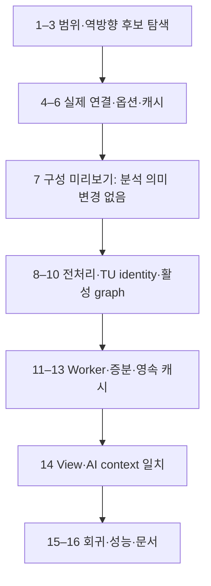

# Scope-first Make Build Context Implementation Plan

> **For agentic workers:** REQUIRED EXECUTION SKILL: Use superpowers:executing-plans by default for continuous inline implementation. Use superpowers:subagent-driven-development only when the user explicitly requested subagents or parallel agent work. Steps use checkbox (`- [ ]`) syntax for tracking.

**Goal:** 설정 Include 범위의 소스에서 가까운 Make 입력을 찾고 상위 폴더와 루트 빌드 스크립트로 출처를 확인하여, 확인된 파일별 빌드 조건을 기존 매크로·콜백 분석에 적용한다.

**Architecture:** 이미 발견한 C/H 경로를 탐색 시작점으로 재사용한다. 아래에서 위로 빌드 진입점 후보를 찾은 뒤 실제 script 호출·Make include·sub-make 관계를 따라 옵션을 계산하며, 파일별 환경과 근거를 캐시한다. 일반 Include/Exclude와 Smart 범위는 각각 소스 인덱싱과 상세 분석을 제한하고, Make 파일의 물리적 위치만으로 설정 의존성을 제거하지 않는다.

**Tech Stack:** 기존 TypeScript, Node.js, VS Code filesystem API, minimatch, web-tree-sitter/tree-sitter-c, node:test + tsx, 기존 Worker와 JSON 캐시. 새 패키지·compiler 실행·MCP 서버는 필요하지 않다.

---

## 0. 문서 상태와 최신 결정

- 작성 기준: 2026-10-25의 현재 작업 트리. HEAD `ddef1367a7e2bd967c674757912dd0f9b457260a` 이후 미커밋 변경을 포함한다.
- **구현 계획이며 제품 구현·테스트 통과 기록이 아니다.** 이번 작업은 이 문서와 선행 설계의 결정 요약만 갱신한다.
- 저장소 루트: `/Users/james_black/work/project/vscode_extension`. 아래 경로와 명령은 이 루트를 기준으로 한다.
- 선행 설계: [build-context-discovery-design.md](/Users/james_black/work/project/vscode_extension/docs/superpowers/specs/2026-10-25-build-context-discovery-design.md).
- 최신 사용자 합의가 선행 설계의 넓은 자동 탐색·기록 import 우선 제안보다 우선한다. `compile_commands.json`은 실제 프로젝트에 없고, 생성·로그 수집을 전제하지 않는다.
- 구현 계획을 요청한 세션이다. 이 문서를 작성한 것만으로 제품 코드 변경·설치·배포가 수행되었다고 보고하지 않는다.

### 채택한 기본안

1. `WorkspaceIndex.discover()`가 발견한 **일반 Include/Exclude 적용 후 C/H**의 디렉터리에서 시작한다. Smart Include는 상세 계산 대상을 정하며 일반 인덱스의 탐색 시작점을 몰래 줄이지 않는다.
2. 같은 디렉터리를 여러 소스가 공유하면 한 번만 조회한다. 가까운 Makefile·`.mk` 후보를 찾고 workspace 루트까지 필요한 조상 경로를 조사한다.
3. 가까운 `.mk`에서 옵션 일부를 찾았다고 완료하지 않는다. 선택된 진입점의 실제 호출/include 관계, cwd, 환경, 재정의 순서를 확인해야 그 소스의 유효 옵션으로 사용할 수 있다.
4. 루트의 `.sh/.bat/.cmd`와 Makefile 후보를 읽고 명시된 하위 script·`-f`·`-C`·Make include를 따라간다. 이름이 `make`라는 파일도 알려진 script 호출/`-f` 근거가 있으면 지원한다. 실행 파일 `make`를 이름만으로 Makefile로 읽지 않는다.
5. **발견한 진입점에 연결된 파일 관계는 제한 안에서 파악한다.** 분석 범위 밖 폴더라는 이유만으로 연결된 `.mk`를 생략하지 않는다. 별도의 관련성 추론·경로 가지치기 엔진은 만들지 않는다.
6. 알 수 없는 호출/변수/조건은 `partial`로 남긴다. 루트 이하 모든 파일을 무조건 재귀 검색해 완전성을 주장하지 않는다. 탐색으로 못 찾은 진입점은 기존 파일 선택 UI로 지정할 수 있게 한다.
7. 소스 편집은 저장된 build context를 재사용한다. script/Make/관련 설정·환경·response가 바뀔 때 해당 컨텍스트를 갱신한다.

### 이번 범위에서 제외

- shell/Make 전체 실행 의미의 재현, `make -n/-p` 자동 실행, 새 빌드 실행기.
- compiler 설치·builtin 자동 probe·Diab 문법 추측, 임의 ABI 모델.
- compile database/log import 전용 명령. 필요가 확인되면 별도 작은 변경으로 추가할 수 있으나 초기 완료 조건이 아니다.
- 자동 source scope 확장, callback 한도 증가, opaque-write 알고리즘 최적화, MCP/T32 구현.
- 구현 전에 시간 단축 비율을 약속하거나 실제 펌웨어 문제가 해결되었다고 판단하는 것.

## 1. 현재 코드 근거와 범위 규칙

| 근거 | 현재 책임 | 적용 원칙 |
|---|---|---|
| `src/workspace.ts:187`, `discover()` | 일반 C/H 파일 발견 | 결과 URI를 build 탐색 seed로 재사용 |
| `src/workspace.ts:297`, `scope()`; `:312`, `eligible()` | folder별 Include/Exclude | 일반 제외 파일은 build가 요구해도 자동 인덱싱하지 않음 |
| `src/workspace.ts:180`, `options()` | 파일별 상세 정책 | build context는 정책 입력을 대체하지 않음 |
| `src/analysis-policy.ts:28`, `smartAnalysisScope()`; `:33`, `resolveAnalysisPolicy()` | Smart/legacy 경계 | 새 scope matcher를 중복 작성하지 않음 |
| `src/analyzer.ts:104`, `analyze()`; `:399`, `derive()` | raw facts·macro·callback | 위치별 build 조건과 context ID 연결 |
| `src/project-analysis.ts:18`, `timeline()` | include/정의 시계열 | 준비된 TU별 이벤트·include 결과 재사용 |
| `src/analysis-worker.ts:17`; `src/relations.ts:43` | URI당 하나의 facts | 동일 header의 TU 변형이 충돌하지 않게 변경 |
| `src/incremental-analysis.ts:12`, `derive()` | dirty component 재사용 | context가 달라지면 다른 입력, dirty batch 예산은 공유 |
| `src/workspace.ts:176`, `analysisKey`; `src/analysis-cache.ts:29`, `AnalysisCache` | 저장/복원 | profile·설정 의존성을 호환성 키에 포함 |

### 파일 종류별 경계

| 입력 | 허용 동작 | 허용하지 않는 동작 |
|---|---|---|
| 일반 Include 안, 일반 Exclude 밖의 C/H | 기본 인덱싱 | Make 소속 미확인만으로 파일 삭제 |
| 위 범위 안이며 Smart 대상인 C/H | 기존 정책과 build 조건으로 상세 분석 | build가 호출한다는 이유로 Smart 밖 함수 전파 |
| 일반 인덱스 안, Smart 밖의 header | 기본 정의를 지원 자료로 사용 | header 함수 본문의 자동 상세 전파 |
| 일반 Include 밖 또는 Exclude 안의 header | 경로와 필요 사유 기록, unavailable 처리 | 암묵적 본문 읽기·인덱스 확장 |
| 선택된 Make/script가 참조한 `.mk`, response | 설정 자료로 읽기, 근거·해시 저장 | 그 부모 폴더의 C/H를 자동 인덱싱 |
| 확정적으로 다른 target 소속인 C | 기본 탐색 유지, 활성 build graph에서 분리 | 해당 정의를 활성 graph의 fallback으로 혼합 |
| build 소속 unknown인 C | 별도 미확정 기본 탐색 유지 | excluded로 확정하거나 활성 profile에 무표시 합류 |

`-I`는 compiler의 헤더 검색 경로이며 `dynsight.include`와 같은 설정이 아니다. `-I`로 찾은 header라도 일반 인덱스 경계를 넘어 읽지 않는 것이 초기 구현의 명시적 제한이다. 필요한 header가 막히면 설정 변경 필요를 표시하고 기존 설정은 그대로 둔다.

`dynsight.include=[]`는 일반 C/H 전체 후보, 명시적 `smartAnalysis.include=[]`는 상세 분석 없음이다. Exclude 우선, Windows 경로 처리, legacy migration을 그대로 유지한다.

## 2. 단계와 의존성



- **단계 A / Task 1–7:** 사용자에게 발견한 빌드 구성·근거·미확정을 보여 주는 독립적인 결과. C 분석 결과는 아직 바꾸지 않는다.
- **단계 B / Task 8–14:** 확인된 context를 실제 parser/IR/resolver/cache에 연결한다. Task 8만으로 제품 기능을 켜지 않는다.
- **단계 C / Task 15–16:** 정확도와 비용 비교. A만 통과하면 '빌드 구성 탐색 구현', B/C까지 통과해야 '분석에 적용'으로 보고한다.
- 같은 기능의 데이터 계약을 공유하므로 이 문서에서 순서대로 다룬다. MCP·빌드 실행기처럼 독립된 기능은 묶지 않는다.

## 3. 파일 구조와 계약

### 신규 파일

| 파일 | 책임 / 제안 export |
|---|---|
| `src/build-discovery.ts` | `discoverBuildEntries()`; source seed·조상 목록·진입점 후보·참조 파일 읽기 캐시 |
| `src/build-options.ts` | `extractStaticBuildOptions()`; 제한된 sh/cmd/Make 구문·호출 graph·근거 있는 argv |
| `src/build-context.ts` | 타입·`normalizeCompileContext()`·`fingerprintBuildInput()`·`sameBuildEpoch()` |
| `src/preprocessor-context.ts` | `preparePreprocessorContext()`·`maskInactive()`; 순서 있는 조건/include 환경 |
| `src/build-service.ts` | `registerBuildConfigurations()`; 후보 선택·파일 선택·persist·갱신 연결 |

테스트는 `test/build-discovery.test.ts`, `test/build-options.test.ts`, `test/build-context.test.ts`, `test/preprocessor-context.test.ts`, `test/build-context-analysis.test.ts`, `test/build-context-cache.test.ts`, `test/build-context-workspace.test.mjs`, `test/build-context-copilot.test.ts`로 나눈다. 성능 harness는 `test/build-context-performance.ts`를 사용한다. test 파일을 생성할 때마다 package.json의 명시적 `test`/`test:worker` 목록에도 등록한다.

### 공통 계약 — Task 1에서 타입을 추가

다음은 새 API의 계약이다. 현재 존재하는 함수로 오인하지 않는다. 런타임 파일은 이 문서 작성 시 만들지 않는다.

```ts
export type Resolution = 'resolved' | 'partial' | 'conflicting';
export type Membership = 'included' | 'excluded' | 'unknown';
export interface BuildEvidence {
  uri: string; line: number; expression: string;
}
export interface BuildIssue {
  code: string; message: string; evidence?: BuildEvidence;
}
export interface BuildFileSystem {
  readText(uri: string): Promise<string | undefined>;
  list(uri: string): Promise<readonly { uri: string; kind: 'file' | 'directory' | 'link' }[]>;
}
export interface BuildEntry {
  id: string; rootUri: string; entryUri: string; cwdUri: string;
  dialect: 'sh' | 'cmd' | 'make'; args: string[];
  evidence: BuildEvidence[];
}
export interface BuildDiscovery {
  entries: BuildEntry[]; candidates: string[]; dependencies: string[];
  missingCandidates: string[]; issues: BuildIssue[];
  counts: { directories: number; filesRead: number; bytesRead: number };
}
export interface CompileInvocation {
  profileId: string; sourceUri: string; outputUri?: string;
  cwdUri: string; argv: string[]; dialect: 'posix' | 'windows';
  evidence: BuildEvidence[];
}
export interface CompileUnitContext extends CompileInvocation {
  id: string; fingerprint: string; compiler: 'gcc' | 'diab' | 'unknown';
  status: Resolution; membership: Membership;
  macroActions: { kind: 'define' | 'undef'; name: string; replacement?: string }[];
  includeSearch: { kind: 'quote' | 'user' | 'system' | 'after'; uri: string }[];
  forcedInputs: { kind: 'macros' | 'header'; uri: string }[];
  builtins: 'known' | 'partial' | 'unknown';
  dependencies: { uri: string; digest: string }[]; issues: BuildIssue[];
}
export interface BuildProfile {
  id: string; entry: BuildEntry; fingerprint: string;
  units: CompileUnitContext[]; coverage: 'complete' | 'partial' | 'unknown';
  dependencies: { uri: string; digest: string }[];
  relevantEnvironment: string[]; issues: BuildIssue[];
}
export interface BuildEpoch {
  profileId: string; fingerprint: string; contextRevision: number; sourceRevision: number;
}
```

API 입력·출력:

- `discoverBuildEntries(fs, {rootUri, sourceUris, explicitEntryUri?}, shouldCancel?) → Promise<BuildDiscovery>`.
- `extractStaticBuildOptions(fs, entry, sourceUris, environment) → Promise<BuildProfile>`. environment는 호출 측에서 제공한 값이며 참조된 값만 사용한다. 전체 환경 값을 로그에 남기지 않는다.
- `normalizeCompileContext(invocation, fs) → Promise<CompileUnitContext>`. 알 수 없는 compiler argv는 보존하고 미확인 옵션을 추측해 해석하지 않는다.
- `fingerprintBuildInput(value: unknown) → string`. 배열 순서는 유지하고 object key만 정규화하여 SHA-256으로 계산한다.
- `sameBuildEpoch(a: BuildEpoch, b: BuildEpoch) → boolean`.

위 다섯 줄의 설명은 각각 입력·출력 계약이며 API 이름은 구현 작업 전체에서 동일하게 사용한다. 제품 설명과 UI 문구는 기존 언어·스타일에 맞춘다.

### 작업별 검증 규칙

각 Task는 아래 checkbox 순서로 실행한다. 표에 여러 fixture가 있으면 한 fixture씩 red → 최소 구현 → green을 반복하고 전체 기능을 한 번에 작성하지 않는다.

- `node_modules/.bin/tsx --test <test-file>`: 새 테스트의 실패를 먼저 확인한다. import 오류 다음에는 실제 기대 결과가 틀려 실패하는 red도 확인한다.
- `npm run typecheck`: 새 계약·기존 호출부 연결을 확인한다.
- 파일 변경 checkpoint는 `git diff -- <task-files>`로 검토한다. 이미 변경된 파일이 많으므로 `git add .`를 사용하지 않는다. 실행 시 commit이 허용된 작업이면 검토한 자기 변경 hunk만 `git add -p` 후 Task별 commit을 만든다. 이 계획 작성에서는 commit하지 않는다.

## Task 1: 범위 경계와 build context의 최소 계약

**Files:** Create `src/build-context.ts`, `test/build-context.test.ts`; Modify `test/analysis-policy.test.ts`, `package.json`.

- [ ] Step 1: 기존 scope 회귀에 다음 테스트를 추가한다. 이는 현재도 통과해야 하며 이후 build integration에서 깨지면 안 된다.

```ts
test('build metadata must not widen the existing Smart scope', () => {
  assert.deepEqual(resolveAnalysisPolicy('App/main.c', ['App/**'], undefined, false, ['App/generated/**']),
    { expandMacros: true, propagateCallbacks: true });
  assert.deepEqual(resolveAnalysisPolicy('SDK/driver.c', ['App/**'], undefined, false),
    { expandMacros: false, propagateCallbacks: false });
  assert.deepEqual(resolveAnalysisPolicy('App/generated/task.c', ['App/**'], undefined, false, ['App/generated/**']),
    { expandMacros: false, propagateCallbacks: false });
});
```

- [ ] Step 2: `fingerprintBuildInput()`가 동일 object key 순서 차이는 같게, `['-DX=1','-UX']`와 역순은 다르게 만드는 테스트를 작성하고 `node_modules/.bin/tsx --test test/build-context.test.ts`로 실패 확인.
- [ ] Step 3: 위 공통 타입과 fingerprint 구현만 추가한다. 배열 순서는 유지하고 object key는 정렬하며 JSON 호환 값만 받는다. `sameBuildEpoch()`는 아래 구현을 사용한다.

```ts
export function sameBuildEpoch(a: BuildEpoch, b: BuildEpoch) {
  return a.profileId === b.profileId && a.fingerprint === b.fingerprint &&
    a.contextRevision === b.contextRevision && a.sourceRevision === b.sourceRevision;
}
```

- [ ] Step 4: 두 test 파일과 typecheck 통과. build context가 아직 Workspace 분석에 전달되지 않는지 확인.
- [ ] Step 5: diff checkpoint. 권장 commit 제목 `feat: define build context identity and scope boundaries`.

## Task 2: 소스 경로에서 조상 방향으로 후보 탐색

**Files:** Create `src/build-discovery.ts`, `test/build-discovery.test.ts`; Modify `package.json`.

- [ ] Step 1: memory filesystem fixture를 test 안에 만든다. `list()`/`readText()` 호출 횟수와 읽은 URI를 기록하여 동작뿐 아니라 불필요한 재탐색도 검사한다.
- [ ] Step 2: 아래 파일을 넣고 sourceUris를 `file:///p/App/src/main.c`, `file:///p/App/src/other.c`로 전달한다.

```text
/p/build.bat                 @echo off\nmake -f Makefile PRODUCT=A
/p/Makefile                  include App/module.mk
/p/App/module.mk             SOURCES := App/src/main.c App/src/other.c
/p/App/src/main.c            void main_task(void){}
/p/App/src/other.c           void other(void){}
/p/Unrelated/deep/build.mk   CFLAGS := -DWRONG=1
```

기대: `App/src`, `App`, `p`의 directory listing 각 1회, `module.mk`·루트 Makefile·build.bat 후보 발견, `Unrelated/deep` 재귀 탐색 0회, `file:///` 조사 0회. `.mk` 후보만으로 entry 적용 상태를 resolved로 만들지 않는다.

- [ ] Step 3: `node_modules/.bin/tsx --test test/build-discovery.test.ts`로 red 확인.
- [ ] Step 4: URI parent 연산을 사용해 source 부모 집합에서 root까지 고유 ancestor 목록을 만든다. root containment를 path segment 기준으로 판정하고 문자열 prefix로 `/p`와 `/p2`를 혼동하지 않는다. 디렉터리 목록에서 GNUmakefile/makefile/Makefile/`*.mk`를 찾고 root에서는 `.sh/.bat/.cmd`도 찾는다. 일반 Exclude를 build metadata 목록에 다시 적용하지 않는다.
- [ ] Step 5: 중첩 루트·Windows drive/UNC·URI 공백·source 없음·취소 fixture 추가. source가 없으면 root의 직접 후보만 확인하며 하위 전체 탐색으로 전환하지 않는다. 초기 내부 상한은 방문 항목 20,000, 텍스트 1MiB/file, 참조 깊이 32. 상한 결과는 `discovery-limited` 진단이다. 자동 symlink 순회는 하지 않고 명시 참조는 중복·cycle 검사 후 처리한다.
- [ ] Step 6: green + typecheck + diff checkpoint. 권장 commit `feat: discover nearby Make inputs from indexed source paths`.

## Task 3: 실제 script/include/sub-make 연결 추적

**Files:** Modify `src/build-discovery.ts`; Create `src/build-options.ts`, `test/build-options.test.ts`; Modify `package.json`.

- [ ] Step 1: 다음 fixture에서 source가 가까운 Makefile에 물리적으로 인접해도 호출되지 않으면 옵션 출처로 채택되지 않는 테스트를 작성한다.

```text
/p/build.sh           make -f build/main.mk BOARD=A
/p/build/main.mk      include ../config/common.mk
/p/App/Makefile       CFLAGS := -DWRONG=1
/p/config/common.mk   CFLAGS += -DBOARD_A
```

`build/main.mk`의 include 경로는 그 파일의 폴더로 자동 바꾸지 않는다. **Make의 현재 작업 디렉터리**와 알려진 include 검색 옵션으로 해석한다. 위 입력은 cwd `/p`라면 `/config/common.mk`를 찾게 되어 missing이어야 한다. `include config/common.mk`로 고친 fixture에서만 `/p/config/common.mk`를 읽는 것이 green 조건이다.

- [ ] Step 2: sh `cd build; make -f main.mk`와 `make -C build -f main.mk`를 각각 독립 statement fixture로 추가한다. 해당 cwd에서는 `include ../config/common.mk`가 `/p/config/common.mk`로 연결되어야 한다. command 문자열에 semicolon을 지원하지 않으면 두 줄 형태를 지원하고 합성 statement는 partial로 남긴다.
- [ ] Step 3: `node_modules/.bin/tsx --test test/build-options.test.ts`로 red 확인.
- [ ] Step 4: 인용·주석·줄 연결을 보존하는 tokenizer를 작성하고 지원되는 호출만 graph edge로 만든다. edge에는 from/to/cwd/args/condition/evidence를 보관한다. 명시적 `sh/bash/call/source/.`, `make/$(MAKE) -f/-C`, `include/-include/sinclude`를 구분한다. 여러 `-f`는 순서를 유지한다. 동적 목적지는 문자열과 unknown 사유를 보관한다.
- [ ] Step 5: parse cache는 `(uri, digest, dialect)`, 실행 문맥 방문은 `(uri, cwd, args, relevant-env, target)`으로 구분한다. 동일 파일을 다른 환경에서 include한 경우를 cycle로 오인하지 않는다. 읽기·파싱은 재사용하지만 문맥별 옵션을 덮어쓰지 않는다.
- [ ] Step 6: 순환 include, 상수 경로의 확장자 없는 script, root 밖 명시 설정 입력, `.git` 자동 발견 제외 fixture로 green. root 밖 의존성은 출처를 남기고 부모 디렉터리 전체를 탐색하지 않는다. 권장 commit `feat: trace build entry dependencies with provenance`.

## Task 4: 제한된 script·Make 변수 계산

**Files:** Modify `src/build-options.ts`, `test/build-options.test.ts`.

- [ ] Step 1: 아래 matrix를 한 사례씩 테스트로 추가한다. 각 사례는 `extractStaticBuildOptions()`의 `units[].argv`, `status`, `issues`를 검사한다.

| 입력 | 기대 |
|---|---|
| sh `BOARD=A`, `export BOARD`, `make BOARD=$BOARD` | A를 전달 |
| cmd `set BOARD=A`, `call build\next.bat %BOARD%` | 인자·caller cwd 보존 |
| cmd `setlocal/endlocal` | 지역 변경이 scope 밖에 남지 않음 |
| `A=$(B)` 후 `B=2` | A 사용 시 2 |
| `A:=$(B)` 후 `B=2` | A 대입 당시 값. B가 미확정이면 unknown 유지 |
| `?=`·`+=`, command-line `BOARD=A` | 정의 유무·변수 flavor·override 우선순위 보존 |
| target-specific CFLAGS·`override`·`eval` | 초기 미지원이면 영향받는 unit partial |
| `$(shell ...)`, backticks, `$(...)` shell 치환 | 실행 0회, unresolved |
| 필수 `%1`/`$1` 미제공 | 빈 값 대입 금지, 인자 필요 |

- [ ] Step 2: `node_modules/.bin/tsx --test test/build-options.test.ts`에서 새 fixture가 실패하는지 확인.
- [ ] Step 3: Make 변수는 `{flavor:'recursive'|'simple', value, origin, evidence}`로 보관한다. 알려진 단순 참조만 확장하고 cycle/depth/operation 상한에 걸리면 partial. command-line 변수, 환경, Make 대입의 지원된 우선순위만 적용한다. `-e` 등 미지원 의미는 숨기지 않는다. ifeq/ifneq/ifdef/ifndef는 값이 확정된 경우에만 선택한다.
- [ ] Step 4: explicit source/object 목록과 단순 `%.o: %.c`·`$@/$<`만 연결한다. 계산하지 못한 source 목록은 coverage partial이다. 각 recipe의 compiler argv를 얻지 못하면 단지 CFLAGS를 발견했다는 이유로 resolved unit을 만들지 않는다.
- [ ] Step 5: 미확정 statement가 후속 옵션을 바꿀 수 있으면 그 뒤의 해당 환경을 오염 표시한다. 앞에서 알던 `BOARD`를 계속 확정값으로 사용하지 않는다. 지원하지 않는 명령을 실행해서 해결하지 않는다.
- [ ] Step 6: 전체 matrix green 및 typecheck. 권장 commit `feat: evaluate bounded static build options conservatively`.

## Task 5: 파일별 compiler 옵션과 구성 identity

**Files:** Modify `src/build-context.ts`, `src/build-options.ts`, `test/build-context.test.ts`, `test/build-options.test.ts`.

- [ ] Step 1: 다음 대표 테스트를 추가한다. import는 `node:test`, `node:assert/strict`, `normalizeCompileContext`를 사용한다.

```ts
test('define and undef order is preserved per compile unit', async () => {
  const fs = { readText: async () => undefined, list: async () => [] };
  const unit = await normalizeCompileContext({ profileId: 'A', sourceUri: 'file:///p/a.c',
    cwdUri: 'file:///p/', argv: ['gcc', '-DX=1', '-UX', '-DX=0', '-Iinc', '-c', 'a.c'],
    dialect: 'posix', evidence: [] }, fs);
  assert.deepEqual(unit.macroActions, [
    { kind: 'define', name: 'X', replacement: '1' },
    { kind: 'undef', name: 'X' },
    { kind: 'define', name: 'X', replacement: '0' }
  ]);
  assert.equal(unit.builtins, 'unknown');
});
```

- [ ] Step 2: `node_modules/.bin/tsx --test test/build-context.test.ts`로 red.
- [ ] Step 3: GCC의 확인된 `-D/-U`, include 종류, forced inputs를 정규화한다. macro action 순서·include 종류 내부 순서·GCC forced-input 처리 단계는 보존한다. compiler·language·target·std·sysroot·원본 argv도 fingerprint에 남긴다. 모르는 옵션이 전처리에 영향을 줄 수 있으면 partial이다.
- [ ] Step 4: response 파일은 확인된 dialect에 대해서만 최대 depth 8·cycle·digest를 적용한다. wrapper가 추가 옵션을 숨기거나 Diab 전용 옵션을 확인하지 못하면 원문과 사유를 남긴다. Diab를 GCC로 위장하지 않는다. 실제 Diab 버전 문서·샘플을 확보하기 전에는 해당 의미 테스트를 통과했다고 보고하지 않는다.
- [ ] Step 5: 같은 source에 서로 다른 argv/output이 있는 fixture로 두 unit 보존을 확인한다. 순서만 다른 같은 효과 옵션의 과도한 semantic dedup은 초기에는 하지 않는다. 완전한 선택 target source graph를 증명한 경우만 coverage complete; 수집한 파일 목록이 작다는 이유로 다른 파일을 excluded로 만들지 않는다.
- [ ] Step 6: green + typecheck + diff checkpoint. 권장 commit `feat: retain per-file compile contexts and uncertainty`.

## Task 6: 설정 탐색 캐시와 변경 의존성

**Files:** Modify `src/build-discovery.ts`, `src/build-options.ts`, `src/build-context.ts`; Create `test/build-context-cache.test.ts`; Modify `package.json`.

- [ ] Step 1: 100개 source가 같은 `.mk`를 쓰는 fixture를 만든다. 최초 read 1회/parse 1회, 동일 요청 warm에서는 설정 파일 재파싱 0회, C 텍스트만 변경하면 metadata 재탐색 0회를 검사한다.
- [ ] Step 2: `node_modules/.bin/tsx --test test/build-context-cache.test.ts`로 red.
- [ ] Step 3: raw 텍스트는 파싱 후 필요하지 않으면 해제하고 요약·digest·provenance·직접 의존성만 유지한다. in-flight read promise도 공유한다. source seed directory 집합 변경, profile 인자 변경, 관련 환경 변경은 후보/옵션 캐시 키를 바꾼다.
- [ ] Step 4: 존재하지 않던 `module.mk`·더 가까운 Makefile·root script가 생성될 때 재발견되도록 탐색한 directory를 negative dependency로 기록한다. 이벤트 유실 가능성이 있는 재시작/수동 refresh에서는 digest를 검증한다. 활성 세션의 C 편집마다 모든 설정 digest를 재계산하지 않는다.
- [ ] Step 5: cache가 없는 source만 추가되면 그 ancestor 집합만 조사하고 기존 목록을 재사용한다. scope 축소 시 공유 의존성은 다른 consumer가 남으면 유지한다. 누적 context가 무제한 남지 않게 현재 후보/선택 context의 참조 수로 정리한다.
- [ ] Step 6: warm·수정·생성·삭제·취소·multi-root fixture green. 권장 commit `perf: reuse build metadata across source indexing`.

## Task 7: 단계 A 사용자 기능 — 후보와 근거 미리보기

**Files:** Create `src/build-service.ts`; Modify `src/extension.ts:20`, `src/workspace.ts:187`, `package.json`, `test/extension.test.ts`; Create `test/build-context-workspace.test.mjs`.

- [ ] Step 1: 기존 `test/workspace.test.mjs`의 esbuild/vscode mock 방식으로 read-only discovery adapter 테스트를 추가한다. 일반 Include/Exclude를 적용한 URI만 seed로 전달하고, build metadata 읽기 때문에 `eligible()` 결과가 늘지 않는지 확인한다.
- [ ] Step 2: `node --test test/build-context-workspace.test.mjs`에서 red.
- [ ] Step 3: `registerBuildConfigurations(context, workspace)`를 추가한다. 명령은 `dynsight.selectBuildConfiguration`, `dynsight.refreshBuildConfiguration` 두 개만 제공한다. 후보 목록에 `빌드 진입 파일 선택…` 항목을 넣어 탐색되지 않은 기존 파일을 지정할 수 있게 한다. import 명령이나 별도 설정 wizard는 만들지 않는다.
- [ ] Step 4: 첫 후보 선택은 출처·필수 인자를 보여 준다. 복수 후보를 자동 합치지 않고 기존 선택은 유지한다. 취소는 상태를 변경하지 않는다. 선택값은 workspaceState에 root별로 저장하며 설정 Include/Exclude는 쓰지 않는다.
- [ ] Step 5: 단계 A에서는 `옵션 확인됨 / 일부 미확정 — 분석 적용 전`을 표시한다. 원본 파일 경로·명령 근거를 열 수 있게 하고 compiler 버전·환경을 추측하지 않는다. 시작 시 기본 Index ready를 metadata 탐색 완료까지 막지 않는다. background 작업 완료 후 미리보기만 갱신한다.
- [ ] Step 6: test 등록·typecheck·adapter green. 단계 A 구현 후 실제 화면 검증은 별도 Extension Development Host에서 수행한다. 권장 commit `feat: preview build configurations without widening analysis`.

## Task 8: 위치별 조건 평가와 원본 위치 보존

**Files:** Create `src/preprocessor-context.ts`, `test/preprocessor-context.test.ts`; Modify `package.json`.

- [ ] Step 1: `maskInactive(text, ranges)` 테스트를 작성한다. 원본 길이·CR/LF·Unicode 뒤 offset이 유지되고 inactive 내용만 공백이 되는지 확인한다.

```ts
export function maskInactive(text: string, ranges: readonly { start: number; end: number }[]) {
  const chars = text.split('');
  for (const { start, end } of ranges)
    for (let n = start; n < end; n++) if (chars[n] !== '\n' && chars[n] !== '\r') chars[n] = ' ';
  return chars.join('');
}
```

- [ ] Step 2: `preparePreprocessorContext(unit, fs, sourceText, control)`를 제안 API로 정의한다. control은 `{shouldCancel?, workBudget, eligibleHeader(uri)}`이고 결과는 각 include occurrence의 `{key, uri, entryEnvironmentFingerprint, maskedText, inactive, events, conditions, resolvedIncludes}`와 dependencies/issues다. conditions는 위치별 true/false/unknown와 기존 MacroBranch identity를 보관한다. 범위가 막힌 헤더는 fs 읽기 전에 차단한다.
- [ ] Step 3: 아래 소스에 unit macroActions `define FLAG=0`을 넣는 실패 테스트를 작성한다.

```c
#ifdef FLAG
void defined_zero(void) {}
#endif
#if FLAG
void inactive(void) {}
#endif
#undef FLAG
#define FLAG 1
#if FLAG
void active_after_redefine(void) {}
#endif
```

기대: `defined_zero`·`active_after_redefine`만 active, 원본 offset 불변. 기본 환경 unknown 상태에서 `#if UNKNOWN_BUILTIN`은 양쪽 보존. `-U UNKNOWN_BUILTIN`이면 그 이름의 부재만 확정한다.

- [ ] Step 4: `node_modules/.bin/tsx --test test/preprocessor-context.test.ts` red 후 기존 `tokenizeC()`를 재사용한 directive scanner를 추가한다. source 순서로 define/undef/include를 처리하며 전역 최종 map으로 과거 분기를 재평가하지 않는다. 최소 식은 defined·정수 literal·객체 alias·괄호·!·비교·&&/||다. 작은 정수의 확정 가능한 연산만 평가하고 overflow/width/문자 상수/미지원 함수 macro는 unknown이다. JS eval은 사용하지 않는다.
- [ ] Step 5: unknown 분기의 환경을 기존 branch correlation과 연결하고 cap·취소·메모리 보호를 적용한다. 같은 predicate 재사용과 재정의 이후 새 predicate를 구분한다. scan 비용은 공유 work budget의 macros로 기록하며 preprocess 단계 소비량도 diagnostics에서 분리 관측한다.
- [ ] Step 6: true/false/unknown, source 순서, 누락 header, repeated condition, `skipInactive=false` fixture green. 권장 commit `feat: prepare source-ordered build preprocessor facts`.

## Task 9: include 검색과 TU별 header identity

**Files:** Modify `src/preprocessor-context.ts`, `src/model.ts`, `src/analyzer.ts:104`, `src/type-info.ts:22`, `src/flow-parser.ts:10`, `src/initializer-preprocessor.ts:14`; Create `test/build-context-analysis.test.ts`.

- [ ] Step 1: 다음 두 TU가 같은 header를 다르게 읽는 fixture를 추가한다.

```c
/* ops.h — a.c: MODE=1, b.c: MODE=2 */
typedef void (*CB)(void);
void first(void); void second(void);
#if MODE == 1
static CB saved = first;
#else
static CB saved = second;
#endif
static void invoke(void) { saved(); }
```

기대: a의 invoke→first, b의 invoke→second; saved/invoke의 semantic ID는 다르고 원본 URI/offset은 같다. 한 TU에서 undef 후 재include하는 경우 entry environment에 따른 occurrence를 구분한다. include guard 때문에 두 번째 include가 비활성이면 facts를 중복 생성하지 않는다.

- [ ] Step 2: `node_modules/.bin/tsx --test test/build-context-analysis.test.ts`에서 red.
- [ ] Step 3: source text 저장과 contextual facts를 분리한다. `FileAnalysis`에 선택적인 context metadata `{profileId, unitId, factKey, environmentFingerprint}`를 추가한다. legacy의 `uri`는 그대로 원본 URI다. `sourceId=uri#offset`는 navigation용으로 유지하고 semantic ID는 `(profileId, unitId, occurrence, sourceId)`의 안정적 조합으로 생성한다.
- [ ] Step 4: `analyze()`의 optional 5번째 인자로 prepared occurrence를 전달한다. `file.text`는 원본, parser는 maskedText를 사용한다. Symbol ID만 바꾸지 말고 CType aggregate/member IDs, locals/params, FlowProgram IDs, global initializers, references/owners/targets, macro·flow keys를 모두 같은 identity factory로 만든다. 기존 `flowFacts(namespace)`를 활용하고 URI 문자열에 가짜 query를 붙이지 않는다.
- [ ] Step 5: quote/user/system/after의 확인된 검색 순서와 forced inputs를 처리한다. unknown 검색 구간보다 앞에서 발견된 header만 확정하고, 막힌/없는 선행 후보를 건너뛰어 뒤쪽 동명 header를 확정하지 않는다. 동일 resolved include 정보를 모든 소비자에게 전달한다.
- [ ] Step 6: raw parse·initializer recovery·Flow IR·macro timeline에서 같은 조건 결과를 사용하게 한다. `skipInactive=false`는 모든 분기 보기라는 기존 의미를 유지한다. green + typecheck. 권장 commit `feat: preserve translation-unit identities and header conditions`.

## Task 10: 활성 구성의 RelationIndex와 macro propagation

**Files:** Modify `src/relations.ts:42`, `src/member-resolver.ts`, `src/project-analysis.ts:18`, `src/analyzer.ts:391`, `src/function-arguments.ts`, `src/explicit-callbacks.ts`, `src/pointer-targets.ts`; Modify `test/build-context-analysis.test.ts`.

- [ ] Step 1: 동일 이름의 port A/B 함수가 있고 선택된 target에 A만 들어가는 fixture를 작성한다. B는 일반 탐색에는 남아도 A caller의 direct/inferred 후보에는 나타나지 않아야 한다. coverage partial의 미관찰 파일은 excluded로 표시하면 안 된다.
- [ ] Step 2: `node_modules/.bin/tsx --test test/build-context-analysis.test.ts`에서 red.
- [ ] Step 3: `RelationIndex.files`의 source lookup과 새 `facts`의 factKey lookup을 분리한다. byName/reference/FileBuckets 기여 키도 factKey로 바꾼다. semantic resolution은 선택 profile/unit/linkage 가시성을 사용하고 기본 탐색 facts를 build resolution fallback에 합치지 않는다. 별도 기본 탐색 projection을 유지한다.
- [ ] Step 4: header static/local은 TU 안에서만 연결하고 extern 선언/정의는 같은 활성 profile의 다른 TU와 연결한다. `visibleFiles()`와 MemberResolver에도 같은 contextual include 경로를 사용한다. 이름만 같은 서로 다른 실행 이미지의 linkage를 확정하지 않는다.
- [ ] Step 5: `timeline()`과 `deriveMacroCalls()`는 prepared events/masked active body를 사용하고 context fingerprint를 cache key에 넣는다. 기본 bind·FunctionArguments·explicit registration·pointer propagation이 모두 factKey를 사용하도록 URI-only map 사용처를 검색하여 교체한다. 정책 밖 함수 body는 기존 out-of-scope로 남긴다.
- [ ] Step 6: 등록 off/on fixture에서 propagation off이면 활성 `registered` 사실은 유지되고 callback work는 0, on이면 실제 간접 호출 위치에만 inferred가 추가되는지 확인한다. `registered`를 호출 증거로 승격하지 않는다. 권장 commit `feat: resolve relations within the selected build context`.

## Task 11: Worker와 workspace 세대 전환

**Files:** Modify `src/analysis-worker.ts`, `src/workspace.ts`, `src/diagnostics.ts`; Modify `test/build-context-workspace.test.mjs`, `test/analysis-worker.test.mjs`.

- [ ] Step 1: mock Worker가 A 분석 결과를 보류한 상태에서 B 선택 후 A 응답을 보내는 테스트를 추가한다. A의 일반 응답뿐 아니라 basic-result·progress·diagnostics도 B 상태를 덮어쓰면 안 된다.
- [ ] Step 2: `node --test test/build-context-workspace.test.mjs` red.
- [ ] Step 3: request/response에 BuildEpoch를 붙이고 `sameBuildEpoch()`로 수신 시 검증한다. raw/versions/snapshot 키는 factKey, 원본 편집 버전은 source URI별로 관리한다. 한 source 변경은 그 source를 쓰는 모든 context에 전달한다. header 삭제는 실제 consumer를 무효화한다.
- [ ] Step 4: profile 변경 시 진행 중 derive를 취소하고 새 snapshot을 준비한 뒤 일괄 적용한다. 완료 전 UI는 준비 중으로 표시한다. callback/function budget을 TU마다 새로 만들어 제한을 곱하지 않는다. 기존 progressive batch 정책을 유지한다.
- [ ] Step 5: 일반 설정 변경은 seed/eligible + affected analysis, Smart 변경은 detailed policy + derived, C 편집은 source/dependents, build metadata 변경은 context/dependents만 갱신한다. root별 workspace 설정과 이벤트를 구분한다.
- [ ] Step 6: `npm run typecheck`, `npm run test:worker` 실행 후 profile A→B→A, 설정 좁힘/넓힘, dirty editor, cancellation 테스트 통과. 이 단계 전후 build는 Extension bundle 생성이며 사용자의 펌웨어 빌드 실행이 아니다. 권장 commit `feat: isolate build analysis generations in the worker`.

## Task 12: contextual 증분 재사용

**Files:** Modify `src/incremental-analysis.ts`, `test/incremental-analysis.test.ts`, `test/build-context-analysis.test.ts`.

- [ ] Step 1: 두 독립 TU 중 한쪽의 옵션만 바뀌면 해당 컴포넌트만 재도출되는 테스트를 작성한다. inactive branch의 raw `##`만으로 모든 TU가 연결되지 않는 known-condition fixture도 추가한다.
- [ ] Step 2: `node_modules/.bin/tsx --test test/incremental-analysis.test.ts test/build-context-analysis.test.ts` red.
- [ ] Step 3: results/seed/components의 URI key를 factKey로 바꾸고 context·prepared dependency를 입력 identity에 포함한다. dependency uses/provides는 active facts와 unknown 근거를 사용한다. 미해결 token paste·외부 alias는 보수적 연결을 유지한다.
- [ ] Step 4: dirty components를 한 번에 derive하는 기존 정책을 유지한다. cold/warm 결과의 관계·불완전성·원본 위치가 같아야 한다. memory/cancel limited 결과를 안정 cache로 seed하지 않는다.
- [ ] Step 5: green 및 기존 budget 테스트 통과. 권장 commit `perf: reuse unchanged contextual analysis components`.

## Task 13: 영속 캐시와 새 의존성 생성

**Files:** Modify `src/analysis-cache.ts`, `src/workspace.ts:176`, `src/analysis-worker.ts`; Modify `test/build-context-cache.test.ts`, `test/analysis-cache-worker.test.mjs`.

- [ ] Step 1: A→B→종료→A 복원의 관계가 cold A와 같은지, source 해시가 같아도 mk/response/forced header가 바뀌면 cache miss인지 테스트한다. include 앞쪽 검색 경로에 새로운 동명 header가 생기는 경우도 추가한다.
- [ ] Step 2: `node_modules/.bin/tsx --test test/build-context-cache.test.ts` red.
- [ ] Step 3: `storageUri/build-context`에 선택 profile과 dependency manifest를 저장하고 기존 generation cache를 profile별로 분리한다. profile ID와 내용 fingerprint는 구분한다. 원본 text를 TU 수만큼 JSON에 중복 저장하지 않도록 source payload와 fact records를 구분한다.
- [ ] Step 4: cache schema/analysis semantic version을 이 변경 시점에 올린다. old URI-only record를 contextual record로 hydrate하지 않는다. key에는 build 해석기 버전·profile/fact fingerprint·source digest·정책·positive/negative dependencies를 넣는다.
- [ ] Step 5: watcher는 실제 읽은 설정 입력과 탐색했던 directory에만 연결한다. root 전체 변경마다 재파싱하지 않는다. source 미저장·취소·부분 실패 snapshot 저장 제한은 기존 정책을 유지한다. 재시작 시 의존성 내용을 검증한다.
- [ ] Step 6: `npm run test:worker`와 cache suite green. 권장 commit `feat: persist and validate build-specific analysis caches`.

## Task 14: Relation/Context View와 AI의 구성 일치

**Files:** Modify `src/view.ts:109`, `src/view-state.ts`, `webview/main.ts`, `src/copilot-service.ts`, `src/copilot-context.ts`, `src/callback-overrides.ts`; Create `test/build-context-copilot.test.ts`; Modify `test/extension.test.ts`, `package.json`.

- [ ] Step 1: 같은 header offset에 두 TU 후보가 있을 때 마지막 처리 TU를 자동 선택하지 않는 테스트, profile 변경 후 진행 중 AI 응답을 버리는 테스트를 추가한다.
- [ ] Step 2: `node_modules/.bin/tsx --test test/build-context-copilot.test.ts` red. UI는 기존 host test 안에서 resolveAt/callbackAt 후보 선택 결과를 확인한다.
- [ ] Step 3: `resolveAt(uri, offset, unitId?)`와 `callbackAt(uri, offset, unitId?)`에 선택 context를 전달한다. unit 미선택이고 여러 의미가 있으면 기존 picker 방식으로 선택한다. preview는 원본 URI/text를 사용한다.
- [ ] Step 4: 상태는 빌드 구성, 옵션 확인/미확정, 기본/Smart 범위, propagation 진행/제한을 분리해 표시한다. '빌드 설정 확인'을 '콜백 분석 완전'으로 표현하지 않는다.
- [ ] Step 5: AI snapshot/settings/cache key에 profile/fact fingerprint를 넣고 supporting evidence도 해당 context로 제한한다. 사용자 override는 profile 변경 시 재검증해 needs-review/inactive로 표시한다. Smart Copilot 범위·사용자 활성화 설정은 유지한다. 새 MCP API는 만들지 않는다.
- [ ] Step 6: AI/override suite 및 Extension host tests green, 두 View가 같은 선택 profile/TU를 보여 주는지 실제 확인. 권장 commit `feat: keep views and AI evidence aligned with build context`.

## Task 15: macro propagation의 효과와 한계 검증

**Files:** Modify `test/build-context-analysis.test.ts`, `test/macros.test.ts`, `test/callback-effects.test.ts`, `test/explicit-callbacks.test.ts`; Create `test/build-context-performance.ts`; Modify `package.json`, `src/diagnostics.ts`의 필요한 계측 필드만.

- [ ] Step 1: 독립 조건 F0…F5의 macro fixture를 만들고 unknown 구성과 모두 1인 구성을 비교한다. 기존 fixture의 정상 상관관계 보존을 깨뜨려 대안 수를 부풀리지 않는다.

```ts
const branchSource = Array.from({ length: 6 }, (_, n) =>
  `#if F${n}\n#define PICK${n}() yes${n}()\n#else\n#define PICK${n}() no${n}()\n#endif\n`
).join('') + Array.from({ length: 6 }, (_, n) =>
  `void yes${n}(void){} void no${n}(void){}`
).join('') + 'void run(void){' + Array.from({ length: 6 }, (_, n) => `PICK${n}();`).join('') + '}';
```

known 구성은 run의 활성 변형 1개·yes0…yes5만 호출, unknown 구성은 기존 대안 한도·불완전성 유지가 기대 결과다. 양쪽 원본 호출 위치와 매크로 근거도 비교한다.

- [ ] Step 2: `node_modules/.bin/tsx --test test/build-context-analysis.test.ts test/macros.test.ts test/callback-effects.test.ts test/explicit-callbacks.test.ts`를 실행한다. 의미 실패부터 고치고 한도 숫자는 바꾸지 않는다.
- [ ] Step 3: 실제 257 callback field 제한, nested container leaf 효과, numeric selector, compound RHS 부작용, propagation off의 등록 경로를 재검증한다. 설정으로 비활성인 후보 감소와 실제 활성 코드 자체의 전파 한계를 구분한다.
- [ ] Step 4: performance harness는 memory filesystem 고정 fixture로 A=넓은 source/B=동일 build source만/C=B+build context를 실행한다. metadata discovery/extraction과 parser/macro/callback 시간을 따로 기록한다. 새 npm 명령 `test:build-context-performance`는 `tsx test/build-context-performance.ts`로 등록한다.
- [ ] Step 5: 다음 수치를 JSON 출력한다: directory/list/read/parse 횟수, bytesRead, metadata peak heap, TU/header occurrence 수, macro variants/parser 재호출 수, macro/callback work, 단계별 시간, 전체 관계 레코드·제한 사유. warm source edit에서 metadata 재탐색/재파싱 0이 필수 gate다. 성능 수치는 5회 반복의 중앙값과 범위를 기록하되 임의 속도 향상 임계값은 만들지 않는다.
- [ ] Step 6: `npm run test:build-context-performance` 실행 후 의미 결과가 동일한 비교끼리만 비용을 비교한다. 실제 펌웨어가 없으면 synthetic 결과로 표시한다. 권장 commit `test: measure build context precision and indexing overhead`.

## Task 16: 통합 gate와 사용자 문서

**Files:** Modify `README.md`, `USER_GUIDE.md`, `package.json`; Create `docs/reviews/2026-10-25-build-context-validation.md` **구현 검증이 실제 수행된 시점에만**.

- [ ] Step 1: 새 TS test가 `npm test`, mjs adapter가 `test:worker`에 모두 등록되었는지 확인한다. WASM unit test는 `node_modules/web-tree-sitter/web-tree-sitter.wasm`, `node_modules/tree-sitter-c/tree-sitter-c.wasm`를 사용해 clean checkout에서 test-before-build를 보존한다.
- [ ] Step 2: `npm run typecheck`와 `npm test` 실행. 기대: 모든 기존·신규 unit test 통과. 실패는 변경 원인과 preexisting failure를 분리하여 기록한다.
- [ ] Step 3: `npm run test:worker` 실행. 기대: worker/cache/workspace 신규 세대 테스트 포함 통과.
- [ ] Step 4: `npm run test:memory` 실행. 기대: 기존 메모리 보호 유지. metadata/context 추가 메모리는 Task 15 측정과 함께 보고한다.
- [ ] Step 5: Extension Development Host가 준비된 환경에서 `npm run test:extension` 실행. root별 후보·취소·경로 출처·Makefile 변경·profile 전환·header TU 선택·Relation/Context 일치를 확인한다. 테스트 runner가 별도 VS Code 다운로드를 요구하면 기존 실행 파일을 지정하고 자동 설치를 수행하지 않는다.
- [ ] Step 6: 가이드에 'Include 경로에서 후보 탐색 → 실제 빌드 연결 확인 → 구성 선택 → 설정 변경 시 갱신'을 설명한다. source scope와 `-I`, Smart scope의 차이, 지원하지 않는 script 표현식, 외부/제외 header 미확정, Diab 확인 범위를 명시한다.
- [ ] Step 7: 검증 보고서에 실행 명령·결과·사용한 fixture/corpus·cold/warm 수치·미확정을 기록한다. 설치/배포/실제 팀 펌웨어 검증은 수행 여부를 별도로 표시한다. 권장 commit `docs: explain scope-first build analysis and validation`.

## 4. 최종 완료 판정

| 확인 항목 | 통과 조건 |
|---|---|
| 탐색 방향 | 설정의 eligible source → 고유 ancestor → workspace root, 관계 없는 subtree 재귀 탐색 없음 |
| 설정 적용 근거 | 인접/상위라는 이유가 아니라 script/include/sub-make 연결로 source 옵션 확인 |
| 여러 Make 입력 | 명시 경로·cwd·변수 환경별 처리, 같은 `.mk` 다중 문맥 보존 |
| scope | 일반 Exclude 우선, Smart 밖 본문 전파 없음, settings 자동 변경 없음 |
| indexing 비용 | C 텍스트만 수정하면 metadata 탐색·파싱 0, 캐시 메모리와 실제 관계 수 기록 |
| macro 정확도 | known inactive 후보 제거, unknown 대안·등록·실제 한계 유지 |
| TU 정확도 | 같은 header의 서로 다른 옵션/정적 저장소가 섞이지 않음 |
| cache/AI | A→B→A·재시작·늦은 Worker/AI 응답에도 이전 구성 결과 혼입 없음 |
| 보고 범위 | synthetic/실제 firmware, unit/host/runtime, 구현/설치/배포를 구분 |

## 5. 설계 대비 변경과 자체 검토

- 선행 설계 §4의 root 전체 탐색을 Task 2의 source-seeded ancestor 탐색으로 대체했다. 하위 파일은 명시 연결을 따라 읽는다. 못 찾는 진입점은 Task 7의 파일 선택으로 해결하며 완전 발견이라고 표시하지 않는다.
- 선행 설계 §5.3의 compile DB/log import는 초기 구현에서 제외했다. 사용자 프로젝트에 해당 파일이 없으며 현재 합의는 script/Make 기반이다.
- 경로 가지치기 엔진을 추가하지 않았다. 발견한 진입점의 연결 관계는 읽되 C source와 Smart 범위의 경계는 유지한다.
- 일반 Include 밖 header 지원 읽기의 모호함을 제거했다. 초기 정책은 본문 읽기/분석하지 않고 missing-scope 근거를 남기는 것이다. metadata 파일 읽기와 source 읽기는 별도다.
- 실제 Diab 옵션 의미는 미확인 상태다. raw argv/출처 보존과 unsupported 표시는 범위에 포함하고, 검증되지 않은 의미 해석은 완료 조건에서 제외했다.
- Task 1–7만으로 macro propagation 개선을 달성했다고 주장하지 않는다. Task 8–14의 의미 연결과 Task 15–16의 검증이 필요하다.
- placeholder 대신 파일·함수·fixture·기대 결과·명령을 지정했다. API 계약은 §3과 각 Task에 정의했고, 현재 존재하지 않는 API를 기존 구현으로 인용하지 않았다.
- 최초 파일 탐색/옵션 해석 비용과 C 분석 비용을 분리 계측한다. 실제 프로젝트에서 효과가 확인되기 전에는 추가 최적화나 더 넓은 Make 문법 지원을 확대하지 않는다.

**계획 작성 검증:** 본 문서의 경로·테스트 명령과 현재 소스의 연결 지점을 확인한다. 이 문서 안의 checkbox는 모두 향후 구현 작업이며, 문서가 생성되었다는 이유로 체크하거나 테스트 통과로 보고하지 않는다.
