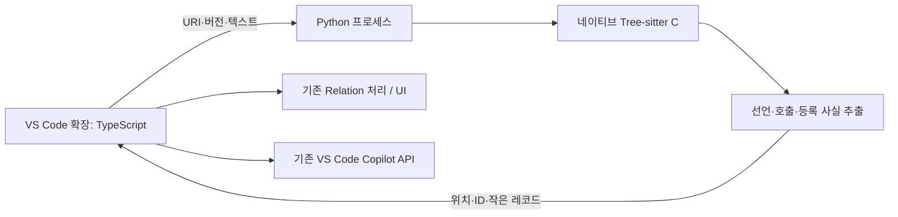

# Dynsight Python 분석기 도입과 최적화 설계 검토

작성일: 2026-10-21 · 기준: **v0.1.56 / `f16d9df`**

상태: **brainstorming 제안. Python 분석기·새 IPC·벤치마크는 아직 구현하거나 실행하지 않았다.** 현재 알고리즘은 [구현 설명 문서](../../architecture/2026-10-21-dynsight-analysis-algorithm.md)를 따른다.

## 1. 목표와 권장 방향

목표는 큰 C 프로젝트에서 탐색 응답을 유지하고, 메모리 사용과 반복 인덱싱 시간을 줄이는 것이다. 콜백의 불확실성을 숨기거나 기존 Copilot 계정 연동을 교체하는 작업은 포함하지 않는다.

**권장 방향은 현재 분석기의 비용을 측정한 뒤, Python을 별도 프로세스의 제한된 추출기로 시험하는 것이다.** 비교용으로 동일한 TypeScript 분석기를 Node 별도 프로세스에 놓은 경우도 측정한다. 이 비교가 있어야 좋아진 이유가 Python·네이티브 파서인지, 프로세스 격리인지, 보관 자료 감소인지 구분할 수 있다.

가정은 다음과 같다.

- 정확도와 UI 응답성 유지가 단순한 최초 파싱 시간 단축보다 우선한다.
- 사용자의 주요 환경은 WSL이며 Windows·macOS 설치도 계속 지원해야 한다.
- 시작과 함수 탐색만으로 새 AI 추론 요청을 보내지 않는 기존 동작을 유지한다.
- 실제 대형 프로젝트를 현재 환경에서 측정하지 못했으므로 성능 개선 수치를 약속하지 않는다.
- Python 전체 재작성은 승인된 범위가 아니다. 이번 산출물은 비교안과 실험 설계다.

## 2. 현재 코드에서 확인한 사실과 아직 모르는 것

| 확인한 사실 | 의미 | 아직 필요한 측정 |
|---|---|---|
| 파싱마다 `parser.parse(text)`, 추출 후 `tree.delete()` | 수정 파일 전체를 다시 파싱 | 파싱 자체와 TS 노드 순회가 각각 차지하는 시간 |
| 관계 재사용 단위는 파일 의존 묶음 | 수정 한 파일이 많은 관계 재계산을 유발할 수 있음 | 한 파일 저장 때 실제 재분석 파일·함수 수 |
| 소스의 `##`가 있으면 전체 작업 공간을 한 묶음으로 처리 | 증분 효과가 작아질 수 있음 | 해당 프로젝트의 묶음 수와 크기 |
| Worker는 원본 흐름 자료, Host는 소스·참조 복사본을 보유 | 언어보다 자료 소유 방식이 메모리에 중요 | 소스·참조·IR·조회 인덱스별 보유량과 전송량 |
| 캐시는 필드 단위 파생 차이를 저장 | 바뀐 참조 배열의 개별 객체 공유가 복원 시 사라질 수 있음 | 최초 구축과 캐시 복원의 정상 상태 메모리 차이 |
| 전체 콜백 추적은 후보 전파와 함수 요약을 반복 | 파서만 빨라져도 해결되지 않는 비용이 있음 | 매크로·정적 전파·등록 후보·Host 인덱스 단계 시간 |
| Copilot 문맥 생성은 Host, 모델 추론은 VS Code API | 로컬 분석과 네트워크 대기를 구분해야 함 | 문맥 검색·해시·직렬화·응답 대기 각각의 시간 |

근거: [analyzer.ts](../../../src/analyzer.ts), [incremental-analysis.ts](../../../src/incremental-analysis.ts), [analysis-worker.ts](../../../src/analysis-worker.ts), [analysis-cache.ts](../../../src/analysis-cache.ts), [pointer-targets.ts](../../../src/pointer-targets.ts), [copilot-context.ts](../../../src/copilot-context.ts).

사용자가 이전에 제공한 메모리 수치와 196/1,820개 파일 진단은 다른 버전·설정의 관찰이다. 현재 v0.1.56이나 Python 실험의 전후 비교 수치로 사용하지 않는다.

## 3. 비교할 세 가지 방법

| 방법 | 얻을 수 있는 이점 | 비용·한계 | 판단 |
|---|---|---|---|
| **A. 현재 TS Worker의 자료·재계산 범위 축소** | 중복 참조, 불필요한 전송, 넓은 재계산을 직접 줄일 수 있음 | 현재와 같은 프로세스 경계. 실제 병목을 측정해야 함 | 첫 기준선과 가장 작은 개선 후보 |
| **B. 기존 TS 분석기를 Node 별도 프로세스로 이동** | 기존 의미 분석을 유지하면서 분석 프로세스 종료·재시작을 분리 | IPC·캐시·생명주기 변경 필요. 자료를 중복 보관하면 RAM은 감소하지 않음 | Python과 비교할 격리 대조군 |
| **C. Python + 네이티브 Tree-sitter 별도 프로세스** | 파싱·추출의 실행 방식 비교, 장기적으로 분석 자료의 독립 소유 가능 | Python 런타임·바이너리 배포, 추출 코드 이식, 위치 변환, IPC 비용 | 작은 실험 후 채택 판단 |

단순히 “같은 콜백 엔진을 Python으로 번역”하는 것은 첫 선택으로 권하지 않는다. 같은 후보 수와 반복 구조를 유지하면 작업량도 남는다. Python 사전·집합·문자열 역시 메모리를 사용한다.

`py-tree-sitter`는 Tree-sitter의 네이티브 Python 바인딩이며 주요 플랫폼용 wheel을 제공한다. 하지만 Dynsight가 지원할 OS·CPU·Python 버전 조합에서 실제 설치와 grammar 호환성을 별도로 확인해야 한다. [공식 Python 바인딩](https://github.com/tree-sitter/py-tree-sitter)

일반 CPython의 GIL이 활성화된 환경에서 Python 스레드 수를 늘린다고 CPU 중심의 Python 코드가 자동으로 병렬화되지는 않는다. free-threaded 빌드나 네이티브 라이브러리의 실행 특성은 별도 조건이다. 첫 실험은 단일 분석 프로세스로 하고, 병렬화는 측정 후 판단한다. [Python 공식 설명](https://docs.python.org/3/library/threading.html#gil-and-performance-considerations)

## 4. Python을 붙인다면 경계를 어디에 둘 것인가

### 첫 실험: 문법 파싱과 작은 사실 추출

실험 범위는 함수·변수 선언, 직접 호출, 구조체 필드, `.field = function` 지정 초기화, 단순 지역 포인터 별칭의 **추출**까지다. `.cb_` 이름 필터를 강제하지 않는다. 이 사실들을 TypeScript 기준 출력과 비교한다.

이 실험 출력은 **현재 전체 `FileAnalysis`/Flow IR을 대체하는 완성 인터페이스가 아니다.** 기존 `flowFacts()`는 Tree-sitter 노드를 직접 소비하므로 Python에서 파싱한 트리를 TS에 간단히 넘겨 사용할 수 없다. 전체 AST를 JSON으로 전송하면 순회·직렬화·복사 비용이 커질 수 있다.

따라서 처음에는 독립 비교 도구로 실행한다. 기존 확장과 동시에 같은 파일을 이중 파싱하는 상태를 제품의 최적화 완료로 삼지 않는다. 전체 분석에 연결하려면 다음 중 하나가 추가로 필요하다.

- 필요한 Flow IR 생성까지 Python으로 이식하고 출력 계약을 검증한다.
- Python이 단순 등록 추출만 담당하는 제한 모드를 명시하고 기능 차이를 보여준다.

어느 경로든 매크로와 전체 정적 콜백 분석이 남는다면 그 비용을 포함한 종단 시간을 측정한다. 파서 미세 실험 결과만으로 Extension 전체가 빨라졌다고 판단하지 않는다.

### 장기안: 분석 자료를 한 프로세스에서 소유

Host 메모리가 핵심 병목으로 확인되면, Python 또는 Node 분석 프로세스가 소스·분석 결과·캐시·관계 조회를 소유하고 Host는 **현재 그래프와 Context에 필요한 결과만** 받는 구조를 검토한다.

이 구조는 전체 소스와 참조의 Host 복사본을 줄일 수 있다. 다만 심볼 검색·Callers·Callees·Context·Copilot 문맥 생성의 조회 API를 옮겨야 하므로 첫 파서 실험보다 큰 변경이다. 프로세스 경계만 옮기고 기존 Host 인덱스도 그대로 유지하면 기대한 메모리 감소가 나오지 않을 수 있다.

분리한 분석기가 종료되어도 VS Code의 다른 확장이 함께 종료될 위험을 줄일 수 있지만, 시스템 전체 메모리 고갈까지 방지하는 보장은 아니다. 프로세스 재시작을 무한 반복하거나 오래된 결과를 최신처럼 보이는 복구 방식도 피한다.

## 5. 작은 실험부터 지켜야 할 계약

### 실행·통신

- TypeScript가 비동기 `spawn`으로 Python을 시작하고 표준 입출력으로 통신한다. 셸 명령 문자열에 사용자 경로를 이어 붙이지 않고 인자 배열을 사용한다.
- 요청은 `requestId`, `uri`, `sourceVersion`, 분석 설정/스키마를 포함한다. 응답도 같은 식별자를 포함하고 오래된 응답은 버린다.
- 첫 실험은 크기 제한이 있는 파일 단위 JSON 메시지로 충분하다. 거대한 전체 프로젝트 AST 메시지는 만들지 않는다. 프레이밍은 JSON Lines처럼 명확한 방식으로 고정한다.
- 메시지 크기 외에 대기 파일 수와 전송 중인 총 바이트 수도 제한한다. 수신 측이 밀리면 송신을 늦춰 수천 파일의 텍스트·복사본이 큐에 한꺼번에 쌓이지 않게 한다.
- 진행 메시지·오류·결과를 구분한다. 계산 중에도 취소를 처리할 수 있는 체크포인트나 제어 경로가 필요하며, 취소 필드를 추가하는 것만으로는 중단되지 않는다.
- UI 이벤트에서 동기 subprocess 호출을 하지 않는다. Node의 `spawn()`은 비동기지만 `spawnSync()`는 이벤트 루프를 막는다. [Node child_process 문서](https://nodejs.org/api/child_process.html#asynchronous-process-creation)

위 필드는 새 프로토콜의 제안이며 현재 구현이라고 해석하지 않는다.

### 경로와 위치

WSL 프로젝트의 Python은 **WSL 안에서 실행**한다. Windows 쪽 Python에 WSL 소스 경로를 그대로 전달하는 구조로 만들지 않는다. 로컬 Windows·macOS도 각각 해당 Extension Host 위치에서 실행한다. [VS Code의 workspace 확장 실행 위치](https://code.visualstudio.com/api/advanced-topics/extension-host)

Python API는 UTF-8을 기본으로 바이트 입력과 바이트 오프셋을 다룬다. 현재 JS 문자열 오프셋·VS Code 위치와 그대로 바꿔 쓸 수 없다. UTF-8 바이트 ↔ UTF-16 코드 단위 변환을 파일별로 명확히 정의하고, 한글·이모지·CRLF·매크로 생성 위치의 원문 매핑을 시험한다. [py-tree-sitter Parser API](https://tree-sitter.github.io/py-tree-sitter/classes/tree_sitter.Parser.html)

파일 경로만 전달하여 Python이 디스크를 읽게 하면 저장하지 않은 편집 내용이 빠진다. 현재 버전의 편집 버퍼 텍스트를 보내거나, 어떤 요청이 저장 파일에만 적용되는지 계약으로 구분해야 한다.

### 캐시와 Copilot

- Python 자료와 TS 자료의 스키마를 구분한다. 엔진·grammar 버전, 소스·설정·의존성 변경 시 무효화한다.
- 파일별 원본 추출은 수정 파일만 갱신할 수 있지만, 공통 헤더·매크로·콜백 등록 변경은 다른 파일의 관계를 무효화할 수 있다.
- 명시적 전체 Rebuild, 일반 파일 저장, 캐시 복원, AI 강제 재분석을 구분한다.
- VS Code 모델 선택·Copilot 권한·모델 요청은 TypeScript에 둔다. Python이 Copilot 내부 인증 정보나 비공개 API를 직접 사용하는 설계는 필요 없다.
- 시작·탐색 때 AI 추론 요청 0회라는 기존 동작을 검증한다. 기존 모델별 캐시도 유지한다.

### 설치

첫 실험은 개발용 격리 환경의 Python과 고정 의존성으로 충분하다. 사용자 설치에 필요한 런타임을 이미 있다고 가정하지 않는다. 정식 도입 판단에는 Windows x64, macOS 지원 CPU, WSL Linux의 패키징·오프라인 설치·업데이트 비용도 포함한다. 검증 전에는 사용자 설정에 Python 경로나 분석기 선택 항목을 추가하지 않는다.

## 6. Python 도입 전후에 정리할 데이터

“LLM을 추가했으므로 기존 콜백 자료는 전부 불필요하다”는 판단은 현재 구조에 맞지 않는다. 정적 추적은 여전히 옵션으로 남아 있고, 단순 등록 후보와 함수 인자 전달 표시도 원본 흐름 자료를 사용한다.

| 자료 | 지금 제거 가능한가? | 최적화 후보 |
|---|---|---|
| Tree-sitter 구문 트리 | 이미 추출 후 삭제 | 열린 파일만 제한적으로 유지하여 증분 파싱과 RAM 절충 실험 |
| 전체 포인터 전파 엔진 | 정적 분석 옵션 사용자가 있어 일괄 제거 불가 | 실제로 비활성화된 모드의 임시 상태 생성 여부 측정 |
| `programs`, `initializers` | 단순 등록·인자 탐색에서도 사용하므로 일괄 제거 불가 | 필요한 사실만 남기는 축약 표현을 별도 검증 |
| Worker→Host 소스·참조 전송 | 현재 UI와 인덱스가 사용 | 변경 없는 필드 재전송 제외, 필요 시 조회하는 구조 비교 |
| 캐시의 파생 참조 배열 | 결과 복원에 필요 | 레코드 ID/추가·제거 목록 등으로 실제 중복을 줄일 수 있는지 측정 |
| AI 문맥 | 요청과 캐시 검증에 필요 | 시작 시 미캐시 항목과 새 요청 한도 밖의 미캐시 항목은 문맥 생성을 생략. 캐시 항목에는 검증용 문맥·해시 비용이 남음 |

작업 순서는 각 자료의 소비자를 확인하고, 출력 동등성 검사 후 자료를 줄이는 것이다. 이 문서 작성 과정에서는 해당 코드나 자료 구조를 삭제하지 않았다.

## 7. 검증 계획과 채택 기준

### 단계 1 — 기준선: 어디가 느린지 확인

동일 커밋·설정·파일 집합에서 작은 콜백 fixture, 현재 로컬 FreeRTOS corpus, 사용자가 문제를 겪은 WSL 프로젝트를 구분한다. 실제 WSL corpus가 없으면 앞의 두 결과로만 보고하고 일반화하지 않는다.

| 시나리오 | 주요 측정 |
|---|---|
| 캐시 없는 최초 인덱싱 | 읽기, 파싱, 추출, 매크로, 정적 전파, 등록 보강, 전송, Host 인덱스 시간 |
| 정상 캐시 재시작 | 소스 검증, JSON 복원, 전송, 정상 상태 메모리 |
| C 파일 하나 저장 | 재파싱 파일 수, 재계산 묶음·함수 수, 완료 시간 |
| 공통 헤더 또는 콜백 등록 변경 | 의존 결과 갱신 범위, 오래된 연결 잔존 여부 |
| 파일 추가·삭제, 명시 Rebuild | 파일 목록 갱신, 삭제한 관계 제거, 전체 재계산·캐시 상태 |
| 함수 클릭 반복 | 그래프 조회 지연과 Extension Host 이벤트 루프 지연 |
| 분석기 종료 후 복구 | 복구 시간, 마지막 결과의 상태 표시, 새 AI 요청 수 |

Cold/warm은 애플리케이션 분석 캐시 상태와 OS 파일 캐시 상태를 구분해 기록한다. AI는 우선 끄고 로컬 분석을 측정한다. AI 측정은 로컬 문맥 생성·전송 대기·모델 응답을 별도 항목으로 둔다.

### 단계 2 — 파싱·추출 소규모 비교

A의 현재 WASM 파서와 C의 Python 네이티브 파서를 **같은 grammar와 입력, 같은 추출 범위**로 비교한다. 순수 파싱 시간과 심볼·호출 레코드 생성 시간을 각각 기록한다. 해당 grammar를 같은 버전으로 빌드할 수 없으면 그 차이를 결과의 제한으로 표시한다.

양쪽 결과를 정렬·정규화하여 선언, 스코프, 위치, 호출 종류, 후보 대상, Callers 역관계, 불완전 표시와 진단을 비교한다. 직접 호출, 함수 포인터 typedef, 지정 초기화, 지역 별칭, getter 전달, 여러 인자 위치, static 동명이인, 분기·배열·미지원 식을 포함한다. 작은 추출기가 아직 지원하지 않는 전체 흐름 사례는 **미지원으로 기록**하며 목표 함수를 억지로 맞추지 않는다. 분석 시간·메모리·후보 한도도 같은 조건으로 두고, 제한에 일찍 걸려 덜 분석한 실행을 속도 개선으로 계산하지 않는다.

### 단계 3 — 종단 비용과 격리 효과 비교

파서 비교가 유망할 때 B의 Node 별도 프로세스 대조군과 C의 통합 후보를 비교한다. 같은 기능 범위를 충족하기 전에는 대체 분석기로 채택하지 않는다. Python이 만든 자료를 TS가 다시 구성하는 시간, 직렬화 바이트 수, 프로세스 시작 비용도 포함한다.

메모리는 Worker JS 힙·Host JS 힙·프로세스 RSS를 구분한다. 현재 Worker와 Host는 같은 프로세스이므로 각자의 RSS처럼 중복 합산하지 않는다. [Node 메모리 측정 문서](https://nodejs.org/docs/latest-v22.x/api/process.html#processmemoryusage)

분리 후에는 프로세스별 RSS와 **동일 시점의 합계**를 기록한다. 각 프로세스에서 서로 다른 때 기록한 최대치를 더해 전체 최대 메모리라고 부르지 않는다. 공유 페이지 때문에 RSS 합계가 실제 물리 메모리 사용과 다를 수 있음을 남기고, 비교가 가능한 Linux 환경에서는 PSS도 보조 지표로 삼는다. Python 객체 추적기만으로 네이티브 파서 메모리를 대표하지 않으며, 단계별 힙 증감을 정확한 할당량으로 간주하지 않는다.

최초 구축·재시작·저장은 반복 5회 이상의 중앙값과 최댓값, 반복 탐색은 충분한 요청 수의 p50/p95를 기록한다. A/B/C 실행 순서는 교대하고, 최초 구축·재시작은 새 프로세스에서, 동일 세션의 편집·탐색은 예열 후 측정한다. CPU·메모리·파일 수·캐시 상태·콜백 옵션과 VS Code 확장 활성 상태를 고정해 기록한다. 이렇게 통제한 비교와 실제 WSL에서 다른 확장을 함께 사용하는 검증은 구분한다.

### 제안하는 합격선

다음 수치는 **실험을 판단할 제안 기준이며 달성한 성능이 아니다.**

1. 같은 기능 범위에서 정규화된 관계·후보·위치·불완전 표시가 기준선과 일치한다. 의도한 차이는 fixture와 문서로 설명한다.
2. 수정·취소·재시작 시 오래된 결과가 최신 결과로 적용되지 않는다. 시작·탐색만으로 새 AI 추론을 요청하지 않는다.
3. 측정한 주 병목에서 종단 지연 25% 이상 또는 분석 프로세스군의 최대 메모리 지표 30% 이상 개선을 목표로 한다. 다른 핵심 시나리오는 10% 넘게 악화시키지 않는다.
4. 과정상 UI 응답성이 나빠지지 않고 지원 플랫폼에서 설치·실행이 가능하다.

작은 파싱 실험만 빠르고 전체 시간·메모리·응답성에 이득이 없으면 Python 도입을 보류한다. 격리만 효과적이면 기존 TS 분석기를 별도 프로세스로 옮기는 B가 더 작은 해결책이다.

## 8. 이번 검토의 결론

Python 연동은 가능하지만, **가장 중요한 설계 결정은 어떤 프로세스가 분석 데이터를 소유하고 얼마나 넓게 재계산하느냐**다.

다음 구현 단위로 권장하는 것은 “현재 단계별 비용 측정 + 동일 C 입력의 Python 추출기 비교 도구”다. 확장 동작과 배포는 유지한 채 판단 근거를 만든다. 결과에 따라 TS 자료 축소, Node 프로세스 분리, Python 분석기 도입 중 가장 작은 유효한 변경을 선택한다.
