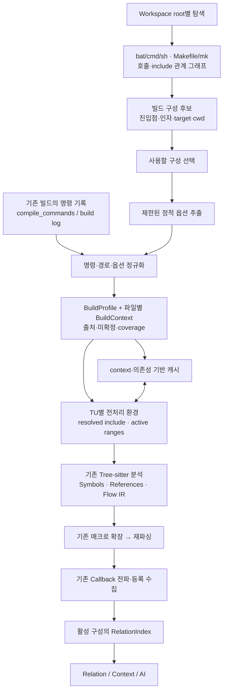

# 프로젝트 빌드 스크립트 자동 탐색과 분석 컨텍스트 설계

> **2026-10-25 후속 합의:** 초기 탐색 방식은 아래 §4의 넓은 root 탐색 대신 **일반 Include/Exclude로 이미 발견한 C/H 경로 → 가까운 Make 입력 → 상위 폴더 → workspace root의 script** 순서로 변경한다. 적용 여부는 물리적 인접성이 아니라 실제 script 호출·Make include·sub-make 관계로 검증한다. 최신 실행 순서는 [구현 계획](/Users/james_black/work/project/vscode_extension/docs/superpowers/plans/2026-10-25-scope-first-build-context.md)을 따른다.
>
> 발견한 진입점에 연결된 설정 파일은 제한 안에서 추적하되, source 경로만으로 `.mk`를 생략하는 별도 최적화 엔진은 만들지 않는다. source 편집 시에는 캐시를 사용하며 설정 입력이 바뀔 때만 다시 계산한다. `compile_commands.json`이나 build log import는 초기 구현의 전제·완료 조건에서 제외한다. 일반 Include 밖/Exclude 안의 C/H 본문은 암묵적으로 읽거나 분석하지 않고 필요한 의존성이 막혔다는 근거를 남긴다. 이는 아래의 지원 header 읽기 설명보다 우선한다.

## 0. 결정 요약과 범위

**프로젝트 루트에서 `.bat`·`.cmd`·`.sh`·Makefile을 자동 탐색하고, 선택한 빌드의 파일별 옵션을 기존 분석기에 반영한다.** 정적으로 확정하지 못하는 값은 빌드 명령 기록으로 보완한다. Tree-sitter와 기존 매크로·콜백 분석기는 재사용한다.

이 설계가 해결하려는 P1은 **실제 빌드 조건 부재로 발생하는 분석 후보 혼합**이다. 컴파일러 전체를 새 분석 엔진으로 도입하는 것이 목적은 아니다.

- 작성일: 2026-10-25, Asia/Seoul.
- 기준 저장소: `/Users/james_black/work/project/vscode_extension`.
- 기준 HEAD: `ddef1367a7e2bd967c674757912dd0f9b457260a` 및 현재 미커밋 작업 트리.
- 선행 보고서: `docs/reviews/2026-10-25-relation-context-architecture-ai.md`.
- 문서 상태: **설계 제안. 아래 새 모듈·명령·Schema·검증 기준은 미구현이다.**
- 이번 작업: 설계 문서 작성과 근거 확인만 수행한다. 빌드 스크립트 실행, 패키지 설치, 제품 코드·빌드 설정 수정, commit·배포는 범위 밖이다.
- 실제 팀 펌웨어의 루트·빌드 파일은 제공되지 않았다. 예시는 설계 검증용이며 실제 프로젝트를 조사한 결과가 아니다.

### 0.1 전제

1. 사용자는 기존 스크립트로 Make 기반 빌드를 수행한다.
2. 제품·구성·target·스크립트 인자는 프로젝트마다 다를 수 있다.
3. 컴파일 명령을 수집하는 것과 모든 compiler 의미를 재현하는 것은 구분한다.
4. 일반 소스 탐색은 기존처럼 계속 제공하고, 빌드 구성 분석 결과와 출처 없는 fallback 사실을 섞지 않는다.
5. 자동 탐색은 읽기 전용이다. 발견한 스크립트나 `make -n/-p`를 자동 실행하지 않는다.

### 0.2 성공 기준

- 빌드 진입점과 옵션마다 파일·줄 또는 명령 기록의 출처를 제시한다.
- `src/a.c`와 `src/b.c`의 서로 다른 옵션을 보존한다.
- 조건·헤더·파일 소속이 확실한 범위만 후보를 좁힌다.
- 같은 헤더의 translation unit별 의미가 섞이지 않는다.
- 빌드 정보가 부족해도 기존 기본 탐색이 동작하고, 미확정 상태가 드러난다.
- 구성 A/B 전환, 헤더·Makefile·response file 변경, 재시작 후에도 잘못된 캐시가 재사용되지 않는다.
- 매크로 대안 감소를 검증하면서 실제 콜백·등록·불완전성 근거를 보존한다.
- 기존 32/64/256 등 제한을 올리거나 callback 분석을 끄는 방식으로 통과시키지 않는다.

## 1. 현재 구현과 실제 변경 지점

| 현재 상태 | 판정 | 소스 근거 | 설계에서 필요한 변화 |
|---|---|---|---|
| Workspace C/H 탐색 및 범위 필터 | 구현 확인 | `src/workspace.ts:187`, `discover()`; `:312`, `eligible()` | 일반 탐색과 별도로 build 입력 파일 탐색 |
| 분석 정책에 expandMacros/propagateCallbacks만 존재 | 구현 확인 | `src/model.ts:2`; `src/workspace.ts:180`, `options()` | 별도 BuildContext 입력 추가 |
| 조건 판정은 기본적으로 literal 0/1 | 부분 구현 | `src/analyzer.ts:22`, `constant()`; `:127`, `visit()` | 위치별 매크로 환경에 의한 3값 판정 |
| Flow IR에서도 전처리 분기 literal 판정 | 부분 구현 | `src/flow-parser.ts:145` | 동일한 활성 범위 결과 공유 |
| initializer 내부 전처리는 별도 복구 | 구현 확인 | `src/initializer-preprocessor.ts:14`, `:71` | 복구와 일반 파서의 조건 결과 일치 |
| include 검색은 상대 경로/filename 후보 | 부분 구현 | `src/project-analysis.ts:55`, `includeMatches()`; `src/relations.ts:144`, `visibleFiles()` | 파일별 검색 순서와 resolved include 공유 |
| 매크로 대안 확장 후 함수 본문 재파싱 | 구현 확인 | `src/project-analysis.ts:281`, `deriveMacroCalls()`; `:359`, `:374` | 비활성 토큰·불가능한 매크로 환경 제외 |
| 원본·파생 데이터가 URI당 하나 | 구현 확인 | `src/analysis-worker.ts:17`; `src/relations.ts:43` | TU별 헤더 변형을 담는 별도 fact 저장소 |
| 심볼 ID가 URI#offset | 구현 확인 | `src/analyzer.ts:190` | source 위치와 context identity 분리 |
| 원본 식별자 기반 보수적 증분 컴포넌트 | 구현 확인 | `src/incremental-analysis.ts:55`, `:82` | 활성 사실의 build context와 의존성을 키에 포함 |
| analysisKey에 빌드 정보 없음 | 미구현 | `src/workspace.ts:176` | profile·파일별 context·설정 의존성 해시 |
| 매크로와 콜백이 같은 work budget 사용 | 구현 확인 | `src/analyzer.ts:407`~`412`; `src/analysis-budget.ts:8` | 예산 정책 유지, 단계별 감소 효과 측정 |
| 매크로 확장 결과에서 등록 사실 수집 | 구현 확인 | `src/explicit-callbacks.ts:154`; `src/analyzer.ts:415` | 활성 확장 사실에서도 같은 등록 의미 유지 |
| AI snapshot은 기존 Index 활용 | 구현 확인 | `src/copilot-service.ts:58` | profile/context 변경 시 후보·사용자 지정 재검증 |

## 2. 대안과 선택

| 접근 | 장점 | 제약 | 선택 |
|---|---|---|---|
| 빌드 스크립트·Make 문법 전체 재현 | 외부 실행 없이 계산 가능 | shell·Make 실행 환경 전체를 재현해야 하며 부정확해지기 쉬움 | 채택하지 않음 |
| **자동 탐색 + 제한된 정적 추출 + 명령 기록 보완** | 바로 얻을 수 있는 설정을 자동 수집하고 동적 부분을 근거로 보완 | 입력별 확정 범위와 누락 관리 필요 | **권장** |
| 항상 compiler 실행/전처리 결과로 분석 | compiler 특수 환경을 더 잘 반영할 수 있음 | 도구·버전·실행 환경 및 원본 매핑 의존성 증가 | 선택적 후속 보완 |

자동 탐색은 기본 기능이다. 모든 프로젝트에서 전체 옵션을 정적으로 추출할 수 있다고 약속하지 않는다. 지원 문법 안에서는 확정하고, 동적 표현식은 실행하지 않고 미확정으로 남긴다.

사용자가 기존 빌드를 수행한 경우에는 파일별 컴파일 명령 기록을 재사용한다. `compile_commands.json`은 지원 입력 형식 중 하나이며 clangd 사용을 강제하지 않는다. 같은 파일에 여러 command가 있을 수 있으므로 파일명만으로 덮어쓰지 않는다. [Compilation Database 형식](https://clang.llvm.org/docs/JSONCompilationDatabase.html)

## 3. 전체 흐름



`TU`는 하나의 C 파일을 시작점으로 헤더를 포함해 해석하는 translation unit이다. 전역 옵션 목록 하나 대신 TU별 컨텍스트를 사용한다.

## 4. 루트와 빌드 파일 자동 탐색

### 4.1 루트 규칙

- VS Code workspace folder 각각을 독립 탐색 루트로 사용한다.
- Git root는 후보 경계·이름 설명에만 사용하고 workspace를 임의의 상위 디렉터리로 확대하지 않는다.
- 루트 Makefile과 `build/`, `scripts/`, `tools/` 등의 하위 진입점도 찾는다. 중첩 프로젝트는 별도 후보로 표시한다.
- 루트가 여러 개인 경우 서로의 Make 옵션·소스 목록을 자동 합치지 않는다. 명시적 호출 관계나 사용자의 구성 선택이 연결 근거다.
- symlink로 루트 밖을 무제한 순회하지 않는다. 실제로 참조된 외부 경로는 출처와 함께 의존성으로 등록한다.

### 4.2 탐색 대상과 비용

- 진입 스크립트: `.bat`, `.cmd`, `.sh`.
- Make 입력: `GNUmakefile`, `makefile`, `Makefile`, `*.mk`, 스크립트 `-f/--file`에서 명시한 파일.
- 후보 근거: 실제 Make 호출, 다른 스크립트 호출, `include` 관계. `build`라는 이름만으로 빌드 진입점으로 확정하지 않는다.
- 스크립트 호출이 명시한 확장자 없는 파일은 추가로 읽을 수 있다.
- 일반 C 분석의 Include/Exclude를 그대로 적용하지 않는다. `build/Makefile`, `build/generated/config.mk`는 일반 소스 분석에서 제외되었어도 빌드 정보로 필요할 수 있다.
- `.git`, `node_modules`, `.vscode-test`는 자동 전체 탐색에서 제외한다. 그 밖의 소스·빌드 부모 폴더를 일괄 제외하지 않는다.
- 제안 기본 상한: 자동 순회 깊이 8, 방문 항목 20,000, 개별 텍스트 1MiB, 참조 재귀 깊이 32. 내부 상수로 시작하고 사용자 설정을 늘리지 않는다.
- 상한에 걸리면 `discoveryLimited`를 기록한다. 탐색을 마친 척하거나 결과를 빈 목록으로 취급하지 않는다.
- 상한 밖이더라도 이미 발견한 파일이 직접 참조한 경로는 별도 bounded 참조 추적으로 읽을 수 있다.

### 4.3 후보 선택

후보는 `root + entry script + argv + make invocation + cwd`를 기준으로 구분한다. 명시된 기존 선택은 유지하고, 여러 후보를 임의로 합치지 않는다. 첫 적용 때 후보와 근거를 보여 준다.

예시 표시:

```text
빌드 구성 후보
  Product A / Release
    build.bat A release → make -f Makefile PRODUCT=A CONFIG=release
  Product A / Debug
    build.sh A debug → make -f Makefile PRODUCT=A CONFIG=debug
```

스크립트에 인자가 필요하지만 값이 없으면 빈 문자열을 넣지 않는다. `PRODUCT: 실행 인자 필요`로 표시하고 값이 확인된 구성만 적용한다. 고정값의 단일 진입점은 추가 옵션 입력 없이 선택할 수 있다.

## 5. 옵션 추출과 명령 기록

### 5.1 스크립트 정적 추출

다음은 초기 지원 범위다. 단순 문자열 정규식 검색만으로 shell/cmd 전체를 해석하지 않는다. 문자열·주석·인용·줄 연결을 구분한 후 지원 구문만 평가한다.

| 종류 | 지원 범위 | 미확정 처리 |
|---|---|---|
| sh | 상수 대입, `export`, 알려진 `$VAR`/`${VAR}`·위치 인자, 상수 `cd`, 명시적 `sh`·`bash`·`.`·`source` 호출 | command substitution, `eval`, 동적 source 경로, 지원하지 않는 분기·함수·loop |
| bat/cmd | `set`, `setlocal/endlocal`의 값 범위, 알려진 `%VAR%`·`%1`·`%~dp0`, 상수 `cd /d`, `pushd/popd`, 명시적 `call` | delayed expansion, `for /f`, 동적 goto·분기, 지원하지 않는 cmd 해석 |
| 공통 | 지원하는 상수 비교 분기의 결정, 실행 순서와 cwd 추적, 명시적 Make 명령·인자 분리 | 실행 순서를 확정 못 하면 분기별 후보를 남기며 뒤 문장의 값을 확정하지 않음 |

`setlocal`, `call`, subshell 등으로 변수 범위를 정확히 처리하지 못한 경로는 partial로 낮춘다. 플랫폼이 다르면 `.bat`를 sh 문법으로 읽지 않는다. 인코딩·인용을 해석하지 못하는 파일도 부분 추출로 표시한다.

### 5.2 Make 정적 추출

초기 지원은 다음의 제한된 부분집합이다.

- Make 호출의 `-f/--file`, `-C/--directory`, 명시 target, `NAME=value`와 영향을 주는 환경 값.
- `=`, `:=`, `?=`, `+=`의 지연/즉시 확장 차이를 보존한 단순 변수 참조.
- 경로가 확정된 `include`, `-include`, `sinclude`, 상수 비교로 판정 가능한 `ifeq/ifneq/ifdef/ifndef`.
- 명시 소스/오브젝트 목록, 단순 `%.o: %.c` 규칙의 `$@`, `$<`, 지원하는 변수 치환.
- target-specific/pattern-specific 변수·`override`·`eval` 등 초기 미지원 문법을 만나면 영향받는 target·옵션의 확정도를 낮춘다. 무시한 채 전역 CFLAGS를 확정하지 않는다.
- `wildcard` 같은 파일 목록 연산은 read-only이고 의미를 구현한 함수만 계산한다. `$(shell ...)`, `!=`, `$(eval ...)`, `$(file ...)`는 실행하지 않는다.

GNU Make는 target/pattern별 변수 값을 가질 수 있으므로 전역 `CFLAGS`만 모아 파일 전체에 적용하는 설계는 사용하지 않는다. [GNU Make pattern-specific variables](https://www.gnu.org/software/make/manual/html_node/Pattern_002dspecific.html)

Make 조건의 `ifdef`와 C 전처리의 `#ifdef`는 같은 evaluator로 처리하지 않는다. 지원하지 않는 Make 문법은 명령 기록 보완으로 해결하며 shell/Make 전체 구현으로 범위를 확대하지 않는다.

### 5.3 실제 명령 기록 입력

정적 추출이 partial인 경로는 다음을 입력받아 보완한다.

1. 프로젝트가 이미 생성한 `compile_commands.json`.
2. 사용자가 기존 빌드에서 저장한 verbose build log.
3. 향후 명시적으로 선택한 빌드 작업의 구조화된 compile command 기록.

초기 구현은 자동 탐색과 기존 기록 가져오기를 제공한다. 통합 빌드 실행기·프로세스 가로채기 도구 설치는 선행 조건으로 삼지 않는다. 나중에 실행 기능을 추가할 때도 발견한 파일을 자동 실행하지 않고, 사용자가 선택한 기존 빌드 명령과 연결한다.

`make -n/-p`를 읽기 전용 파일 파싱처럼 자동 호출하지 않는다. GNU Make의 `-n`에는 재귀 recipe 예외가 있고, `shell` 함수는 확장 시 명령을 실행할 수 있다. 이 제약은 자동 탐색과 실행 작업을 구분하는 근거다. [GNU Make 실행 대체 옵션](https://www.gnu.org/software/make/manual/make.html#Instead-of-Execution), [GNU Make shell 함수](https://www.gnu.org/software/make/manual/html_node/Shell-Function.html)

### 5.4 정규화 규칙

- 원본 명령 문자열과 파싱된 argv, cwd, 출처를 구분한다. argv 입력이 있으면 불필요하게 shell 문자열로 재조립하지 않는다.
- `-D`, `-U` 순서, 같은 이름의 재정의, 인용 문자열, 공백 경로를 보존한다.
- Include는 종류와 종류 안의 순서를 보존한다. `-I`·`-iquote`·`-isystem` 등을 모두 같은 배열로 정렬하지 않는다.
- 강제 헤더는 compiler의 적용 단계·순서를 따른다. GCC의 `-D/-U`, `-imacros`, `-include`를 원본 argv 순서 그대로 실행하는 것과 구분한다. [GCC 전처리 옵션](https://gcc.gnu.org/onlinedocs/gcc/Preprocessor-Options.html)
- compiler ID·명령 경로·언어·target 관련 옵션·sysroot·표준 옵션·나머지 argv도 보관한다. 초기 의미를 모르는 옵션은 `unsupported-option` 진단과 fingerprint에 남긴다.
- `@response`는 compiler별 인용·상대경로 규칙을 아는 경우만 확장한다. 최대 중첩 8, 순환 검출, 내용 해시를 적용한다. 알 수 없거나 파일이 없으면 partial이다.
- wrapper가 실제 compiler에 추가하는 인자를 모르면 출력된 명령 전체를 effective command라고 단정하지 않는다.
- Windows와 WSL·원격 경로는 실행 환경을 함께 기록한다. `C:\...`를 무조건 `/mnt/c/...`로 바꾸지 않는다. 확인된 path mapping만 적용한다.
- 사용하는 환경 값만 컨텍스트에 반영하고, 전체 프로세스 환경을 보고서·AI 입력에 복사하지 않는다.
- GCC/Diab별 옵션 해석기는 작게 분리한다. Diab 전용 옵션·기본 검색·내장 정의는 실제 버전 문서와 샘플 명령으로 검증한 항목만 지원한다. GCC 규칙을 추측해 적용하지 않는다.

### 5.5 명령 완전성과 프로젝트 소속

**명령 하나가 정확한 것과 프로젝트 소스 목록이 완전한 것은 서로 다르다.**

- 일반 증분 build log는 이번에 컴파일된 파일만 포함할 수 있다.
- build 성공·종료 표시만으로 `coverage=complete`를 부여하지 않는다.
- command DB도 선택한 target의 완전한 목록인지 별도 출처가 필요하다.
- complete는 지원 문법으로 전체 target 소스/오브젝트 graph를 해결했거나, 선택한 구성의 전체 manifest 등으로 소스 목록을 확인한 경우에만 사용한다.
- partial 기록에 없는 파일을 미사용으로 확정해 제거하지 않는다. 기존 같은 구성의 유효 명령과 병합하고, 나머지는 `membership=unknown`이다.
- 삭제·구성 변경·출처 변경으로 과거 명령이 무효이면 재사용하지 않는다. 실패·중단된 빌드 기록은 관찰한 명령의 근거만 제공한다.
- 링크 입력까지 확인하지 못하면 여러 실행 이미지가 같은 빌드에 들어올 수 있다. profile을 최종 target별로 나누고, 경계를 확인 못 한 관계에는 linkage 미확정 사유를 유지한다.

## 6. 데이터 계약 제안

아래는 새 개념의 계약 예시다. 실제 구현 타입은 현재 모델과 결합하며 불필요한 일반화 계층은 만들지 않는다.

```text
BuildProfile
  id, workspaceRootUri, entryUri, entryArguments, makeTargets
  executionEnvironment, cwd, selectionRevision
  inputFiles[{uri, digest}], relevantEnvironmentDigest
  coverage: complete | partial | unknown
  configurationFingerprint, issues[]

CompileUnitContext
  id, profileId, sourceUri, objectUri?
  commandSource: static | compilation-database | build-log
  originalCommand?, argv[], cwd, compilerFamily
  macroActions[{define|undef, name, replacement?, provenance}]
  includeSearch[{kind, directory, ordinal, provenance}]
  forcedInputs[{kind, uri, ordinal, provenance}]
  language, targetOptions[], otherArguments[]
  commandStatus: resolved | partial | conflicting
  membership: included | excluded | unknown
  builtinEnvironment: known | partial | unknown
  unresolved[], fingerprint

Evidence
  sourceUri, line/column 또는 recordId, expression, resolution

PreprocessorContext
  compileUnitId, initialEnvironmentFingerprint
  macroStateAtLocations, resolvedIncludes[], inactiveRanges[]
  unresolvedConditions[], dependencies[], missingSearchCandidates[]
  fingerprint
```

`id`는 대상을 식별하고, `fingerprint`는 내용 호환성을 판정한다. profile identity는 루트·진입점·실행 인자·선택 target로 안정되게 정하고, 내용이 바뀌면 fingerprint와 revision을 갱신한다.

예를 들어 같은 C 파일을 두 번 컴파일하면 `(profile, source, object 또는 invocation identity)`로 구분한다. 서로 다른 Define 집합을 합집합으로 만들지 않는다. 충돌한 기록은 후보 선택이나 `conflicting` 처리로 드러낸다.

### 6.1 상태를 하나의 완전성 플래그로 합치지 않기

| 상태 축 | 설명 |
|---|---|
| discovery | 후보 파일을 충분히 찾았는가 |
| command | 해당 TU 명령을 해석했는가 |
| coverage | 프로젝트 소스 집합을 확인했는가 |
| builtins | compiler 기본 매크로·기본 검색 경로를 아는가 |
| preprocessing | 이 소스 위치의 분기·헤더를 확정했는가 |
| propagation | 기존 callback 전파가 한계 없이 끝났는가 |

명령이 resolved여도 builtins가 unknown이면 compiler 전용 조건은 미확정일 수 있다. `-U X`로 X 부재를 확인하는 것과 단지 `-D X`가 없다는 것은 다르다.

## 7. 기존 매크로 분석에 적용

### 7.1 적용 순서

```text
선택한 TU의 compiler 기본 환경 중 확인된 부분
 → command-line define/undef 처리
 → compiler 규칙에 따른 강제 macro/header 입력
 → 소스 순서대로 define/undef/include/조건 평가
 → 활성·미확정 범위로 parser 입력·사실 구성
 → 활성 함수/초기화만 기존 MacroExpander에 전달
 → 확장 위치를 원본에 매핑하여 재파싱
 → 기존 명시적 등록 및 callback 전파
```

단순히 모든 `-D`를 파일 맨 앞에 텍스트로 붙이지 않는다. 그러면 원본 offset과 View navigation이 어긋난다. 매크로 환경을 별도 입력으로 전달하고, inactive 구간은 줄바꿈과 길이를 유지한 공백 mask로 parser에 제공한다. 원본 `file.text`와 `Location`은 유지한다.

`preparePreprocessorContext()`는 AST가 완성되기 전에 실행한다. 기존 `tokenizeC()`의 주석·문자열·줄 연결과 원본 위치 정보를 재사용하는 directive scanner로 소스를 순서대로 처리한다. include 진입 시 현재 환경을 전달하고, 복귀 시 헤더에서 변경한 정의를 이어받는다. 전역 최종 Define map으로 과거 조건을 다시 판정하지 않는다.

unknown 분기는 기존 `MacroBranch`에 대응하는 조건 identity와 환경 대안으로 합친다. 같은 predicate의 반복 사용과 source 재정의는 환경 version으로 구분하며, 기존 대안·include/event 상한을 유지한다. 생성한 resolved include·조건·전처리 이벤트를 `analyzer`와 `timeline()`이 공유하여 서로 독립적인 전처리 세계를 계산하지 않게 한다. 미지원 directive와 누락된 헤더는 해당 위치 이후 환경을 불확실하게 만드는 근거로 남긴다.

### 7.2 위치별 3값 조건 평가

조건 결과는 `true | false | unknown`이다. source 안에서 재정의·undef·include가 발생하므로 TU 시작의 Define map을 모든 줄에 그대로 쓰지 않는다.

- 최소 지원: `defined`, `#ifdef/#ifndef`, 정수 literal, 객체형 macro alias, 괄호, `!`, 비교, `&&/||`.
- 지원하는 정수 연산은 C 전처리 의미·우선순위를 따른다. JavaScript `eval`이나 JS Number/bitwise 결과를 그대로 C 의미로 사용하지 않는다.
- 정수 폭·signedness·character constant·미지원 builtins·미확정 함수형 매크로로 결과가 달라질 수 있으면 unknown이다. 초기에는 판정 가능한 작은 정수 부분집합부터 제공한다.
- 일부 operand가 unknown이어도 `0 && unknown`·`1 || unknown` 등 결과가 증명되는 경우만 좁힌다.
- 완전한 환경에서 미정의 식별자는 C 전처리 규칙에 따라 0이다. 기본 환경·헤더·조건부 정의를 모르는 상태에서 임의 식별자를 미정의라고 간주하지 않는다. [C 전처리 조건식](https://gcc.gnu.org/onlinedocs/cpp/If.html)
- `-D FLAG=0`이면 `#ifdef FLAG`는 참, `#if FLAG`는 거짓이다.
- unknown 조건은 기존 branch correlation과 대안 보존을 유지한다. `skipInactive=false`로 모든 분기를 보는 기존 동작은 유지하고, 활성 빌드만 본다는 표시를 하지 않는다.

**일관성 요구:** `analyzer.visit()`, `flowFacts()`, `initializerPreprocessor()`, `timeline()`이 서로 다른 조건 판정을 하지 않도록 하나의 결과를 공유한다. raw symbol/reference만 줄이고 IR·매크로 환경에는 비활성 경로를 남기는 구현은 실패다.

근거가 되는 현재 중복 판정 위치: `src/analyzer.ts:127`, `src/flow-parser.ts:145`, `src/initializer-preprocessor.ts:71`.

### 7.3 include 검색

- GCC는 quote·일반·system·after 등 종류별 검색 순서와 cwd/sysroot를 보존한다. 현재 filename 후보 전체 연결을 확정 경로로 대체할 수 있을 때만 대체한다. [GCC 헤더 검색](https://gcc.gnu.org/onlinedocs/gcc/Directory-Options.html)
- 검색된 실제 헤더가 발견되면 그 뒤의 같은 이름 헤더를 대안으로 넣지 않는다.
- 검색 경로 일부를 모르는 경우에도, unknown 영역보다 앞에서 발견된 확정 헤더는 선택할 수 있다. 그 뒤의 후보는 선택이 보장되지 않는다.
- 강제 include는 source의 일반 include와 함께 의존성으로 등록한다.
- 외부 헤더는 실제 참조된 파일만 읽는다. 시스템 디렉터리 전체를 인덱싱하지 않는다. 미지원 원격 파일 접근은 unknown으로 유지한다.
- `#include SOME_HEADER`, `include_next`, `pragma push_macro/pop_macro` 등 미지원 경로는 기존 불확실성을 보존한다.
- 같은 resolved include 결과를 매크로 환경과 `MemberResolver`의 가시성에 함께 사용한다. 한쪽만 바꾸지 않는다.
- 일반 Exclude에 걸린 헤더가 필요하면 `분석에서 제외된 필수 헤더`로 표시한다. 사용자 Exclude를 자동 수정하거나 그 파일 본문을 몰래 상세 분석하지 않는다.

현재 교체 지점: `src/project-analysis.ts:55`, `includeMatches()`; `src/relations.ts:144`, `visibleFiles()`.

### 7.4 Translation unit별 헤더 변형

**필수 변경이다. 파일별 옵션 추가만으로 이 문제를 생략할 수 없다.**

```text
a.c: -D MODE=1 → common.h의 callback = first
b.c: -D MODE=2 → common.h의 callback = second
```

현재 `Map<uri, FileAnalysis>`와 `URI#offset` ID만 사용하면 common.h의 둘 중 하나가 덮어써지거나 후보가 섞일 수 있다.

제안:

1. 원본 소스 텍스트 저장소는 계속 `URI → text`로 공유한다.
2. contextual fact는 `(profile, compileUnitId, headerUri, entryMacroEnvironmentFingerprint)`로 구분한다. 한 TU에서 같은 헤더를 다른 환경으로 반복 include하는 경우도 구분한다.
3. 원본 탐색용 `sourceId=URI#offset`과 의미 분석용 fact ID를 분리한다. 헤더 static 객체·함수는 TU별 독립 identity를 가진다.
4. inline·typedef·aggregate·멤버·로컬·FlowProgram·macro/reference ID와 내부 참조도 같은 context에 맞춰 생성한다. 함수 심볼만 태그하고 Flow IR ID를 그대로 두지 않는다.
5. 헤더 선언과 다른 C 파일의 외부 함수 정의는 활성 profile 안에서 linkage·scope·선언 근거로 연결한다. 같은 이름의 static을 전역으로 합치지 않는다. 링크 소속이 불명확하면 후보와 이유를 남긴다.
6. `RelationIndex`는 하나의 활성 profile projection을 조회한다. 파일 텍스트와 contextual facts를 분리하고, 기존 탐색용 facts가 build 관계의 대상을 추가하지 않도록 한다.
7. 동일 소스 위치에 여러 TU 의미가 있으면 UI·`resolveAt`·`callbackAt`에서 TU 선택/후보를 제공한다. 마지막으로 처리한 TU로 조용히 덮어쓰지 않는다.
8. 같은 내용·같은 환경의 읽기 전용 parse facts는 공유할 수 있으나, header static 저장소 identity는 TU 간 공유하지 않는다.

참조: `src/analysis-worker.ts:17`, `src/relations.ts:43`, `src/analyzer.ts:190`, `src/flow-parser.ts:10`, `src/type-info.ts`의 aggregate ID 생성.

## 8. 기존 macro propagation 문제별 효과

### 8.1 개선 효과를 기대할 수 있는 경우

| 문제 원인 | 적용 | 검증할 효과 |
|---|---|---|
| 여러 제품/보드 분기가 모두 unknown | 확인된 Define와 위치별 조건 평가 | 불가능한 macro variants와 callback 후보 감소 |
| 같은 이름의 설정 헤더가 여러 개 | 실제 include 검색 순서 | header 후보 분기와 잘못된 정의 연결 제거 |
| 다른 port/heap/제품 구현이 전파 참여 | 완전성이 확인된 빌드 소스 소속 | 다른 구현의 요약·저장소 효과가 섞이지 않음 |
| generated config가 분석에 없음 | 강제 헤더·생성 파일 의존성 | 빠진 조건·타입·macro 정의 보완 |
| 비활성 코드가 토큰·IR로 남음 | parser·expander 전에 inactive mask 적용 | 매크로·콜백 평가량 감소 |
| 관계없어진 정의가 후보 graph를 넓힘 | active profile의 정의·가시성으로 resolver 제한 | 불필요한 callee·영역 연결 감소 |

이것은 원인에 따른 기대 효과다. 실제 펌웨어에서 각 문제가 얼마나 줄어드는지는 측정 전까지 확정하지 않는다.

### 8.2 이번 개선으로 직접 해결하지 않는 경우

| 남는 문제 | 이유 | 유지할 대응 |
|---|---|---|
| 활성 코드 자체가 257개 callback 효과를 가짐 | 빌드 조건을 알아도 실제 효과 수는 동일 | 256 제한·누락 불확실성 유지 |
| 활성 매크로가 매우 깊거나 큰 본문 생성 | 구성 선택만으로 확장 비용이 없어지지 않음 | 기존 token/depth/work 제한과 진단 |
| callback alias·opaque write invalidation 비용 | 함수 요약·저장소 알고리즘의 문제 | 별도 의미 보존 성능 재현·최적화 |
| 매우 긴 다단계 전파·미수렴 | 실제 활성 경로가 길 수 있음 | 기존 12-pass·후보 제한과 미해결 사유 |
| 정수 연산·runtime index·외부 함수 본문 부재 | build metadata가 실행값·소스를 제공하지 않음 | 후보·unknown 보존 |
| runtime에서 선택되는 callback | compile 설정만으로 선택 실행을 증명하지 못함 | inferred/registered/AI 의미 유지 |

현재 코드 근거: `src/pointer-targets.ts:470`, `:1172`, `:1250`; `src/macro-expansion.ts:32`.

### 8.3 이미 수정한 근본 원인을 재분류하지 않기

저장소의 기존 리뷰에는 다음 결함·수정 기록이 있다. 이 세션에서 테스트를 재실행한 결과는 아니다.

- 불필요한 scalar 계산이 callback 앞에서 작업량을 소진한 문제.
- aggregate container 주소가 실제 callback leaf와 함께 effect 슬롯을 소비한 문제.
- compound assignment RHS 호출의 부작용이 누락된 문제.
- 동일 조건을 독립 대안으로 세어 잘못된 macro 조합을 만든 문제.

이들은 Make 정보 부재와 별개인 분석기 결함이었다. 현재 구현을 보존하고 회귀 대상으로 포함한다. 특히 관련 리뷰는 단일 port 33파일 상세 분석의 지연이 남았다고 기록하며, 이 corpus는 사용자의 Diab 펌웨어가 아니다.

근거: `docs/reviews/2026-10-23-photo-propagation-fixes.md:5`, `:31`; `docs/reviews/2026-10-23-macro-callback-root-fixes.md:7`, `:26`; `test/callback-effects.test.ts:37`, `:52`.

### 8.4 등록과 실제 호출을 분리

`SET_TASK_PARAM(..., handler)`가 활성 구성에서 `.on_create = handler`로 확장되면 현재 `suggestExplicitCallbacks()` 경로로 등록을 표시한다. 이 사실을 얻기 위해 함수 간 callback 전파가 전부 완료될 필요는 없다.

하지만 `create_task()` 내부 복사·저장과 이후 `on_create()`를 연결하려면 기존 `inferPointerCalls()`가 여전히 필요하다. Make에서 `handler`를 찾았다는 이유로 `create_task → handler` 확정 호출을 새로 만들지 않는다.

검증: propagation off에서도 활성 registration만 나타나고 callback work는 0이어야 한다. propagation on에서는 실제 호출 위치에 inferred가 나타나는지 별도로 확인한다.

근거: `src/explicit-callbacks.ts:154`; `src/analyzer.ts:415`; `test/explicit-callbacks.test.ts:269`.

### 8.5 예산과 증분 처리 원칙

- 기존 `AnalysisWorkBudget`의 공유·누적 의미를 유지한다. 활성 조건을 판단하는 macro 작업도 budget·취소·메모리 보호에 포함한다.
- TU별 분리로 예산을 무한히 새로 만들지 않는다. active profile의 dirty batch 단위로 프로젝트 정책을 유지한다.
- 조건이 확정되기 전의 raw text·`##`만으로 active profile의 모든 컴포넌트를 계속 연결하면 효과가 줄 수 있다. known facts와 preprocessing dependencies를 사용하되 unresolved token paste는 보수적 연결을 유지한다.
- 기존 코드의 progressive 모드와 함수별 제한을 유지하며 수치 증가·분석 비활성화를 성능 개선으로 보고하지 않는다.

근거: `src/analysis-budget.ts:8`; `src/analyzer.ts:407`; `src/incremental-analysis.ts:22`, `:76`~`84`.

## 9. 파일 범위와 기존 Settings의 관계

범위를 세 가지로 구분한다.

1. **탐색 범위:** 기존 Include/Exclude로 선택한 C/H 기본 탐색. 유지한다.
2. **빌드 소속:** selected profile의 included/excluded/unknown TU와 실제 include 의존성.
3. **상세 분석 범위:** 기존 Smart Analysis Include/Exclude·Macro/Analyze Callbacks 정책. 유지한다.

상세 전파는 선택한 build context와 사용자 상세 범위의 교집합에 적용한다. 필요한 헤더 정의는 지원 자료로 읽을 수 있지만, 외부 함수 본문을 자동 상세 전파하지 않는다.

profile 밖 소스는 기본 탐색에서 볼 수 있다. 그 파일을 선택하면 `선택한 빌드에 포함되지 않음` 또는 `빌드 포함 여부 미확인`으로 표시하며 build graph와 합치지 않는다. 미사용 파일을 삭제하거나 Include/Exclude 설정을 자동 재작성하지 않는다.

근거: `src/analysis-policy.ts:33`, `resolveAnalysisPolicy()`; `src/workspace.ts:297`, `scope()`; `:312`, `eligible()`.

## 10. 캐시·변경 감지·동시성

### 10.1 저장 키

제안 저장 구조:

```text
context.storageUri/
  build-context/
    profiles.json
    contexts/<profile-id>.json
  analysis-cache/
    profiles/<profile-id>/<현재 generation 방식>
```

- context hash: 해석기 버전·실행 환경·argv/cwd·compiler 기본 환경 상태·의미 옵션·response 내용·관련 환경·설정 입력 해시.
- 분석 raw cache: source hash + contextual identity + preprocessor 의존성/활성 범위 fingerprint + 분석 정책.
- derived cache: 활성 fact 집합·설정 key·콜백 분석 의미 버전.
- old URI-only 캐시를 contextual cache로 오인하지 않도록 schema/semantic version을 변경한다. 현재 숫자 12를 이 설계 문서만으로 올리지 않는다.
- A/B 결과는 분리 저장하되 활성 runtime graph는 하나만 유지한다. warm 결과도 source·의존성·coverage 검증을 통과해야 한다.

### 10.2 무효화 대상

| 변경 | 무효화 |
|---|---|
| script·Makefile·mk·선택 인자·관련 환경 | 후보/명령 다시 해결, 영향받는 TU context |
| command DB·build log import·response file | 해당 구성·명령과 분석 결과 |
| header·forced include·generated config | 실제 consumer TU와 파생 컴포넌트 |
| 더 앞선 include directory에 새 동명 header 생성 | 기존 선택을 재해결. 실패했던 검색 경로도 의존성 |
| C 파일 미저장 변경 | live 소스로 분석, 디스크 영속 저장은 기존 정책대로 지연 |
| profile 전환 | 진행 중 분석 취소, 새 context 세대에 맞는 결과만 수락 |
| 파일 삭제·rename | 해당 unit·dependent graph 제거/재도출 |

지원 파일에는 기존 C/H watcher 외에 script·Makefile·mk·response·강제 헤더와 실제 해석한 외부 의존성 watcher가 필요하다. 기본 디렉터리 전체 변경마다 무조건 전체 재빌드하지 않는다.

### 10.3 세대와 AI 결과

Worker 요청·응답·cache validation에 `profileId + configurationFingerprint + contextRevision + sourceRevision`을 포함한다. epoch/revision 검사와 원자적 snapshot 교체 방식을 재사용한다. A의 응답이 늦게 도착해 B에 반영되지 않게 한다.

AI cache의 settings key에 build fingerprint를 포함한다. 사용자 지정 대상도 context fingerprint를 검증하여 profile 변경 시 needs-review/inactive로 전환한다. URI·같은 이름·같은 offset만 같다고 다른 빌드의 후보를 재사용하지 않는다.

기존 근거: `src/workspace.ts:176`, `:418`; `src/analysis-worker.ts:130`; `src/analysis-cache.ts:59`; `src/copilot-service.ts:58`, `:90`; `src/callback-overrides.ts:64`.

## 11. 사용자 표시와 AI 조회

제안 명령명은 아직 등록되지 않았다.

- `Dynsight: Detect Build Configurations`: 읽기 전용 재탐색.
- `Dynsight: Select Build Configuration`: 후보·필요 인자 선택.
- `Dynsight: Import Build Commands`: 기존 command DB/log 가져오기와 구성 연결.

발견·옵션 갱신은 자동 수행하고, 여러 구성 중 어느 것을 적용할지는 기존 선택을 유지하거나 선택 목록으로 해결한다. 매번 재확인하지 않는다. 명령 실행은 자동 탐색과 별도 동작이다.

UI 표시 예시:

```text
빌드 구성: Product A / Release
옵션 출처: build.bat → Makefile → product/a.mk
파일별 명령: 확인 120 · 미확정 8
소스 목록: 일부 확인
상세 분석: 진행 중 / 제한 있음
```

`Build ready` 하나로 모든 상태를 합치지 않는다. 선택된 빌드·조건 근거는 사용자가 의미를 판단하는 데 필요한 정보다. 내부 cache key·IR 이름은 일반 화면에 노출하지 않는다.

AI가 재사용할 데이터에는 profile·TU·source 위치, 정의·참조·등록·추론 종류, unknown 사유, 빌드 설정 근거, 분석 제한을 함께 제공한다. 이 기능 자체가 MCP 서버를 구현하는 것은 아니다.

## 12. 모듈 설계와 향후 변경 파일

**아래 신규 파일은 모두 제안이다. 이번 작업에서 생성하는 제품 파일이 아니다.**

| 파일 | 책임·핵심 함수 제안 |
|---|---|
| `src/build-discovery.ts` | `discoverBuildEntries()`: 루트별 파일 탐색, 참조 graph·후보·상한 진단 |
| `src/build-options.ts` | `extractStaticBuildOptions()`, `importCompileRecords()`: 지원 script/Make 구문과 기록 입력을 출처 있는 옵션으로 변환 |
| `src/build-context.ts` | BuildProfile/CompileUnitContext 계약, `normalizeCompileContext()`, fingerprint·충돌·coverage 관리 |
| `src/preprocessor-context.ts` | `preparePreprocessorContext()`: source 순서·3값 조건·include 해결·활성 mask·의존성 |
| `src/build-service.ts` | 구성 선택·import·workspace events·읽기 전용 탐색 연결 |

초기에는 compiler별 옵션을 `build-context.ts`의 작은 분기/함수로 둔다. plugin registry나 범용 빌드 플랫폼은 만들지 않는다. 실제 코드 크기가 커질 때 책임별 파일 분리를 검토한다.

| 기존 파일 | 필요한 변경 |
|---|---|
| `src/workspace.ts` | 활성 profile과 범위·watcher·작업 세대·analysisKey·기본 탐색 분리 |
| `src/analysis-worker.ts` | contextual 요청·저장·snapshot·ID 기반 전달·취소 |
| `src/model.ts` | source identity와 contextual fact metadata |
| `src/analyzer.ts` | preprocessor mask·위치·조건 입력과 contextual ID 생성 |
| `src/flow-parser.ts`, `src/initializer-preprocessor.ts` | 공통 활성 범위·조건 결과 사용 |
| `src/project-analysis.ts` | TU/위치별 macro 환경·resolved include·캐시 키 |
| `src/type-info.ts`, `src/member-resolver.ts` | contextual aggregate/type identity와 resolved 가시성 |
| `src/relations.ts` | source text와 contextual fact 저장 분리, 선택 TU 조회, profile 밖 후보 차단 |
| `src/pointer-targets.ts`, `src/function-arguments.ts`, `src/explicit-callbacks.ts` | 활성 contextual ID/입력 소비, 외부 함수·헤더 static 구분; 알고리즘의 불필요한 refactor는 하지 않음 |
| `src/incremental-analysis.ts` | context·실제 include·미확정 의존성을 통한 무효화 |
| `src/analysis-cache.ts` | profile별 저장·버전·의존성 검증 |
| `src/copilot-service.ts`, `src/copilot-context.ts`, `src/callback-overrides.ts` | context별 후보·수동 대상·근거 유효성 |
| `src/extension.ts`, `src/diagnostics.ts`, `src/view.ts`, `src/view-state.ts`, `webview/main.ts`, `package.json` | 구성 선택·상태 표시·header TU 선택 |

## 13. 단계별 적용과 완료 조건

### 단계 A: 탐색과 옵션 근거 수집

- 루트·진입점·호출 관계·선택 인자·정적 지원 문법·명령 기록 import를 구현한다.
- 이 단계는 옵션 미리보기만 제공하며 기존 분석 결과를 바꾸지 않는다.
- 완료: `.bat/.sh`가 같은 resolved 명령을 가리킬 때 같은 semantic context가 나오고, unknown·충돌·coverage가 정확하게 드러난다. 후보가 없으면 기존 동작을 유지한다.

### 단계 B: 파일별 context와 분석기 연결

- TU별 fact identity·active mask·header 환경·resolved include·조건 판정·cache를 연결한다.
- all-source 기본 탐색과 build graph를 분리하고, 선택 구성의 facts만 전파한다.
- 완료: 소스 변경 없이 A/B 전환으로 기대한 macro·callback 대상이 바뀌며, 같은 header의 다른 TU와 static 저장소가 섞이지 않는다.

### 단계 C: macro/callback 효과 검증

- 아래 비교군과 회귀 테스트로 정확도·작업량·캐시 일관성을 검증한다.
- 완료: 알려진 inactive 후보가 없어지고 실제 활성 관계가 유지된다. genuine 257 효과 제한은 남는다. 남는 지연은 단계별 측정으로 분리한다.

단계 A만 완료하고 P1이 해결되었다고 보고하지 않는다. 실제 조건·헤더·IR·resolver·cache 연결과 회귀 검증까지 통과해야 P1의 build-context 지원을 구현했다고 판단한다.

## 14. 검증 계획

### 14.1 필수 fixture와 예상 결과

새 테스트 파일명도 제안이다.

| 테스트 파일 제안 | 입력/조건 | 기대 결과 |
|---|---|---|
| `test/build-discovery.test.ts` | multi-root, nested Makefile, `build/` 아래 script, 순환 호출 | 독립 후보·참조 근거 유지, source Exclude 때문에 build metadata 누락하지 않음 |
| `test/build-discovery.test.ts` | `build.sh`에 명령 치환, `.bat`에 외부 명령 | 외부 실행 0, 동적 값 unknown |
| `test/build-options.test.ts` | `set/call/cd`, `export/source`, 공백 경로·줄 연결·입력 인자 | 지원 문법에서 정확한 argv/cwd·값 범위, 미지원 분기는 partial |
| `test/build-options.test.ts` | 두 object에 다른 CFLAGS, 미지원 target-specific 변수 | 전역 옵션 합집합 금지, partial 또는 기록 입력으로 파일별 resolved |
| `test/build-options.test.ts` | `-DX=1 -UX -DX=0`, 문자열 macro, 강제 헤더 | 최종 정의와 적용 순서가 일치 |
| `test/build-options.test.ts` | response 중첩·순환·없는 파일·불명 wrapper | 해시·상한·unknown 유지, 기본값을 추측하지 않음 |
| `test/build-context.test.ts` | 증분 log에 a.c만 존재 | b.c를 excluded로 확정하지 않음, coverage partial |
| `test/build-context.test.ts` | source 하나가 서로 다른 두 command로 컴파일 | 두 unit 보존, 조용한 overwrite 없음 |
| `test/preprocessor-context.test.ts` | FLAG=0, source 재정의/undef, header 안 재정의 | 위치별 #ifdef와 #if 차이 및 환경 순서 보존 |
| `test/preprocessor-context.test.ts` | 알려진 숫자·defined·alias·unknown builtin·missing header | 증명 가능한 분기만 제거, unknown 대안 유지 |
| `test/preprocessor-context.test.ts` | 동명 header 둘, quote/system 차이, 새 우선 header 생성 | 실제 순서대로 선택·무효화, filename 후보 합집합 금지 |
| `test/build-context-analysis.test.ts` | 같은 header를 MODE=1/2로 서로 다른 TU에서 include | first/second가 해당 TU에만 연결, static 저장소 독립 |
| `test/build-context-analysis.test.ts` | 같은 header 반복 include, 중간에 macro 변경 | inclusion 환경별 facts, guard·undef 순서 보존 |
| `test/build-context-analysis.test.ts` | initializer #if와 함수 본문 #if가 같은 macro 사용 | symbol/reference/initializer/Flow IR가 같은 활성 결과 |
| `test/build-context-analysis.test.ts` | 아래 6개 독립 조건에 F0..F5=1 명시 | unknown 32-alternative 제한 사례가 활성 변형 1개로 축소, 필요한 등록·호출 유지 |
| `test/build-context-analysis.test.ts` | macro 등록, propagation off/on | off: 등록·원본 위치 유지, callback work 0; on: 실제 호출 위치에서 inferred 확인 |
| `test/build-context-analysis.test.ts` | 다른 port·heap 구현을 가진 완전한 target source 집합 | 비선택 구현이 resolver·효과 요약에 참여하지 않음 |
| `test/build-context-cache.test.ts` | cold/warm/disk, A→B→A, response/mk/header 변경 | stale 후보 없음, 호환 입력만 재사용 |
| `test/build-context-workspace.test.mjs` | 이전 Worker 응답 중 profile 전환 | 이전 세대 결과 폐기, 기본 탐색 유지 |
| `test/build-context-copilot.test.ts` | 같은 offset에서 profile 변경 | AI cache·사용자 지정 대상 재검증 |

6개 독립 조건 fixture는 기존 `test/macros.test.ts:123` 형태를 재사용하되 각 조건이 실제로 명령 입력에서 모두 확정된 경우만 단일 활성 변형을 기대한다. 현재 상관관계 개선을 무효화하는 중복 독립 조건으로 새 테스트를 만들지 않는다.

### 14.2 기존 회귀 보존

- `test/callback-effects.test.ts:37`: 실제 selector·pointer 효과 유지.
- `test/callback-effects.test.ts:52`: 257개 실제 callback field 제한 유지.
- `test/macros.test.ts:115`: 같은 조건 환경 상관관계와 warm 재사용.
- `test/macros.test.ts:123`: 진짜 unknown 독립 조건의 32개 한계 유지.
- `test/explicit-callbacks.test.ts:269`: macro 등록과 propagation 구분.
- `test/pointer-calls.test.ts`: getter·인자 위치·별칭·원본 호출 위치·미해결 보존.
- `test/incremental-analysis.test.ts`, `test/analysis-cache.test.ts`, Worker cache·memory suites: 동일 의미·복원·한계·취소 보존.

이 목록은 향후 실행할 검증이다. 이번 문서 작성에서 실행·통과했다고 주장하지 않는다.

### 14.3 성능 실험 설계

같은 소스 snapshot·동일 budget·동일 Macro/Callback 옵션으로 세 비교군을 둔다.

| 비교군 | 입력 | 분리해 확인할 효과 |
|---|---|---|
| A | 기존 넓은 source scope | 현재 기준 |
| B | 빌드와 같은 파일만 수동 선택, 조건 정보 없음 | 파일 범위 축소 효과 |
| C | B와 같은 파일 + 파일별 build context | Define·include·조건 확정의 추가 효과 |

측정 지표:

- 선택/미확정/excluded TU 수, 원본 header 수와 contextual header 변형 수.
- 확정·unknown 조건, 제거된 inactive 토큰, 매크로 variants·생성 parser 호출 수.
- macro/callback work, 함수 재평가·cache hit·무효화 원인, 실제 유지/누락 효과·영역 수.
- 단계별 시간과 Worker/Host peak heap, cold/warm/disk 결과.
- direct·expanded·inferred·registered 레코드 전체와 원본 위치·근거·미해결 사유.

fixture의 통과 기준은 의미와 작업량 차이로 정한다. 실제 펌웨어 속도 개선 비율·목표 초수는 측정 전 임의로 약속하지 않는다. source 범위 축소 효과를 propagation 엔진 최적화로 보고하지 않는다.

## 15. 우선순위와 후속 경계

| 작업 | 우선순위 | 이 설계의 결론 |
|---|---|---|
| root/script/Make 옵션 자동 탐색·출처 | P1 | 단계 A |
| TU별 조건·include·활성 사실·cache 적용 | P1 | 단계 B의 필수 범위 |
| 활성·미확정 관계 보존·macro 비교 검증 | P1 | 단계 C |
| compiler builtin/default 경로 확인 | 필요한 구성부터 보완 | compiler 실행을 기본 전제로 두지 않되 모르는 환경은 표시 |
| 활성 코드의 opaque-write/alias propagation 최적화 | 별도 성능 과제 | Make 지원으로 해결되었다고 처리하지 않음 |
| 안정된 AI/MCP 조회 API | 기존 별도 P1 | 이 설계는 metadata·provenance를 준비하고 서버는 추가하지 않음 |
| T32/ELF/ABI·Safety 등급 판정 | 별도 범위 | 이번 설계에 포함하지 않음 |

**권장 방향:** 자동 탐색으로 빌드 진입점을 찾아 파일별 근거를 만들고, 확인된 구성만 기존 매크로·콜백 분석에 적용한다. 일반적인 `.bat/.sh/Makefile` 프로젝트에서 즉시 얻을 수 있는 정보부터 사용하면서, 모르는 값을 거짓 확정으로 바꾸지 않는 것이 정확도와 성능 개선의 공통 조건이다.

## 16. 공식 참고 자료

- [GNU Make 실행 대체 옵션](https://www.gnu.org/software/make/manual/make.html#Instead-of-Execution): dry-run을 무조건 무실행으로 취급하지 않는 근거.
- [GNU Make shell 함수](https://www.gnu.org/software/make/manual/html_node/Shell-Function.html): 평가 중 외부 명령이 실행될 수 있는 근거.
- [GNU Make pattern-specific variables](https://www.gnu.org/software/make/manual/html_node/Pattern_002dspecific.html): 파일별 옵션을 보존해야 하는 근거.
- [Compilation Database 형식](https://clang.llvm.org/docs/JSONCompilationDatabase.html): TU·directory·arguments·동일 파일의 복수 명령 표현.
- [GCC 전처리 옵션](https://gcc.gnu.org/onlinedocs/gcc/Preprocessor-Options.html): define/undef와 강제 입력의 의미·처리 순서.
- [GCC 헤더 검색](https://gcc.gnu.org/onlinedocs/gcc/Directory-Options.html): 종류별 include 검색 순서.
- [C 전처리 조건식](https://gcc.gnu.org/onlinedocs/cpp/If.html): macro 확장·defined·정수 조건과 미정의 식별자의 의미.

실제 Diab 전용 옵션은 아직 확인하지 않았다. 위 GCC 자료를 Diab 호환성 증거로 사용하지 않는다.
